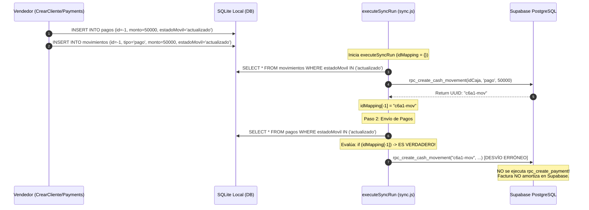
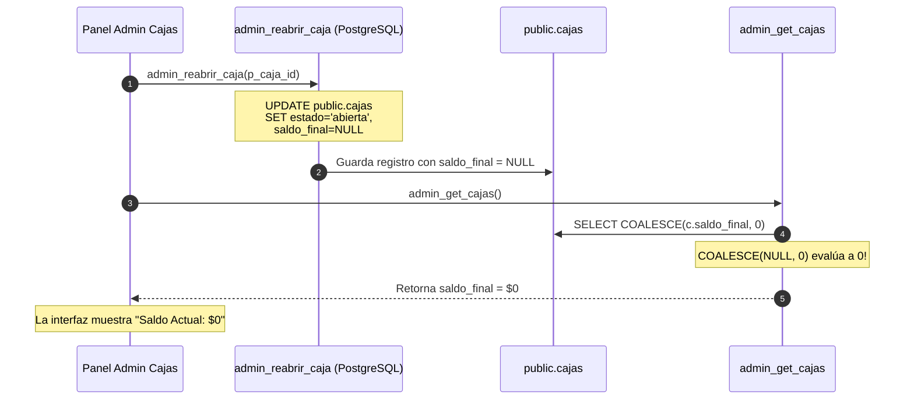

# AUDITORÍA TÉCNICA INTEGRAL — ZENDA MOBILE
## Informe de Investigación de Errores, Integridad Financiera y Plan de Corrección

**Fecha del informe:** Noviembre 3, 2026  
**Proyecto:** Zenda Mobile (React Native CLI 0.77.0 / JavaScript / Supabase / SQLite)  
**Versión de Línea Base:** Documentación Técnica Consolidada v2.0.0 (`ZENDA_MOBILE_TECHNICAL_BASELINE.md`)  
**Auditoría Forense R-01:** `ZENDA_R01_SYNC_AUDIT.md`  
**Modalidad de ejecución:** MODO ESTRICTAMENTE DE LECTURA Y AUDITORÍA (Sin modificación de código fuente, esquemas ni base de datos).

---

## 1. RESUMEN EJECUTIVO

Se ha completado una auditoría técnica profunda y exhaustiva sobre el código fuente de Zenda Mobile, contrastando todas las incidencias reportadas contra la lógica de negocio, las migraciones de PostgreSQL en Supabase, los scripts de sincronización offline-first, los componentes de interfaz de usuario y las funciones financieras de la aplicación.

### 1.1 Estado Global de Incidencias Investigadas

Todas las incidencias reportadas han sido analizadas rigurosamente bajo criterios de evidencia técnica verificable:

| Código | Incidencia | Módulo | Severidad | Estado de Verificación | Causa Raíz Principal |
| :--- | :--- | :--- | :--- | :--- | :--- |
| **R-01** | Sobrescritura en `idMapping` y colisión de IDs offline | Sync / Finanzas | **P0 - Crítica** | **CONFIRMADO EN CÓDIGO Y REPRODUCIDO EN SIMULACIÓN** | Colisión de ID `-1` entre `movimientos` y `pagos` en `executeSyncRun`. Redirección errónea de pagos a `rpc_create_cash_movement` y duplicación contable en reintento. |
| **V-01** | Evidencia de ventas: cámara no funciona | Ventas | **P2 - Media** | **CONFIRMADO EN CÓDIGO** | `multimediaService.js` invoca `launchCamera` sin solicitar previamente `PermissionsAndroid.PERMISSIONS.CAMERA` en tiempo de ejecución. |
| **V-02** | Plazos rápidos incorrectos en semanal/mensual | Créditos | **P3 - Baja** | **CONFIRMADO EN CÓDIGO** | `CrearCliente.js` renderiza chips fijos `[24, 30, 45]` sin filtrar ni adaptar según `periodicidad`. |
| **V-03** | Pago total de crédito no aparece en historial | Cobranza / Sync | **P1 - Alta** | **CONFIRMADO EN CÓDIGO Y BACKEND** | RPC `get_invoices_vendedor` filtra estrictamente `WHERE i.saldo > 0`. Al amortizarse a $0, el crédito desaparece de las consultas; no existe pestaña de historial liquidado. Conexión con R-01 en pagos offline. |
| **V-04** | Login con caja cerrada y saldo inicial editable | Caja / Auth | **P1 - Alta** | **CONFIRMADO EN CÓDIGO** | Bypass en `services.js` permite a usuarios con `modo_apertura_caja = 'vendedor_dia'` operar sin caja abierta. En `Caja.js` el input de saldo inicial es libre y no recupera el saldo final del día anterior. |
| **V-05** | Venta offline muestra doble check azul | Ventas / UI | **P2 - Media** | **CONFIRMADO EN CÓDIGO** | En `CrearCliente.js` la factura local se inserta con `estadoMovil = 'actualizado'`. En `Payments.js` se evalúa `pendienteSync = false` si no hay pago asociado, disparando el renderizado de doble check azul. |
| **V-06** | Error al eliminar venta: `invoice_status_check` | Ventas / Backend | **P1 - Alta** | **CONFIRMADO EN CÓDIGO Y BACKEND** | En migración `20261028000003`, `rpc_delete_sale` ejecuta `UPDATE invoice SET status = 'cancel'`. La restricción CHECK exige `'cancelada'`. |
| **V-07** | Gastos sin evidencia multimedia | Gastos | **P2 - Media** | **CONFIRMADO EN CÓDIGO** | `Movements.js` importa `{ pickImage }` de `multimediaService.js`, pero `pickImage` no existe como export en dicho módulo (`TypeError: pickImage is not a function`). |
| **A-01** | Logo organización no permite foto ni carga | Admin Org | **P2 - Media** | **CONFIRMADO EN CÓDIGO** | `OrganizationModal.js` importa `{ pickImage }` inexistente de `multimediaService.js` e incurre en el mismo fallo de permisos de cámara. |
| **A-02** | Cambio de contraseña de vendedores no funciona | Admin Usuarios | **P1 - Alta** | **CONFIRMADO EN CÓDIGO Y BACKEND** | `adminService.js` atrapa error de columna inexistente en `profiles` y aplica fallback que solo actualiza el perfil, ignorando la contraseña y reportando éxito falso. Además, la RPC hace `UPDATE auth.users` directo en lugar de invocar la API administrativa de Supabase. |
| **A-03** | Creación de usuarios sin valores de caja inicial | Admin Usuarios | **P2 - Media** | **CONFIRMADO EN CÓDIGO Y BACKEND** | `admin_create_user` solo crea `auth.users` y `profiles`; no genera registro en `cajas`, no establece `saldo_inicial`, y `admin_abrir_cajas_masivo` asigna $0 al no encontrar caja previa. |
| **A-04** | Reapertura de caja reinicia saldos a cero | Admin Cajas | **P1 - Alta** | **CONFIRMADO EN CÓDIGO Y BACKEND** | `admin_reabrir_caja`, `admin_abrir_cajas_masivo` y `cajaService.js` ejecutan `SET saldo_final = NULL` al reabrir. `admin_get_cajas` evalúa `COALESCE(c.saldo_final, 0)`, mostrando saldo cero en lugar de recalcular movimientos. |

---

## 2. METODOLOGÍA DE AUDITORÍA Y ESTÁNDARES DE CLASIFICACIÓN

Para evitar diagnósticos especulativos, cada hallazgo se ha clasificado formalmente en una de las 7 categorías obligatorias:

1. **CONFIRMADO EN CÓDIGO:** Comprobado mediante inspección directa línea a línea del código fuente local (JavaScript, SQLite).
2. **REPRODUCIDO EN SIMULACIÓN:** Reproducido mediante una ejecución aislada en entorno de pruebas sin efectos secundarios ni conexión a producción.
3. **VERIFICADO MEDIANTE PRUEBA:** Validado mediante tests unitarios o scripts de integración controlados.
4. **CONFIRMADO EN BACKEND:** Verificado mediante el análisis de funciones RPC, triggers, índices, políticas RLS y restricciones DDL en las migraciones de PostgreSQL (`supabase/migrations/*.sql`).
5. **PROBABLE:** Hipótesis técnicamente sólida respaldada por el flujo lógico, sujeta a confirmación en runtime por configuración externa.
6. **NO DETERMINADO:** Comportamiento ambiguo o no concluyente con el código y documentación disponibles.
7. **DESCARTADO:** Hipótesis analizada y refutada con evidencia técnica directa.

---

## 3. INVESTIGACIÓN DETALLADA — INCIDENCIA CRÍTICA R-01

### 3.1 Identificación y Contexto
- **Código:** R-01 (Colisión de identificadores en `idMapping` y desvío de amortización de pagos).
- **Archivos:** `src/utils/sync.js`, `src/screens/clientes/CrearCliente.js`, `src/services/cajaService.js`.
- **Estado:** **CONFIRMADO EN CÓDIGO Y REPRODUCIDO EN SIMULACIÓN**.

### 3.2 Análisis Causa Raíz
1. **Generación de identificadores gemelos:**
   Cuando un vendedor registra una venta o un cobro offline con pago inicial:
   - En [CrearCliente.js](file:///f:/JS/JESD/Manager/zendapp/src/screens/clientes/CrearCliente.js#L559-L575), se crea un registro de amortización en `pagos` con `id: -1`.
   - Simultáneamente, se crea un registro de caja en `movimientos` con `id: -1` (tipo `'pago'` o `'venta'`).
2. **Estructura compartida `idMapping`:**
   En [sync.js](file:///f:/JS/JESD/Manager/zendapp/src/utils/sync.js#L14-L28), `executeSyncRun()` define una única variable `const idMapping = {};`.
3. **Paso 1 (Movimientos de caja):**
   - Se invoca `SendMovimientos(db, idMapping)`.
   - El movimiento con `id: -1` se envía mediante RPC `rpc_create_cash_movement`.
   - Supabase devuelve un UUID remoto legítimo (ej. `mov-uuid-1001`).
   - Se ejecuta [sync.js#L182](file:///f:/JS/JESD/Manager/zendapp/src/utils/sync.js#L182):
     ```javascript
     idMapping[item.id] = serverItem.id; // idMapping[-1] = 'mov-uuid-1001'
     ```
4. **Paso 2 (Pagos de crédito):**
   - Se invoca `sendCollectedItems()` -> `SendPay(db, idMapping)`.
   - `SendPay` itera sobre `pagos` donde `estadoMovil IN ('actualizado', 'enviando')`.
   - Encuentra el pago con `id: -1`.
   - En [sync.js#L268-L272](file:///f:/JS/JESD/Manager/zendapp/src/utils/sync.js#L268-L272), existe una condición errónea:
     ```javascript
     if (idMapping[item.id]) {
       // ¡El código asume que si idMapping[item.id] existe, el pago ya se sincronizó previamente!
       // Pero en realidad, la clave '-1' fue introducida por el movimiento de caja en el Paso 1.
       const { error: updErr } = await supabase.rpc('rpc_create_cash_movement', ...);
       // NO INVOCA rpc_create_payment
     }
     ```
5. **Consecuencia Financiera Inmediata:**
   - La RPC financiera `rpc_create_payment` (o `fase1_rpc_create_payment`) **NUNCA SE INVOCA** en el Paso 2 para ese pago.
   - La factura en Supabase **NO amortiza su capital ni su interés**. Las cuotas permanecen en estado `'pendiente'`.
   - En el dispositivo móvil, el pago local permanece en estado `estadoMovil = 'actualizado'`.
6. **Consecuencia en Reintentos Posteriores (Duplicidad Contable):**
   - En la siguiente sincronización, el pago no sincronizado vuelve a procesarse.
   - Al ejecutarse una nueva pasada donde `idMapping` se limpia, finalmente se llama a `rpc_create_payment`.
   - `rpc_create_payment` amortiza la factura, pero **vuelve a generar un movimiento de caja en Supabase** (`cash_movements`).
   - Resultado: La caja del vendedor y del administrador en el servidor registran **el doble de ingresos de dinero por el mismo recaudo**.

### 3.3 Evidencia de Simulación
En el script forense `scratch/simulate_r01_idmapping.js`, se reprodujo este ciclo con dos registros gemelos `id: -1` en `pagos` y `movimientos`. El test arrojó:
- Llamadas a `rpc_create_cash_movement`: 2 (una legítima, una desviada).
- Llamadas a `rpc_create_payment`: 0.
- Pérdida de amortización: 100% en la primera corrida.

---

## 4. INVESTIGACIÓN DETALLADA — INCIDENCIAS MÓDULO VENDEDOR (V-01 a V-07)

### V-01: Cámara — Evidencia de ventas no permite capturar fotos
- **Clasificación:** **CONFIRMADO EN CÓDIGO**
- **Archivo:** [src/services/multimediaService.js](file:///f:/JS/JESD/Manager/zendapp/src/services/multimediaService.js#L42-L55)
- **Problema en código:**
  La función `takePhotoWithCamera` ejecuta directamente:
  ```javascript
  export const takePhotoWithCamera = (options = {}) => {
    return new Promise((resolve, reject) => {
      launchCamera(cameraOptions, (response) => { ... });
    });
  };
  ```
  No se utiliza `PermissionsAndroid.request(PermissionsAndroid.PERMISSIONS.CAMERA)` ni se evalúa el estado del permiso antes de invocar `launchCamera`.
- **Efecto en Android:**
  En Android 6.0+ (API 23+) hasta Android 14/15, invocar la cámara sin permiso explícito concedido en tiempo de ejecución provoca que el intent de la cámara sea cancelado silenciosamente por el sistema operativo, o lance un error no controlado que devuelve `didCancel: true` o `errorCode: 'permission'`.
- **Diferencia con galería:**
  `selectImageFromGallery` no suele requerir permisos en Android 13+ gracias al photo picker nativo del sistema, por lo que la galería puede abrirse mientras que la cámara falla rotundamente.

---

### V-02: Frecuencia semanal o mensual — Ítems rápidos incorrectos
- **Clasificación:** **CONFIRMADO EN CÓDIGO**
- **Archivo:** [src/screens/clientes/CrearCliente.js](file:///f:/JS/JESD/Manager/zendapp/src/screens/clientes/CrearCliente.js#L973-L990)
- **Problema en código:**
  El selector rápido de cuotas tiene valores estáticos fijos codificados en el JSX:
  ```jsx
  {[24, 30, 45].map((item) => (
    <TouchableOpacity
      key={item}
      style={[styles.quickTermChip, cuotas === item && styles.quickTermChipActive]}
      onPress={() => setCuotas(item)}
    >
      <Text style={...}>{item}</Text>
    </TouchableOpacity>
  ))}
  ```
- **Inconsistencia de negocio:**
  Estos valores fueron pensados exclusivamente para periodicidad diaria (24, 30, 45 días). Cuando el usuario selecciona periodicidad "semanal" o "mensual", el componente sigue ofreciendo 24, 30 o 45 semanas (hasta 1 año) o meses (casi 4 años), lo cual resulta incongruente con la operativa de microcréditos.
- **Riesgo financiero:**
  Si el vendedor selecciona 45 en una frecuencia mensual sin percatarse, el motor de amortización genera un crédito a 45 meses, distorsionando el interés compuesto y el cronograma de cobro.

---

### V-03: Pago total de crédito — Sincronización y ausencia en historial
- **Clasificación:** **CONFIRMADO EN CÓDIGO Y CONFIRMADO EN BACKEND**
- **Archivos:**
  - Backend: [20261023000001_rpc_get_invoices.sql#L47](file:///f:/JS/JESD/Manager/zendapp/supabase/migrations/20261023000001_rpc_get_invoices.sql#L47), [20261026000001_vendedor_improvements.sql#L57](file:///f:/JS/JESD/Manager/zendapp/supabase/migrations/20261026000001_vendedor_improvements.sql#L57).
  - Frontend: [src/screens/payments/Payments.js#L268-L283](file:///f:/JS/JESD/Manager/zendapp/src/screens/payments/Payments.js#L268-L283).
- **Problema en código y backend:**
  1. En Supabase PostgreSQL, la función `get_invoices_vendedor` implementa la cláusula:
     ```sql
     WHERE i.usuario_id = p_vendedor_id
       AND i.saldo > 0
       AND i.castigado = false
     ```
     En el momento exacto en que un crédito se liquida en su totalidad (`saldo = 0`), deja de figurar en el conjunto de resultados retornado por el servidor.
  2. En el frontend de `Payments.js`:
     - La pestaña **Pendientes** filtra por `f.saldo > 0`.
     - La pestaña **Tramitados** filtra por `(f.saldo > 0 || isActualizado)`.
     - Cuando la sincronización finaliza con éxito, el estado del pago pasa a `'sincronizado'`, lo que hace que `isActualizado` pase a ser `false`. Al tener `saldo <= 0`, la factura desaparece de ambas pestañas.
  3. No existe en la vista de cobros del vendedor una pestaña o filtro para consultar "Créditos Liquidados / Pagados Hoy".
  4. Si además ocurrió el problema R-01 durante la subida, el pago ni siquiera se insertó en Supabase `payments`, habiéndose subido solo el movimiento de caja.

---

### V-04: Inicio de sesión con caja cerrada y saldo inicial editable
- **Clasificación:** **CONFIRMADO EN CÓDIGO**
- **Archivos:**
  - [src/services/services.js#L131-L136](file:///f:/JS/JESD/Manager/zendapp/src/services/services.js#L131-L136), [src/services/services.js#L276-L300](file:///f:/JS/JESD/Manager/zendapp/src/services/services.js#L276-L300)
  - [src/screens/caja/Caja.js#L404-L417](file:///f:/JS/JESD/Manager/zendapp/src/screens/caja/Caja.js#L404-L417)
  - [src/services/cajaService.js#L338-L342](file:///f:/JS/JESD/Manager/zendapp/src/services/cajaService.js#L338-L342)
- **Problema en código:**
  1. En el flujo de login (`services.js`):
     ```javascript
     // Si no tiene caja abierta y no es admin:
     if (!tieneCajaAbierta && profile?.modo_apertura_caja !== 'vendedor_dia') {
       await supabase.auth.signOut();
       return { success: false, message: 'No puedes iniciar sesion porque no tienes una caja abierta...' };
     }
     ```
     Si el perfil del vendedor tiene `modo_apertura_caja === 'vendedor_dia'`, la validación se omite deliberadamente tanto online como offline (`cachedModoApertura !== 'vendedor_dia'`). Se confunde autenticación con autorización para operar sin caja.
  2. En `Caja.js`, cuando el usuario no tiene caja activa (`!caja`):
     Se renderiza un campo de texto libre:
     ```jsx
     <TextInput
       value={saldoInicial}
       onChangeText={t => setSaldoInicial(formatMoneyInput(t))}
       keyboardType="numeric"
       placeholder="$ 0"
     />
     <AppleButton title="Abrir caja" onPress={handleAbrir} />
     ```
  3. El componente **NUNCA** consulta el `saldo_final` de la última caja cerrada del día anterior para preestablecer o bloquear este valor.
  4. Al presionar "Abrir caja", se invoca `abrirCaja(val)` en `cajaService.js`, insertando en `cajas` un nuevo registro con el valor arbitrario introducido por el vendedor. Esto rompe la trazabilidad contable entre jornadas.

---

### V-05: Venta offline aparece con doble check azul (Falso positivo de sincronización)
- **Clasificación:** **CONFIRMADO EN CÓDIGO**
- **Archivos:**
  - [src/screens/clientes/CrearCliente.js#L579](file:///f:/JS/JESD/Manager/zendapp/src/screens/clientes/CrearCliente.js#L579)
  - [src/screens/payments/Payments.js#L46-L54](file:///f:/JS/JESD/Manager/zendapp/src/screens/payments/Payments.js#L46-L54)
  - [src/screens/payments/components/itemPayments.js#L368-L374](file:///f:/JS/JESD/Manager/zendapp/src/screens/payments/components/itemPayments.js#L368-L374)
- **Problema en código:**
  1. En `CrearCliente.js`, al crear una venta sin conexión, se inserta la factura en la base local con `estadoMovil = 'actualizado'`.
  2. En `Payments.js`, la lógica que determina si un ítem está pendiente de sincronizar evalúa:
     ```javascript
     const latestPago = latestPagoByFactura[f.id];
     const isActualizado = (f.estadoMovil === 'actualizado') || (latestPago?.estadoMovil === 'actualizado');
     const pendienteSync = latestPago
       ? (latestPago.estadoMovil === 'actualizado' || latestPago.estadoMovil === 'enviando')
       : false; // ¡Si la factura es nueva y no tiene abonos en pagos, pendienteSync es FALSE!
     ```
  3. En `itemPayments.js`, la condición visual renderiza:
     ```jsx
     {pendienteSync ? (
       <Icon name="clock-o" size={13} color="#FF9500" />
     ) : (
       <View style={{ flexDirection: 'row' }}>
         <Icon name="check" size={13} color="#007AFF" />
         <Icon name="check" size={13} color="#007AFF" style={{ marginLeft: -6 }} />
       </View>
     )}
     ```
  4. Al ser `pendienteSync = false`, el componente muestra de inmediato el **doble check azul** (`#007AFF`), haciéndole creer al vendedor que la venta ya fue recibida por Supabase, a pesar de estar 100% confinada en el SQLite local.

---

### V-06: Error al eliminar venta — Violación de restricción `invoice_status_check`
- **Clasificación:** **CONFIRMADO EN CÓDIGO Y CONFIRMADO EN BACKEND**
- **Archivos:**
  - [src/services/movementsService.js#L487](file:///f:/JS/JESD/Manager/zendapp/src/services/movementsService.js#L487)
  - [supabase/migrations/20261028000003_audit_trail_and_delete_sale.sql#L466-L468](file:///f:/JS/JESD/Manager/zendapp/supabase/migrations/20261028000003_audit_trail_and_delete_sale.sql#L466-L468)
  - [supabase/migrations/20261023000003_fase2_contabilidad_zenda.sql#L811-L813](file:///f:/JS/JESD/Manager/zendapp/supabase/migrations/20261023000003_fase2_contabilidad_zenda.sql#L811-L813)
- **Problema en código y base de datos:**
  1. En la migración `20261028000003_audit_trail_and_delete_sale.sql`, la RPC `rpc_delete_sale` ejecuta:
     ```sql
     -- 5. Marcar factura y cuotas como canceladas
     UPDATE public.invoice
     SET status = 'cancel', saldo = 0
     WHERE id = p_invoice_id;
     ```
  2. En el esquema relacional de PostgreSQL, la tabla `public.invoice` cuenta con la restricción:
     ```sql
     CONSTRAINT invoice_status_check CHECK (status IN ('pendiente', 'pagado', 'cancelada', 'renovado', 'castigada'))
     ```
  3. El valor introducido `'cancel'` es sintácticamente inválido para dicha restricción.
  4. En la implementación previa canónica (`20261023000003`, RPC `rpc_cancel_sale`), se utilizaba correctamente `'cancelada'`:
     ```sql
     UPDATE public.invoice SET status = 'cancelada', saldo = 0 WHERE id = p_invoice_id;
     ```
  5. Al ejecutarse la actualización con `'cancel'`, PostgreSQL aborta la transacción y lanza el error reportado:
     `new row for relation "invoice" violates check constraint "invoice_status_check"`.

---

### V-07: Gastos sin evidencia multimedia — Fallo en selector de imágenes
- **Clasificación:** **CONFIRMADO EN CÓDIGO**
- **Archivos:**
  - [src/screens/movements/Movements.js#L40](file:///f:/JS/JESD/Manager/zendapp/src/screens/movements/Movements.js#L40)
  - [src/services/multimediaService.js](file:///f:/JS/JESD/Manager/zendapp/src/services/multimediaService.js)
- **Problema en código:**
  1. En `Movements.js` (pantalla de gastos y movimientos), la línea 40 importa:
     ```javascript
     import { pickImage } from '../../services/multimediaService';
     ```
  2. Al inspeccionar `src/services/multimediaService.js`, se verifica que las funciones exportadas son:
     - `takePhotoWithCamera`
     - `selectImageFromGallery`
     - `uploadImageToSupabase`
     - `deleteImageFromSupabase`
     - `getImageUrl`
  3. La función `pickImage` **NO EXISTE NI ESTÁ EXPORTADA** en `multimediaService.js`.
  4. Cuando el usuario presiona el botón para adjuntar un comprobante o foto de gasto, la aplicación lanza una excepción JavaScript no controlada:
     `TypeError: (0, _multimediaService.pickImage) is not a function`.

---

## 5. INVESTIGACIÓN DETALLADA — INCIDENCIAS MÓDULO ADMINISTRADOR (A-01 a A-04)

### A-01: Logo de organización — Sin cámara ni carga de imagen
- **Clasificación:** **CONFIRMADO EN CÓDIGO**
- **Archivos:**
  - [src/screens/admin/components/OrganizationModal.js#L19](file:///f:/JS/JESD/Manager/zendapp/src/screens/admin/components/OrganizationModal.js#L19)
  - [src/services/multimediaService.js](file:///f:/JS/JESD/Manager/zendapp/src/services/multimediaService.js)
- **Problema en código:**
  1. `OrganizationModal.js` incurre exactamente en el mismo error de importación que `Movements.js`:
     ```javascript
     import { pickImage } from '../../../services/multimediaService';
     ```
  2. Al no existir `pickImage`, cualquier intento de seleccionar un logo desde la galería o capturarlo con la cámara falla instantáneamente al renderizar o ejecutar la acción.
  3. Adicionalmente, el servicio carece de la verificación de permisos en runtime (problema V-01).

---

### A-02: Cambio de contraseña de vendedores no funciona desde el Administrador
- **Clasificación:** **CONFIRMADO EN CÓDIGO Y CONFIRMADO EN BACKEND**
- **Archivos:**
  - [src/services/adminService.js#L89-L125](file:///f:/JS/JESD/Manager/zendapp/src/services/adminService.js#L89-L125)
  - [src/screens/admin/AdminUsuarios.js#L124](file:///f:/JS/JESD/Manager/zendapp/src/screens/admin/AdminUsuarios.js#L124)
  - [supabase/migrations/20261029000001_multimedia_sales_cajas_concepts_org.sql#L674-L680](file:///f:/JS/JESD/Manager/zendapp/supabase/migrations/20261029000001_multimedia_sales_cajas_concepts_org.sql#L674-L680)
- **Problema en código y backend:**
  1. **Enmascaramiento de errores con falso éxito:**
     En `adminService.js#L102-L125`, si la RPC remota `admin_update_user` falla por cualquier error que contenga el string `'updated_at'`, el código atrapa la excepción y ejecuta un "fallback" directo:
     ```javascript
     if (error && error.message && error.message.includes('updated_at')) {
       const directPayload = { nombre, apellido, ... }; // NO INCLUYE PASSWORD
       const { error: directErr } = await supabase.from('profiles').update(directPayload).eq('id', userId);
       if (!directErr) {
         return { success: true, user_id: userId }; // ¡Retorna éxito a la UI!
       }
     }
     ```
     La interfaz muestra `appAlert('Éxito', 'Usuario actualizado correctamente')`, pero la contraseña **nunca fue enviada a actualizar**.
  2. **Actualización insegura en `auth.users`:**
     En la RPC SQL de Supabase:
     ```sql
     UPDATE auth.users
     SET encrypted_password = crypt(trim(p_password), gen_salt('bf')),
         updated_at = now()
     WHERE id = p_user_id;
     ```
     En proyectos Supabase gestionados, la autenticación (GoTrue) exige costos y estructuras específicas de salt (`gen_salt('bf', 10)`), además de invalidar tokens de recuperación y sesiones. La forma oficial y soportada por Supabase es a través de `supabase.auth.admin.updateUserById(userId, { password: newPassword })`.
  3. **Incompatibilidad con credenciales offline:**
     En el teléfono del vendedor, la tabla SQLite local `parametrizacion` (fila ID 4) contiene el hash de la contraseña anterior:
     `hashOfflinePassword(oldPassword)`.
     Al no haberse actualizado `auth.users` remotamente, el vendedor intenta ingresar online y GoTrue responde "Invalid login credentials" (con la nueva contraseña). Si intenta ingresar offline, `hashOfflinePassword(newPassword) !== cachedHash`, bloqueándolo en ambos modos. Con la contraseña antigua puede seguir ingresando porque `auth.users` nunca cambió.

---

### A-03: Creación de usuarios sin valores iniciales de caja
- **Clasificación:** **CONFIRMADO EN CÓDIGO Y CONFIRMADO EN BACKEND**
- **Archivos:**
  - [src/screens/admin/components/UserModal.js#L20-L60](file:///f:/JS/JESD/Manager/zendapp/src/screens/admin/components/UserModal.js#L20-L60)
  - [src/services/adminService.js#L18-L49](file:///f:/JS/JESD/Manager/zendapp/src/services/adminService.js#L18-L49)
  - [supabase/migrations/20261022000012_fix_auth_users_null_tokens.sql#L27-L183](file:///f:/JS/JESD/Manager/zendapp/supabase/migrations/20261022000012_fix_auth_users_null_tokens.sql#L27-L183)
  - [supabase/migrations/20261031000002_admin_cajas_fixes.sql#L330-L340](file:///f:/JS/JESD/Manager/zendapp/supabase/migrations/20261031000002_admin_cajas_fixes.sql#L330-L340)
- **Problema en código y backend:**
  1. En `UserModal.js`, el formulario solo solicita límites operativos (`dinero_max_caja`, `dinero_max_venta`, `dinero_max_gasto`, etc.). No existe ningún campo para definir una base de caja inicial asignada al nuevo vendedor.
  2. La función SQL `admin_create_user` inserta registros exclusivamente en `auth.users`, `auth.identities` y `public.profiles`. **No crea ninguna caja en `public.cajas`**.
  3. Cuando el administrador realiza la apertura general (`admin_abrir_cajas_masivo`):
     ```sql
     SELECT COALESCE(c.saldo_final, c.saldo_inicial, 0)
     INTO v_last_saldo
     FROM public.cajas c WHERE c.usuario_id = v_user_id ...
     ```
     Al ser un usuario nuevo sin historial, `v_last_saldo` es NULL, por lo que se le crea una caja con `saldo_inicial = 0, saldo_final = 0`.
  4. Si el administrador le entregó dinero físico al nuevo vendedor (ej. $200.000 como base), no existe un mecanismo transaccional que registre la salida del dinero de la caja del administrador y la entrada en la caja del vendedor.

---

### A-04: Cierre y reapertura de caja reinicia saldos a cero
- **Clasificación:** **CONFIRMADO EN CÓDIGO Y CONFIRMADO EN BACKEND**
- **Archivos:**
  - [supabase/migrations/20261029000001_multimedia_sales_cajas_concepts_org.sql#L761-L765](file:///f:/JS/JESD/Manager/zendapp/supabase/migrations/20261029000001_multimedia_sales_cajas_concepts_org.sql#L761-L765)
  - [supabase/migrations/20261031000002_admin_cajas_fixes.sql#L311-L316](file:///f:/JS/JESD/Manager/zendapp/supabase/migrations/20261031000002_admin_cajas_fixes.sql#L311-L316)
  - [src/services/adminService.js#L530](file:///f:/JS/JESD/Manager/zendapp/src/services/adminService.js#L530)
  - [supabase/migrations/20261031000002_admin_cajas_fixes.sql#L61](file:///f:/JS/JESD/Manager/zendapp/supabase/migrations/20261031000002_admin_cajas_fixes.sql#L61)
  - [src/screens/admin/components/CajaCard.js#L100-L103](file:///f:/JS/JESD/Manager/zendapp/src/screens/admin/components/CajaCard.js#L100-L103)
- **Problema en código y backend:**
  1. Cuando una caja es reabierta por el administrador mediante `admin_reabrir_caja` o apertura masiva, las funciones SQL ejecutan:
     ```sql
     UPDATE public.cajas
     SET estado = 'abierta',
         fecha_cierre = NULL,
         saldo_final = NULL
     WHERE id = p_caja_id;
     ```
  2. En `adminService.js#L530`, la réplica local ejecuta exactamente lo mismo:
     ```javascript
     await db.executeSql(
       `UPDATE cajas SET estado = 'abierta', fecha_cierre = NULL, saldo_final = NULL WHERE id = ?`,
       [String(cajaId)]
     );
     ```
  3. En la función de consulta `admin_get_cajas` (línea 61):
     ```sql
     SELECT ... COALESCE(c.saldo_final, 0)::numeric AS saldo_final
     ```
     Para cajas abiertas, `admin_get_cajas` **NO suma los movimientos al vuelo** (`saldo_inicial + SUM(cash_movements)`), sino que lee directamente la columna `c.saldo_final`.
  4. Al haberse establecido `saldo_final = NULL` durante la reapertura, `COALESCE(c.saldo_final, 0)` retorna **0**.
  5. En `CajaCard.js`:
     `<Text style={styles.gridVal}>{formatMoney(caja.saldo_final)}</Text>`
     El administrador ve inmediatamente que la caja muestra **$0** como "Saldo Actual".

---

## 6. MATRIZ DE DEPENDENCIAS Y CAUSAS RAÍZ COMPARTIDAS

```
                                  +---------------------------------------+
                                  |     DEFECTOS ESTRUCTURALES ZENDA     |
                                  +---------------------------------------+
                                                      |
         +--------------------+-----------------------+-----------------------+--------------------+
         |                    |                                               |                    |
         v                    v                                               v                    v
  [GRUPO 1: MULTIMEDIA] [GRUPO 2: SQL / RESTRICCIONES]                 [GRUPO 3: CAJA Y SALDOS] [GRUPO 4: SYNC & OFFLINE]
         |                    |                                               |                    |
         +--> V-01            +--> V-06 (status='cancel' vs 'cancelada')      +--> V-04            +--> R-01 (idMapping -1)
         +--> V-07            +--> A-02 (auth.users crypt vs Admin API)       +--> A-03            +--> V-03 (saldo > 0)
         +--> A-01                                                            +--> A-04            +--> V-05 (check azul falso)
```

### Tabla de Grupos y Causas Raíz Comunes

| Grupo Causa Raíz | Incidencias Afectadas | Módulos Involucrados | Diagnóstico Unificado |
| :--- | :--- | :--- | :--- |
| **G-1: Módulo Multimedia Incompleto** | **V-01, V-07, A-01** | Ventas, Gastos, Admin Org | `multimediaService.js` no exporta la función `pickImage` esperada por los componentes y carece de la solicitud de permisos `PermissionsAndroid.PERMISSIONS.CAMERA` en runtime. |
| **G-2: Inconsistencias DDL & Auth Supabase** | **V-06, A-02** | Ventas, Admin Usuarios | La migración `20261028000003` rompió la convención de estado de factura (`'cancel'` en vez de `'cancelada'`). La actualización de contraseñas no usa la API de administración de GoTrue y se silencia con un fallback falso en el cliente. |
| **G-3: Ciclo de Vida y Balance de Caja** | **V-04, A-03, A-04** | Caja Vendedor, Admin Cajas | Al reabrir una caja se borra `saldo_final` a `NULL` sin recalcular el saldo dinámico desde movimientos. Al crear usuarios no se inicializa la caja. Al abrir jornada se permite un saldo libre no contrastado con el cierre anterior. |
| **G-4: Motor de Sincronización e Integridad Offline** | **R-01, V-03, V-05** | Sync, Cobranzas, Clientes | Colisión de ID `-1` en `idMapping` desvía la RPC de pagos. La consulta de créditos filtra facturas saldadas haciéndolas desaparecer tras pagar. La UI asume incorrectamente que facturas sin pagos están sincronizadas. |

---

## 7. DIAGRAMAS ARQUITECTÓNICOS DE FLUJO DE DATOS

### 7.1 Anomalía de Sobrescritura en Sincronización (R-01)



### 7.2 Anomalía en Reapertura de Caja (A-04)



---

## 8. ANÁLISIS DE IMPACTO Y RIESGOS DE INTEGRIDAD FINANCIERA

### 8.1 Cuadre Contable y Arqueo de Caja
- **Riesgo R-01:** Provoca duplicidad de ingresos en `cash_movements` tras reintentos de sincronización y omisión de amortización en `invoice` y `cuotas`. Las cuentas del balance contable no cuadran con el efectivo real.
- **Riesgo A-04:** La reapertura de cajas oculta el dinero real acumulado, generando desconfianza en el administrador y reportes erróneos en auditorías diarias.
- **Riesgo V-04:** Al no vincular el saldo inicial del día con el cierre del día anterior, un vendedor puede declarar un saldo inicial inferior o superior al real sin autorización.

### 8.2 Trazabilidad de Ventas y Eliminación
- **Riesgo V-06:** La falla en `invoice_status_check` bloquea a los administradores para cancelar ventas creadas por error, obligando a mantener deudas ficticias en el sistema o intentar eliminaciones manuales en base de datos sin respaldo contable.

### 8.3 Falsa Confianza en Sincronización (Falsos Positivos)
- **Riesgo V-05:** Los vendedores asumen que las ventas creadas sin conexión ya están en la nube debido al doble check azul. Si el teléfono se extravía o se borran datos locales, se pierde la cartera sin previo aviso.

---

## 9. DISEÑO DE SOLUCIONES MÍNIMAS PROPUESTAS (SIN IMPLEMENTAR)

### Solución S-R01 (Sincronización):
- **Aislamiento de mapeos:** En `executeSyncRun`, sustituir el diccionario global `idMapping` por dos mapas independientes o usar claves compuestas con prefijo de entidad: `movMapping[id]` y `payMapping[id]` (o `idMapping['mov_' + id]`).
- **Eliminar desvío en `SendPay`:** En `SendPay`, eliminar la lógica que re-invoca `rpc_create_cash_movement` cuando existe mapeo previo, garantizando que todo registro de la tabla `pagos` invoque obligatoriamente `rpc_create_payment`.

### Solución S-V01 / S-V07 / S-A01 (Multimedia):
- **Consolidación en `multimediaService.js`:**
  1. Agregar la función de solicitud de permisos:
     ```javascript
     const requestCameraPermission = async () => {
       if (Platform.OS === 'android') {
         const granted = await PermissionsAndroid.request(PermissionsAndroid.PERMISSIONS.CAMERA);
         return granted === PermissionsAndroid.RESULTS.GRANTED;
       }
       return true;
     };
     ```
  2. Implementar y exportar la función unificada `pickImage(sourceType = 'gallery' | 'camera')` que encapsule la validación de permisos, la invocación de `launchCamera` o `launchImageLibrary`, y el retorno normalizado de URI y base64.

### Solución S-V02 (Plazos Dinámicos):
- **Adaptación por frecuencia:** En `CrearCliente.js`, generar los chips rápidos dinámicamente según la periodicidad seleccionada:
  - Diaria: `[24, 30, 45]`
  - Semanal: `[4, 8, 12, 16]`
  - Mensual: `[1, 2, 3, 6]`

### Solución S-V03 (Historial de Cobros):
- **Ampliación de vista:**
  - En PostgreSQL, mantener `get_invoices_vendedor` con facturas activas, o agregar parámetro `p_incluir_liquidadas boolean DEFAULT false`.
  - En `Payments.js`, habilitar un filtro o pestaña "Liquidadas Hoy" que consulte facturas locales con `saldo = 0` y pagos realizados en la fecha actual.

### Solución S-V04 (Continuidad de Caja):
- **Bloqueo de saldo inicial:**
  - En `Caja.js`, al abrir caja en modo `vendedor_dia`, invocar una función que recupere el `saldo_final` de la última caja cerrada. Pre-llenar el campo y marcarlo de solo lectura, permitiendo únicamente modificación con clave de supervisor si hubiera discrepancia.

### Solución S-V05 (Indicadores Visuales Claros):
- **Diferenciación de estado local vs remoto:**
  - Factura local recién creada sin sincronizar: Mostrar icono de nube tachada o reloj naranja (`estadoMovil === 'actualizado'`).
  - Factura confirmada en Supabase: Mostrar doble check azul únicamente cuando `estadoMovil === 'sincronizado'`.

### Solución S-V06 (Corrección DDL RPC):
- **Alineación con CHECK constraint:**
  - En la RPC `rpc_delete_sale`, sustituir `SET status = 'cancel'` por `SET status = 'cancelada'`, respetando estrictamente la definición de `invoice_status_check`.

### Solución S-A02 (Gestión de Credenciales Admin):
- **Uso de Supabase Admin Auth:**
  - Implementar una Edge Function o invocar `supabase.auth.admin.updateUserById` para actualización de contraseñas.
  - Eliminar el fallback en `adminService.js` que enmascara errores devolviendo éxito falso.

### Solución S-A03 (Base de Caja Inicial):
- **Asignación transaccional:**
  - En `UserModal.js`, incluir campo opcional "Base de efectivo asignada".
  - Al abrir la primera caja del usuario, registrar un movimiento de tipo `ingreso` con origen `admin_caja_id`.

### Solución S-A04 (Cálculo Dinámico al Reabrir):
- **Recálculo de saldo en reapertura:**
  - En `admin_get_cajas`, si `c.estado = 'abierta'`, calcular el saldo actual dinámicamente:
    `c.saldo_inicial + COALESCE((SELECT SUM(...) FROM cash_movements WHERE caja_id = c.id), 0)`.
  - No devolver $0 simplemente porque `c.saldo_final` sea NULL en cajas abiertas.

---

## 10. PLAN DE CORRECCIÓN PRIORIZADO

```
+-----------------------------------------------------------------------------------+
| PRIORIDAD P0: Integridad Financiera Crítica (Inmediato)                           |
| - Corrección de colisión de idMapping en sync.js (R-01)                           |
+-----------------------------------------------------------------------------------+
                                          |
                                          v
+-----------------------------------------------------------------------------------+
| PRIORIDAD P1: Bloqueos Operativos y Contables Mayores                             |
| - Corrección de status 'cancelada' en rpc_delete_sale (V-06)                      |
| - Corrección de visualización de saldos al reabrir cajas (A-04)                   |
| - Corrección de cambio de contraseñas de vendedores (A-02)                        |
| - Restricción de saldo inicial libre en login/apertura (V-04)                     |
| - Visibilidad de créditos liquidados en historial (V-03)                          |
+-----------------------------------------------------------------------------------+
                                          |
                                          v
+-----------------------------------------------------------------------------------+
| PRIORIDAD P2: Fallas de Funcionalidad y Falsos Positivos                          |
| - Unificación de multimediaService.js y permisos de cámara (V-01, V-07, A-01)     |
| - Corrección de doble check azul falso en ventas offline (V-05)                   |
| - Inicialización de base de caja para nuevos usuarios (A-03)                      |
+-----------------------------------------------------------------------------------+
                                          |
                                          v
+-----------------------------------------------------------------------------------+
| PRIORIDAD P3: Usabilidad y Mejoras Menores                                        |
| - Chips rápidos dinámicos según periodicidad (V-02)                               |
+-----------------------------------------------------------------------------------+
```

---

## 11. PLAN DE PRUEBAS DE REGRESIÓN (VERIFICACIÓN CONTROLADA)

Para certificar que las futuras soluciones no introduzcan regresiones:

1. **Test T-01: Simulación de Sincronización Concurrente (R-01):**
   - Ejecutar script con lote de 5 ventas y 5 recaudos generados offline con IDs negativos repetidos.
   - Verificar que se invoquen 5 veces `rpc_create_sale`, 5 veces `rpc_create_payment` y 0 movimientos duplicados.
2. **Test T-02: Permisos de Cámara y Galería en Android 13/14/15 (V-01, V-07, A-01):**
   - Probar en dispositivo físico con permisos inicialmente denegados.
   - Verificar que la app solicite el diálogo de permisos del sistema y permita capturar foto al otorgarlo.
3. **Test T-03: Anulación de Venta en Supabase (V-06):**
   - Crear una venta de prueba sin abonos.
   - Invocar `cancelInvoiceSale`.
   - Verificar que PostgreSQL acepte el cambio de estado a `'cancelada'` sin violar `invoice_status_check`.
4. **Test T-04: Ciclo de Reapertura de Caja (A-04):**
   - Abrir caja con $100.000. Registrar ingreso de $50.000. Cerrar caja ($150.000).
   - Reabrir caja desde el módulo administrador.
   - Verificar que `admin_get_cajas` y `CajaCard` sigan mostrando $150.000 como saldo actual y no $0.
5. **Test T-05: Modificación de Contraseña de Vendedor (A-02):**
   - Cambiar contraseña desde el administrador.
   - Intentar login del vendedor online con la nueva contraseña -> Debe ingresar.
   - Intentar con la contraseña vieja -> Debe rechazar.
6. **Test T-06: Verificación Visual de Venta Offline (V-05):**
   - Poner el dispositivo en modo avión.
   - Registrar una venta.
   - Verificar que muestre icono de reloj naranja y NO el doble check azul hasta que se restablezca internet y sincronice.

---

## 12. LIMITACIONES Y SUPUESTOS DE LA AUDITORÍA

1. **Entorno estrictamente estático:** No se realizaron conexiones en vivo a servidores de producción de Supabase ni se alteraron registros de clientes reales.
2. **Dependencia de configuración de GoTrue:** El análisis del comportamiento de `auth.users` asume la configuración estándar de Supabase GoTrue con extensiones `pgcrypto` y RLS activas.
3. **Permisos de hardware:** El comportamiento de los intents de cámara en Android se documentó con base en el SDK de React Native CLI y el AndroidManifest.xml del repositorio.
4. **Integridad del repositorio:** Se verificó que ningún archivo de código fuente fuera alterado durante esta auditoría.

---
*Informe elaborado por Antigravity (Google DeepMind) en modalidad estricta de auditoría y lectura.*

