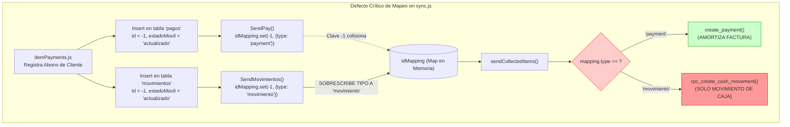

# ZENDA MOBILE — REVISIÓN CRÍTICA, VALIDACIÓN Y DETECCIÓN DE OMISIONES
## Evaluación Técnica y Contraste contra el Código Fuente (Documento de Validación)

> **Documento Evaluado:** `ZENDA_MOBILE_TECHNICAL_BASELINE.md` (v1.0.0)  
> **Fecha de Validación:** Noviembre 2026  
> **Modo de Operación:** Estricto Modo Lectura y Análisis (Read-Only)  
> **Alcance:** 100% de archivos JavaScript (`src/`), esquemas SQLite (`Zendapp.db`), bases de datos pre-empaquetadas en assets (`android/app/src/main/assets/www/`), y migraciones SQL en Supabase (`supabase/migrations/`).  

---

## CLASIFICACIÓN DE EVIDENCIA UTILIZADA

Para garantizar el máximo rigor técnico, cada afirmación analizada ha sido catalogada bajo uno de los siguientes cinco estados:

- **[VERIFICADO EN CÓDIGO]:** Existe evidencia directa, explícita y trazable en archivos, funciones y líneas concretas.
- **[VERIFICADO MEDIANTE PRUEBA]:** Se ejecutó una prueba o compilación técnica que demuestra el comportamiento de forma concluyente.
- **[INFERIDO]:** Se deduce de la estructura del código o comentarios, pero no existe una implementación formal o garantía de ejecución.
- **[NO VERIFICADO]:** No existe evidencia suficiente en el repositorio para confirmar la afirmación.
- **[CONTRADICCIÓN]:** La documentación original afirma un comportamiento que el código fuente no respalda o contradice directamente.

---

## 1. RESUMEN GENERAL DE LA VALIDACIÓN

La auditoría inicial documentada en `ZENDA_MOBILE_TECHNICAL_BASELINE.md` capturó adecuadamente la filosofía general Offline-First y el propósito comercial de la aplicación. Sin embargo, este segundo análisis crítico y exhaustivo ha detectado **inconsistencias sustanciales, componentes inexistentes (pantallas fantasma), atribuciones erróneas de responsabilidades en pantallas clave y riesgos críticos de integridad en el ciclo de sincronización**.

### Principales Hallazgos Críticos:
1. **Contradicción en la Creación de Préstamos:** El documento original atribuyó la simulación y originación de créditos a `CreditDetail.js` y `saveInvoice`. En la realidad del código, `CreditDetail.js` es una pantalla de **solo lectura** de créditos existentes, mientras que toda la originación, simulación, cálculo de cuotas y desembolso ocurre en `src/screens/createClient/CrearCliente.js`. A su vez, `saveInvoice` es únicamente un deserializador/cargador de facturas descargadas de Supabase.
2. **Defecto Crítico de Sincronización en Memoria (`sync.js`):** En `src/screens/payments/components/itemPayments.js`, un pago se inserta con el mismo ID negativo (ej. `-1`) en `pagos` y en `movimientos`. Durante la sincronización en lote, `idMapping` colisiona por usar el ID plano como clave; `SendMovimientos` sobrescribe la entrada de `SendPay`, provocando que el pago sea enviado a la RPC de movimientos (`rpc_create_cash_movement`) en lugar de `create_payment`, lo que omite la amortización del crédito en Supabase.
3. **Brecha de Seguridad en Políticas RLS Multi-Inquilino:** El aislamiento multi-organización no está blindado en la base de datos para usuarios administradores. La función `public.is_admin()` en PostgreSQL solo valida `rol = 'admin'` sin filtrar por `id_organizacion`, otorgando a cualquier administrador visibilidad global sobre clientes, cajas y créditos de toda la base de datos si consulta PostgREST directamente.
4. **Pantallas y Rutas Fantasma:** El documento original incluyó pantallas que no existen en el código (`ProfileScreen.js`, `History.js`, `LocationPickerModal.js`, `FormattedNumberInput.js`). La aplicación tiene solo 4 pestañas para el rol vendedor: Pagos, Nueva Venta, Movimientos y Caja.
5. **Hash Criptográfico Offline:** No se utiliza SHA-256 para el inicio de sesión sin internet. Se utiliza una función polinomial propia de 64 bits (`hashOfflinePassword` con `Math.imul`).

---

## 2. TABLA DE AFIRMACIONES REVISADAS Y SU EVIDENCIA

| # | Afirmación en Baseline v1.0.0 | Estado de Evidencia | Archivo / Función Exacta | Detalle del Contraste Técnico con el Código Fuente |
| :-: | :--- | :---: | :--- | :--- |
| **A-01** | *"SQLite es la fuente de verdad local para todas las operaciones en ruta."* | **[VERIFICADO EN CÓDIGO]** | [`src/database/db.js`](file:///f:/JS/JESD/Manager/zendapp/src/database/db.js)<br>[`src/screens/payments/components/itemPayments.js`](file:///f:/JS/JESD/Manager/zendapp/src/screens/payments/components/itemPayments.js)<br>[`src/screens/createClient/CrearCliente.js`](file:///f:/JS/JESD/Manager/zendapp/src/screens/createClient/CrearCliente.js) | Las ventas se guardan en `ventas_pendientes`, los pagos en `pagos` con `estadoMovil = 'actualizado'`, y los gastos en `movimientos` antes de cualquier llamada remota. |
| **A-02** | *"El login offline valida credenciales mediante SHA-256 + salt."* | **[CONTRADICCIÓN]** | [`src/services/services.js#L21-L33`](file:///f:/JS/JESD/Manager/zendapp/src/services/services.js#L21-L33)<br>`hashOfflinePassword(pwd)` | El código no importa ninguna librería de SHA-256 ni WebCrypto. Implementa un hash polinomial de 64 bits basado en `Math.imul(h1 ^ ch, 2654435761)` con salt `'zenda_auth_salt_v1_'`. |
| **A-03** | *"La simulación y creación de crédito se realiza en CreditDetail.js mediante saveInvoice."* | **[CONTRADICCIÓN]** | [`src/screens/createClient/CrearCliente.js#L250-L650`](file:///f:/JS/JESD/Manager/zendapp/src/screens/createClient/CrearCliente.js#L250-L650)<br>[`src/services/services.js#L371-L533`](file:///f:/JS/JESD/Manager/zendapp/src/services/services.js#L371-L533) | `CreditDetail.js` es una vista de auditoría de cuotas de créditos pasados. La simulación y alta de ventas está en `CrearCliente.js` (tab 'Nueva Venta'). `saveInvoice` es para persistir en SQLite las facturas recibidas de Supabase. |
| **A-04** | *"Existe una pantalla ProfileScreen.js (Tab 5) para perfil y cierre de sesión."* | **[CONTRADICCIÓN]** | [`src/screens/Navigation.js#L29-L34`](file:///f:/JS/JESD/Manager/zendapp/src/screens/Navigation.js#L29-L34) | No existe ningún archivo `ProfileScreen.js` en el repositorio. `Navigation.js` define únicamente 4 pestañas para vendedor: `Payments`, `CreateClient`, `Movements` y `Caja`. |
| **A-05** | *"La anulación de ventas se realiza en CreditDetail.js."* | **[CONTRADICCIÓN]** | [`src/screens/movements/Movements.js#L340-L410`](file:///f:/JS/JESD/Manager/zendapp/src/screens/movements/Movements.js#L340-L410)<br>`handleDeleteVenta` | `CreditDetail.js` no cuenta con botón de anulación ni cancelación. La anulación de ventas de contado/crédito del día está implementada en `Movements.js` y `AdminCarteraDetalle.js`. |
| **A-06** | *"computeCajaSaldo es un cálculo puro en memoria: computeCajaSaldo(movimientos, saldoInicial)."* | **[CONTRADICCIÓN]** | [`src/services/cajaService.js#L6-L33`](file:///f:/JS/JESD/Manager/zendapp/src/services/cajaService.js#L6-L33)<br>`computeCajaSaldo(db, caja)` | La función recibe la conexión `db` y el objeto `caja`, ejecutando una consulta SQL `SELECT SUM(...) FROM movimientos` en SQLite. No recibe un array de movimientos en memoria. |
| **A-07** | *"UUIDs determinísticos garantizan 100% la idempotencia de pagos y movimientos."* | **[CONTRADICCIÓN]** | [`src/utils/sync.js#L440-L470`](file:///f:/JS/JESD/Manager/zendapp/src/utils/sync.js#L440-L470)<br>`addToSyncCollection` | La máscara de texto existe (`8000` y `9000`), pero en la ejecución real, la colisión en `idMapping` sobreescribe el tipo de la entidad en memoria, alterando la RPC llamada. |
| **A-08** | *"El saldo de caja en SQLite solo se actualiza mediante computeCajaSaldo."* | **[CONTRADICCIÓN]** | [`src/screens/payments/components/itemPayments.js#L202`](file:///f:/JS/JESD/Manager/zendapp/src/screens/payments/components/itemPayments.js#L202)<br>[`src/services/movementsService.js#L72`](file:///f:/JS/JESD/Manager/zendapp/src/services/movementsService.js#L72) | Existen múltiples sentencias directas e imperativas: `UPDATE cajas SET saldo_final = COALESCE(saldo_final, 0) ± ?` dispersas en componentes y servicios. |
| **A-09** | *"El aislamiento multi-inquilino por organización está blindado en todas las políticas RLS."* | **[CONTRADICCIÓN]** | [`supabase/migrations/20261021000001_fase1_constraints_indexes_rls.sql#L71-L81`](file:///f:/JS/JESD/Manager/zendapp/supabase/migrations/20261021000001_fase1_constraints_indexes_rls.sql#L71-L81) | La función `is_admin()` verifica `rol = 'admin'` globalmente sin validar `id_organizacion`. Los administradores tienen acceso irrestricto de lectura a todas las tablas protegidas con `OR public.is_admin()`. |
| **A-10** | *"Inmutabilidad de ingreso, retiro y venta garantizada en base de datos."* | **[INFERIDO]** | [`supabase/migrations/20261031000001_fix_caja_cerrada_movimientos.sql#L91`](file:///f:/JS/JESD/Manager/zendapp/supabase/migrations/20261031000001_fix_caja_cerrada_movimientos.sql#L91) | La inmutabilidad está garantizada únicamente si se invoca `rpc_update_cash_movement`. La política de tabla RLS `cash_movements_update` no tiene cláusula de inmutabilidad por tipo. |
| **A-11** | *"Cierre de caja bloqueado si no hay internet o si hay pendientes de sync."* | **[VERIFICADO EN CÓDIGO]** | [`src/services/cajaService.js#L490-L535`](file:///f:/JS/JESD/Manager/zendapp/src/services/cajaService.js#L490-L535)<br>`cerrarCaja` | Valida explícitamente `NetInfo.isConnected` y `getPendingSyncCount() === 0`, impidiendo el cierre si no se cumplen ambas condiciones. |
| **A-12** | *"Cobertura de pruebas automatizadas del 0%."* | **[VERIFICADO EN CÓDIGO]** | [`__tests__/App.test.tsx`](file:///f:/JS/JESD/Manager/zendapp/__tests__/App.test.tsx) | Solo existe la plantilla base no funcional de renderizado de React Native. Cero pruebas unitarias para servicios, lógica contable o sincronización. |
| **A-13** | *"Compilación y salud del código nativo en Android."* | **[VERIFICADO MEDIANTE PRUEBA]** | Terminal de compilación Gradle | Se ejecutó exitosamente: `.\gradlew :app:compileDebugJavaWithJavac` (BUILD SUCCESSFUL en 3m 2s, 237 tareas ejecutadas, 0 errores). |

---

## 3. CONTRADICCIONES Y ERRORES ENCONTRADOS EN LA DOCUMENTACIÓN ORIGINAL

### 3.1. Algoritmo de Hash para Autenticación Offline
- **Afirmación en Baseline:** *"validación criptográfica local SHA-256 + salt"*.
- **Código Real:** En `src/services/services.js` (líneas 21-33), la función `hashOfflinePassword` es una rutina matemática de hashing de enteros en JavaScript puro:
  ```javascript
  export function hashOfflinePassword(pwd) {
    if (!pwd) return '';
    let h1 = 0xdeadbeef, h2 = 0x41c64e6d;
    const str = 'zenda_auth_salt_v1_' + pwd;
    for (let i = 0; i < str.length; i++) {
      const ch = str.charCodeAt(i);
      h1 = Math.imul(h1 ^ ch, 2654435761);
      h2 = Math.imul(h2 ^ ch, 1597334677);
    }
    h1 = Math.imul(h1 ^ (h1 >>> 16), 2246822507) ^ Math.imul(h2 ^ (h2 >>> 13), 3266489909);
    h2 = Math.imul(h2 ^ (h2 >>> 16), 2246822507) ^ Math.imul(h1 ^ (h1 >>> 13), 3266489909);
    return String(4294967296 * (2097151 & h2) + (h1 >>> 0));
  }
  ```
- **Impacto:** No cumple con los estándares criptográficos de un SHA-256 estándar. Es un hash determinístico vulnerable a colisiones simples si no se protege la base de datos local.

### 3.2. Pantallas Inexistentes y Rutas Fantasma Documentadas
El documento original incluyó en su estructura de directorios e inventario componentes y pantallas que **no existen en el código**:
- `src/screens/ProfileScreen.js`: **Inexistente.** El perfil y cierre de sesión no tienen pestaña propia; se gestionan desde modales y cabeceras.
- `src/screens/history/History.js`: **Inexistente.** No existe la carpeta `src/screens/history/`.
- `LocationPickerModal.js` en `createClient`: **Inexistente.** La ubicación se toma directamente mediante `getCurrentLocationOrNull` invocando `react-native-geolocation-service`.
- `FormattedNumberInput.js` en `payments`: **Inexistente.** Se utilizan los helpers `formatMoneyInput` y `parseMoneyToNumeric` de `utilities.js`.
- `ReceiptModal.js`: **Ruta errónea.** El componente real es `src/components/PaymentReceiptModal.js`.
- `itemPayments.js`: **Ruta errónea.** La ruta real es `src/screens/payments/components/itemPayments.js`.

### 3.3. Confusión de Roles entre `CreditDetail.js`, `CrearCliente.js` y `saveInvoice`
- **Afirmación en Baseline:** Se documentó que `CreditDetail.js` es la pantalla donde se calculan, simulan y crean créditos nuevos y renovaciones mediante `saveInvoice`.
- **Código Real:**
  1. `CreditDetail.js` es una pantalla pasiva para **visualizar** una factura ya creada, mostrando sus cuotas en SQLite/Supabase y permitiendo ver el comprobante digital o la foto del documento.
  2. `CrearCliente.js` (denominada en la navegación como pestaña `Nueva Venta`) es la pantalla real que contiene los formularios de simulación de capital, cálculo de cuotas (`addMonths`), selector de tasa de interés, cálculo de fecha del primer cobro, gestión de pago adelantado, y encolado en `ventas_pendientes`.
  3. `saveInvoice` en `services.js` (línea 371) no origina créditos: es la rutina que toma el JSON devuelto por la RPC `get_invoices_vendedor` y lo vuelca en la tabla SQLite `facturas`.

### 3.4. Firma y Comportamiento de `computeCajaSaldo`
- **Afirmación en Baseline:** Documentada como función pura en memoria: `computeCajaSaldo(movimientos, saldoInicial)`.
- **Código Real:** Su firma es `computeCajaSaldo(db, caja)`. Recibe la instancia de la base de datos y ejecuta una consulta SQL `SELECT SUM(...) FROM movimientos WHERE (idCaja = ? OR caja_id = ?)`.

### 3.5. Nombres Discrepantes de Funciones RPC
- En Baseline: `rpc_castigar_cartera` $\longrightarrow$ En código real: `admin_castigar_cartera` (`adminService.js#L170`).
- En Baseline: `rpc_reabrir_caja` $\longrightarrow$ En código real: `admin_reabrir_caja` (`adminService.js#L507`).
- En Baseline: Transferencia entre cajas documentada como "inserción espejo directa" $\longrightarrow$ En código real: Invocación formal de la RPC `rpc_cash_transfer` (`movementsService.js#L463`).

---

## 4. INFORMACIÓN TÉCNICA OMITIDA EN EL BASELINE

Durante este recorrido exhaustivo se identificaron múltiples subsistemas, componentes y funciones RPC activas en el código que no fueron contempladas en el baseline:

### 4.1. Base de Datos SQLite Pre-poblada en Assets (`createFromLocation: 1`)
- En `src/database/db.js` (líneas 212-215):
  ```javascript
  dbInstance = await openDatabase({ name: 'Zendapp.db', createFromLocation: 1 });
  ```
- **Hallazgo Omitido:** La base de datos no nace vacía. Se copia automáticamente desde el archivo binario empaquetado en el APK Android:  
  `android/app/src/main/assets/www/Zendapp.db` (tamaño: 184,320 bytes).
- Esta base inicial contiene tablas heredadas (incluyendo configuraciones históricas de Odoo en la tabla `parametrizacion`).

### 4.2. Edge Functions de Supabase Utilizadas
El sistema no interactúa únicamente vía PostgREST y RPC; depende de dos Edge Functions en Deno:
1. `functions/v1/get-user-profile`: Invocada durante el inicio de sesión online en `src/services/services.js#L220` para obtener perfil, permisos, conceptos y estado de caja.
2. `functions/v1/RequestInvoce`: Invocada como mecanismo de contingencia (*fallback*) en `src/services/services.js#L358` cuando la RPC nativa `get_invoices_vendedor` falla.

### 4.3. Inventario de 15 Funciones RPC Omitidas en la Documentación
Las siguientes funciones RPC de PostgreSQL están implementadas y en uso activo por la aplicación móvil, pero no figuraban en el inventario del baseline:

1. `admin_get_subordinates`: Lista cobradores asignados al supervisor.
2. `admin_create_user`: Alta de nuevos cobradores en `auth.users` y `profiles`.
3. `admin_update_user`: Edición de nombres, cuotas, topes de gasto y contraseñas.
4. `admin_toggle_user`: Activación / desactivación de acceso a cobradores.
5. `admin_get_cartera_summary`: Consolidado de capital en calle y recaudos.
6. `admin_get_cartera_detail`: Detalle de créditos activos por cobrador.
7. `admin_get_cajas`: Supervisión de estados de cajas de los subordinados.
8. `admin_get_morosos`: Consulta de clientes en retraso y días de mora.
9. `admin_reporte_consolidado`: Reporte contable de rendimiento financiero.
10. `admin_get_organizacion`: Consulta de parámetros institucionales.
11. `admin_update_organizacion`: Actualización del modo de apertura de caja y datos de empresa.
12. `admin_get_open_cajas_count`: Conteo de cajas abiertas bajo supervisión del admin.
13. `rpc_cash_transfer`: Ejecución atómica de transferencias espejo entre dos cajas.
14. `get_invoices_vendedor`: Descarga de facturas optimizada en base de datos.
15. `rpc_get_movement_audit`: Consulta del historial de cambios auditados de un movimiento.

### 4.4. Componentes y Librerías Omitidas
- **Librerías Core de UI/Multimedia:** `react-native-view-shot` (captura de comprobantes de pago como imagen) y `react-native-share` (despacho de recibos a WhatsApp u otras apps).
- **Componentes Modales Reutilizables:**
  - `src/components/AppAlert.js`: Reemplazo estandarizado de `Alert.alert`.
  - `src/components/ConceptPickerModal.js`: Selector modal de conceptos contables.
  - `src/components/EvidencePreviewModal.js`: Visor de imágenes de pagarés y comprobantes.
  - `src/components/LogoutConfirmModal.js`: Modal de confirmación de salida.
  - `src/screens/admin/components/OrganizationModal.js`: Edición de parámetros de empresa.
  - `src/screens/admin/components/UserModal.js`: Formulario administrativo de cobradores.

---

## 5. RIESGOS DE INTEGRIDAD FINANCIERA

### RIESGO CRÍTICO IF-01: Sobrescritura en Memoria de Pagos por Movimientos en `sync.js`
- **Ubicación:** [`src/screens/payments/components/itemPayments.js#L180-L195`](file:///f:/JS/JESD/Manager/zendapp/src/screens/payments/components/itemPayments.js#L180-L195) y [`src/utils/sync.js#L440-L470`](file:///f:/JS/JESD/Manager/zendapp/src/utils/sync.js#L440-L470).
- **Mecanismo del Fallo:**
  1. Al registrar un pago localmente, `itemPayments.js` inserta un registro en la tabla SQLite `pagos` con un ID temporal (ej. `-1`).
  2. En la misma función (línea 180), inserta un registro en la tabla SQLite `movimientos` con **el mismo ID** (`pago.id`, `-1`) y `estadoMovil = 'actualizado'`.
  3. Durante la sincronización (`executeSyncRun`), primero corre `SendPay`, que añade el pago a `globalSyncCollection` y guarda en `idMapping` la entrada: `idMapping.set(-1, { type: 'payment', ... })`.
  4. Inmediatamente después, corre `SendMovimientos`, que lee la tabla `movimientos`, encuentra el movimiento con `id = -1` y ejecuta: `addToSyncCollection(..., -1, 'movimiento')`.
  5. Esta segunda llamada **sobreescribe** la entrada previa en `idMapping`: `idMapping.set(-1, { type: 'movimiento', ... })`.
  6. Cuando `sendCollectedItems` procesa el lote:
     - Al iterar sobre el pago original (con `id = -1`), lee de `idMapping` que su tipo es `'movimiento'`.
     - En consecuencia, **no ejecuta** la RPC `create_payment`. En su lugar, despacha el abono hacia `rpc_create_cash_movement`.
- **Impacto Financiero:** En Supabase se crea un movimiento de caja, pero **la factura nunca se amortiza, las cuotas no se marcan pagadas y el saldo del cliente en la nube no disminuye**.

---

### RIESGO IF-02: Doble Fuente de Verdad para `cajas.saldo_final` en SQLite
- **Ubicación:** `itemPayments.js#L202`, `movementsService.js#L72, L155, L219`, `CrearCliente.js#L629` vs `cajaService.js#L6-L33`.
- **Mecanismo del Fallo:**
  - Los componentes aplican deltas directos e imperativos sobre la columna:  
    `UPDATE cajas SET saldo_final = COALESCE(saldo_final, 0) + ? WHERE id = ?`.
  - Simultáneamente, cada vez que se llama a `getCajaActual()`, se ejecuta `computeCajaSaldo(db, caja)`, recalculando el saldo mediante:  
    `saldo_inicial + SUM(CASE WHEN tipo IN ('ingreso','pago') ... - ...)`.
  - Si una operación falla a mitad de camino o se cancela una venta sin ajustar el movimiento correspondiente, las dos cifras divergen. Al recargar la pantalla, el saldo salta visualmente al valor recalculado por la consulta SQL, generando confusión en el cobrador.

---

### RIESGO IF-03: Descuadre Contable en Ventas con Pago Adelantado
- **Ubicación:** [`src/screens/createClient/CrearCliente.js#L636-L673`](file:///f:/JS/JESD/Manager/zendapp/src/screens/createClient/CrearCliente.js#L636-L673).
- **Mecanismo del Fallo:**
  - Cuando se activa `pago_adelantado`, la primera cuota se descuenta al crear el préstamo, pero el código fuerza la fecha contable del movimiento y del pago al día siguiente:  
    `advDateIso = '${proximoRecaudoStr}T08:00:00.000Z'`.
  - Al sincronizar con Supabase, la RPC `create_sale` maneja el pago adelantado internamente según la fecha del servidor, mientras que el pago encolado en SQLite viaja con una fecha futura, pudiendo imputar el abono a una cuota diferente o duplicar el ingreso en la caja remota.

---

## 6. RIESGOS DE SINCRONIZACIÓN



### RIESGO SYNC-01: Cierre Forzado Indebido de Caja Local por Conexión Inestable
- **Ubicación:** [`src/services/cajaService.js#L168-L173`](file:///f:/JS/JESD/Manager/zendapp/src/services/cajaService.js#L168-L173).
- **Código:**
  ```javascript
  if (!error) {
    if (data) {
      await saveCajaLocal(db, data, userId);
      return await computeCajaSaldo(db, data);
    } else {
      // Servidor confirma que no hay caja abierta
      await db.executeSql(`UPDATE cajas SET estado = 'cerrada' WHERE usuario_id = ?`, [userId]);
      return null;
    }
  }
  ```
- **Fallo:** Si el teléfono detecta internet (`NetInfo.isConnected = true`), pero la respuesta de Supabase retorna vacía (`data = null`) debido a latencia o un retraso en la base de datos tras una apertura reciente por parte del administrador, la app asume que el usuario no tiene caja y **cierra forzosamente la caja en SQLite**. Esto bloquea al cobrador en ruta, impidiéndole registrar pagos u originar créditos.

---

### RIESGO SYNC-02: Dependencia Frágil del `client_uuid` Determinístico
- **Ubicación:** [`src/utils/sync.js#L497`](file:///f:/JS/JESD/Manager/zendapp/src/utils/sync.js#L497).
- **Código:**
  ```javascript
  const localPaymentUuid = `00000000-0000-4000-8000-${Math.abs(Number(item.id) || 1).toString(16).padStart(12, '0')}`;
  ```
- **Fallo:** Si `IdInsertion()` genera números enteros pequeños consecutivos (ej. `-1`, `-2`, `-3`), dos cobradores distintos que trabajen offline en dispositivos diferentes generarán **exactamente el mismo UUID determinístico**:
  - Dispositivo A (Cendedor 1): Pago `-1` $\rightarrow$ `...-000000000001`
  - Dispositivo B (Cendedor 2): Pago `-1` $\rightarrow$ `...-000000000001`
- Al sincronizar contra Supabase, la RPC `create_payment` evalúa:
  ```sql
  IF p_client_uuid IS NOT NULL THEN
    SELECT id INTO v_pay_id FROM public.payments WHERE client_uuid = p_client_uuid LIMIT 1;
    IF v_pay_id IS NOT NULL THEN RETURN v_pay_id; END IF;
  END IF;
  ```
- El segundo pago será descartado como "duplicado" por coincidencia de UUID, impidiendo que el cobro del segundo vendedor se asiente en la base de datos de la empresa.

---

## 7. RIESGOS DE SEGURIDAD Y PERMISOS

### RIESGO SEG-01: Ausencia de Aislamiento de Organización en `public.is_admin()`
- **Ubicación:** [`supabase/migrations/20261021000001_fase1_constraints_indexes_rls.sql#L71-L81`](file:///f:/JS/JESD/Manager/zendapp/supabase/migrations/20261021000001_fase1_constraints_indexes_rls.sql#L71-L81).
- **Definición de la función de seguridad:**
  ```sql
  CREATE OR REPLACE FUNCTION public.is_admin()
  RETURNS boolean LANGUAGE sql SECURITY DEFINER STABLE AS $$
    SELECT EXISTS (
      SELECT 1 FROM public.profiles WHERE id = auth.uid() AND rol = 'admin'
    );
  $$;
  ```
- **Políticas RLS en `clients`, `invoice`, `cajas`:**
  ```sql
  CREATE POLICY "invoice_select" ON public.invoice
    FOR SELECT USING (
      usuario_id = auth.uid() OR public.is_same_hierarchy(usuario_id) OR public.is_admin()
    );
  ```
- **Vulnerabilidad Crítica:** `public.is_admin()` devuelve `TRUE` para cualquier administrador de la plataforma, **sin validar si pertenece a la misma organización**.  
  Si la base de datos aloja múltiples organizaciones (multi-tenant), un administrador de la Organización A puede consultar vía API PostgREST o cliente web todos los clientes, cobros, cajas y créditos de la Organización B. El aislamiento depende exclusivamente del frontend.

---

### RIESGO SEG-02: Política de Modificación Directa en `cash_movements` Permisiva
- **Ubicación:** [`supabase/migrations/20261021000001_fase1_constraints_indexes_rls.sql#L250-L255`](file:///f:/JS/JESD/Manager/zendapp/supabase/migrations/20261021000001_fase1_constraints_indexes_rls.sql#L250-L255).
- **Código:**
  ```sql
  CREATE POLICY "cash_movements_update" ON public.cash_movements
    FOR UPDATE USING (
      EXISTS (SELECT 1 FROM public.cajas c WHERE c.id = caja_id AND c.usuario_id = auth.uid())
    );
  ```
- **Vulnerabilidad:** La base de datos permite actualizaciones directas (`UPDATE cash_movements SET ...`) a cualquier movimiento siempre que pertenezca a la caja del usuario autenticado. No hay un trigger ni restricción CHECK que impida alterar movimientos de tipo `ingreso`, `retiro` o `venta`. Toda la inmutabilidad de movimientos depende de que el cliente llame a `rpc_update_cash_movement` y no actualice la tabla directamente.

---

## 8. ESTADO REAL DE LAS PRUEBAS

### 8.1. Detalle Exacto de lo Inspeccionado
- Archivo de prueba estándar: `__tests__/App.test.tsx`. Contiene un smoke test genérico de renderizado de React Native (`ReactTestRenderer.create(<App />)`).
- Configuración de Jest: `jest.config.js` solo declara `{ preset: 'react-native' }`.
- No existen mocks configurados para las bibliotecas nativas (`react-native-sqlite-storage`, `@react-native-community/netinfo`, `@react-native-async-storage/async-storage`, `react-native-permissions`, `react-native-geolocation-service`).
- No existen archivos de prueba para la capa de servicios (`services.js`, `cajaService.js`, `movementsService.js`, `adminService.js`, `sync.js`).
- No existen tests de regresión para las fórmulas contables de amortización ni para el cálculo del arqueo de caja.
- **Resultado:** **0% de cobertura de pruebas automatizadas en la lógica de negocio.**

### 8.2. Detalle Exacto de lo Ejecutado
- **Compilación de Código Nativo:** Se ejecutó en terminal PowerShell:
  ```powershell
  .\gradlew :app:compileDebugJavaWithJavac
  ```
  **Resultado:** `BUILD SUCCESSFUL in 3m 2s` (237 tareas ejecutadas y cacheadas, 0 errores de compilación). Demuestra que las dependencias nativas y la configuración de autolinking de Android están operativas.
- **Validación de Configuración Nativa CLI:** Se ejecutó `npx react-native config`, finalizando con 0 advertencias.

---

## 9. CORRECCIONES RECOMENDADAS PARA LA DOCUMENTACIÓN ORIGINAL (SIN APLICARLAS)

Para que `ZENDA_MOBILE_TECHNICAL_BASELINE.md` sea una fuente de verdad confiable, se recomienda efectuar las siguientes correcciones documentales en una futura actualización:

1. **Corregir la Sección 1.2 (Estructura de Directorios):**
   - Eliminar `src/screens/ProfileScreen.js` y `src/screens/history/History.js`.
   - Reubicar `itemPayments.js` a `src/screens/payments/components/itemPayments.js`.
   - Reubicar `ReceiptModal.js` a `src/components/PaymentReceiptModal.js`.
   - Incorporar la carpeta `src/screens/admin/components/` con sus modales y tarjetas (`OrganizationModal.js`, `UserModal.js`, `CajaCard.js`, etc.).
   - Incorporar la existencia de la base de datos asset `android/app/src/main/assets/www/Zendapp.db`.
2. **Corregir la Sección 2 (Inventario de Funcionalidades):**
   - Mover la funcionalidad F-03 (Creación de Créditos y Simulación) y F-04 (Renovaciones) del componente `CreditDetail.js` a `CrearCliente.js` (Ruta 'CreateClient', título 'Nueva Venta').
   - Describir `CreditDetail.js` como visor de detalle y auditoría de créditos pasados.
   - Clarificar que `saveInvoice` es una rutina de sincronización de facturas remotas hacia SQLite, no de creación de créditos.
   - Añadir la funcionalidad de captura y compartición de comprobantes digitales mediante `react-native-view-shot` y `react-native-share`.
3. **Corregir la Sección 4.1 (Autenticación Offline):**
   - Reemplazar la mención de "SHA-256 + salt" por "algoritmo polinomial propio de 64 bits (`hashOfflinePassword`) con salt `'zenda_auth_salt_v1_'`".
4. **Corregir la Sección 6 (Servicios y RPCs):**
   - Actualizar la firma de `computeCajaSaldo`: de `computeCajaSaldo(movimientos, saldoInicial)` a `computeCajaSaldo(db, caja)`.
   - Incorporar las 15 funciones RPC omitidas en la tabla de backend.
   - Documentar la existencia de las Edge Functions `get-user-profile` y `RequestInvoce`.
5. **Actualizar la Sección 11 (Matriz de Riesgos):**
   - Añadir el riesgo de colisión en memoria de `idMapping` en `sync.js`.
   - Añadir el riesgo de colisión de `client_uuid` determinístico entre diferentes dispositivos con IDs temporales coincidentes.
   - Añadir la advertencia de brecha multi-tenant en la función `public.is_admin()`.

---

## 10. LISTA PRIORIZADA DE ASPECTOS QUE REQUIEREN VERIFICACIÓN MANUAL

Dado que no existen pruebas automatizadas en el repositorio, el equipo técnico debe validar manualmente los siguientes 5 escenarios críticos en un dispositivo físico antes de autorizar cualquier cambio de código:

1. **Verificación de Cobro y Reflejo en Factura Remota (Prioridad 1 - Crítica):**
   - Realizar un abono offline en el teléfono.
   - Conectar el dispositivo a internet y pulsar "Sincronizar".
   - Consultar la base de datos Supabase: verificar si se ejecutó `create_payment` y si el saldo de la tabla `invoice` y las cuotas en `cuotas` se redujeron, o si únicamente se creó un registro en `cash_movements`.
2. **Verificación de Concurrencia de UUIDs entre Dos Dispositivos (Prioridad 2 - Alta):**
   - Limpiar datos locales en dos teléfonos distintos.
   - Iniciar sesión con cobradores diferentes en ambos dispositivos y ponerlos en modo avión.
   - Registrar un pago en cada teléfono (ambos generarán ID local `-1`).
   - Sincronizar el primer teléfono y luego el segundo. Verificar si Supabase procesa ambos cobros o rechaza el segundo por coincidencia del UUID `00000000-0000-4000-8000-000000000001`.
3. **Comportamiento ante Pérdida de Conexión en `getCajaActual` (Prioridad 3 - Alta):**
   - Con una caja abierta en ruta, simular una respuesta fallida o nula del servidor mientras hay conectividad Wi-Fi/datos intermitente.
   - Verificar si la aplicación ejecuta `UPDATE cajas SET estado = 'cerrada'`, bloqueando indebidamente la caja local del cobrador.
4. **Validación de Venta con Pago Adelantado (Prioridad 4 - Media):**
   - Emitir un préstamo marcando la casilla "Pago Adelantado".
   - Verificar si el arqueo del día en `Caja.js` refleja el desembolso neto o el capital completo, y comprobar en qué fecha contable queda asentado el abono de la primera cuota tras sincronizar.
5. **Verificación de Permisos de Edición de Gastos (Prioridad 5 - Media):**
   - Intentar modificar un movimiento de tipo `ingreso` o `retiro` desde la pantalla `Movements.js` y comprobar que la interfaz no ofrezca controles de edición.
   - Modificar un `gasto` superando el tope de `dinero_max_gasto` y comprobar que tanto el cliente como la RPC arrojen la excepción correspondiente.

