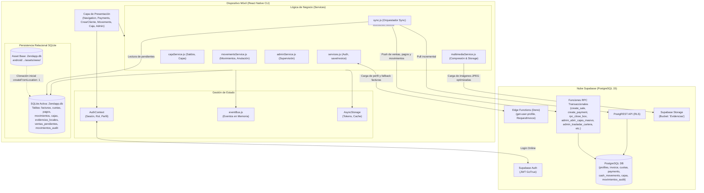
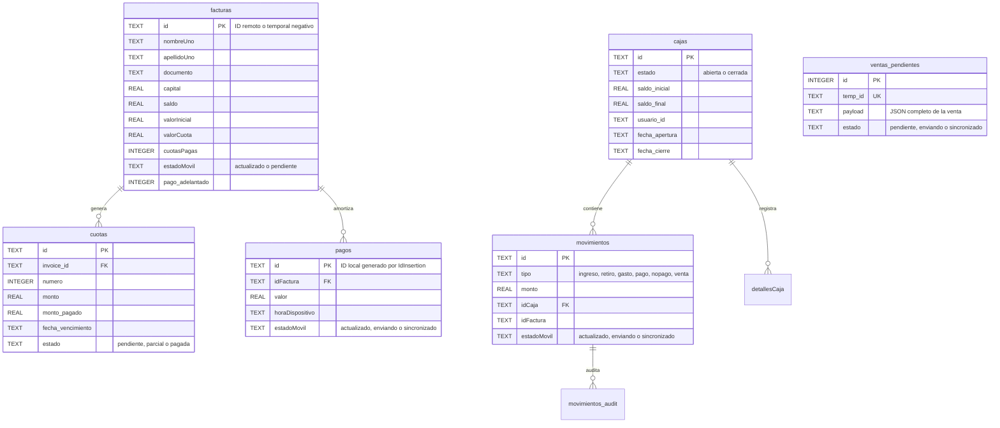
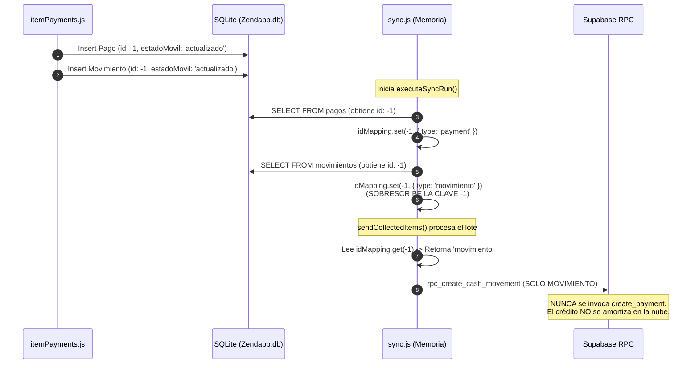

# ZENDA MOBILE — DOCUMENTO BASE Y ESPECIFICACIÓN TÉCNICA CONSOLIDADA (BASELINE DEFINITIVO)

> **Versión:** 2.0.0 (Consolidada, Auditada y Verificada)  
> **Fecha de Publicación:** Noviembre 2026  
> **Estado:** Fuente Única de Verdad para Mantenimiento y Desarrollo Asistido por IA  
> **Modo de Operación:** Estricto Contrato de No Regresión y Modo Lectura / Auditoría  
> **Entorno:** React Native CLI (Android / iOS) con backend PostgreSQL en Supabase y persistencia local SQLite  

---

## CONVENCIONES DE EVIDENCIA TÉCNICA

Para garantizar la máxima transparencia y evitar asunciones infundadas, cada afirmación, componente, flujo y regla técnica en este documento está etiquetada formalmente con una de las siguientes clasificaciones:

- **`[VERIFICADO EN CÓDIGO]`**: Existe evidencia explícita, directa y comprobada en líneas de código fuente, archivos y funciones del proyecto.
- **`[VERIFICADO MEDIANTE PRUEBA]`**: Se ejecutó una prueba, comando de compilación o inspección de ejecución que demostró el comportamiento de forma fehaciente.
- **`[INFERIDO]`**: Se deduce del diseño del código, comentarios o dependencias, pero no cuenta con implementación garantizada o prueba de estrés.
- **`[NO VERIFICADO]`**: No existe evidencia concluyente en el repositorio para validar la afirmación; requiere prueba manual en dispositivo.
- **`[RIESGO O VULNERABILIDAD DETECTADA]`**: Comportamiento, lógica o diseño que presenta fallas de concurrencia, colisión de datos, brechas de seguridad o pérdida de sincronización.

---

## ÍNDICE GENERAL

1. [Arquitectura General y Pila Tecnológica](#1-arquitectura-general-y-pila-tecnológica)
2. [Estructura de Directorios y Responsabilidades Reales](#2-estructura-de-directorios-y-responsabilidades-reales)
3. [Inventario Completo de Funcionalidades por Módulo](#3-inventario-completo-de-funcionalidades-por-módulo)
4. [Reglas de Negocio y Lógica Financiera](#4-reglas-de-negocio-y-lógica-financiera)
5. [Autenticación, Roles, Jerarquías y Seguridad (RLS)](#5-autenticación-roles-jerarquías-y-seguridad-rls)
6. [Modelo de Datos y Esquemas (SQLite vs PostgreSQL)](#6-modelo-de-datos-y-esquemas-sqlite-vs-postgresql)
7. [Inventario de Servicios, RPCs y Edge Functions de Backend](#7-inventario-de-servicios-rpcs-y-edge-functions-de-backend)
8. [Ciclo de Sincronización Offline-First y Manejo de Conflictos](#8-ciclo-de-sincronización-offline-first-y-manejo-de-conflictos)
9. [Navegación y Flujos de Usuario](#9-navegación-y-flujos-de-usuario)
10. [Estado Real de Pruebas y Cobertura](#10-estado-real-de-pruebas-y-cobertura)
11. [Matriz Integral de Riesgos y Vulnerabilidades](#11-matriz-integral-de-riesgos-y-vulnerabilidades)
12. [Contrato de No Regresión para Intervenciones Futuras](#12-contrato-de-no-regresión-para-intervenciones-futuras)

---

## 1. ARQUITECTURA GENERAL Y PILA TECNOLÓGICA

### 1.1. Pila de Tecnologías Base
`[VERIFICADO EN CÓDIGO]`

La aplicación móvil **Zenda** está construida bajo una arquitectura **Offline-First** sobre React Native CLI en JavaScript (ES6+ / JSX), operando de manera autónoma en ruta mediante una base de datos local SQLite y sincronizándose bidireccionalmente con PostgreSQL vía **Supabase**.

- **Núcleo y Runtime:**
  - `react-native`: `0.77.0` (especificado en `package.json#L24`)
  - `react`: `18.3.1`
  - `Node.js Target`: Node 18+ / 20+ LTS
  - `Android SDK`: Compile SDK 35, Target SDK 34, Min SDK 24 (Android 7.0+)
  - `Gradle / AGP`: Gradle 8.10.2 con Android Gradle Plugin 8.7.2
  - `Arquitecturas Android Compiladas`: `arm64-v8a`, `x86_64` (configuradas en `android/gradle.properties`)
- **Backend y Red:**
  - `@supabase/supabase-js`: `^2.49.4`
  - `@react-native-community/netinfo`: `^11.4.1` (detección reactiva de conectividad de red)
  - Edge Functions de Supabase (Deno runtime) para perfiles y contingencia de facturas.
- **Persistencia Local y Motor Relacional:**
  - `react-native-sqlite-storage`: `^6.0.1` (gestiona `Zendapp.db`)
  - Base de datos relacional pre-poblada: `android/app/src/main/assets/www/Zendapp.db` (184 KB), clonada al inicio mediante `openDatabase({ createFromLocation: 1 })` `[VERIFICADO EN CÓDIGO: src/database/db.js#L214]`.
  - `@react-native-async-storage/async-storage`: `^2.2.0` (tokens de sesión, perfil cacheado `cached_profile`).
- **Navegación:**
  - `@react-navigation/native`: `^7.1.6`
  - `@react-navigation/native-stack`: `^7.3.10`
  - `@react-navigation/bottom-tabs`: `^7.3.10`
- **Hardware, Multimedia y Comprobantes Digitales:**
  - `react-native-geolocation-service`: `^5.3.1` (captura de coordenadas GPS en cobros y ventas)
  - `react-native-image-picker`: `^8.3.0` (captura de fotografías de pagarés y comprobantes)
  - `react-native-compressor`: `^1.19.4` (compresión JPEG en cliente antes de subida a Storage)
  - `react-native-view-shot`: `^4.0.3` (captura del comprobante digital como imagen PNG/JPEG) `[VERIFICADO EN CÓDIGO]`
  - `react-native-share`: `^12.3.1` (compartición de recibos de pago vía WhatsApp y hojas de compartir) `[VERIFICADO EN CÓDIGO]`
  - `react-native-background-timer`: `^2.4.1`

---

### 1.2. Gestión de Estado y Comunicación Interna
`[VERIFICADO EN CÓDIGO]`

El estado de la aplicación se distribuye en cuatro capas desacopladas:
1. **Estado de Sesión Global (`AuthContext`):** Mantiene `user`, `session`, `profile` (rol, permisos, topes de gasto, `modo_apertura_caja`), y flags de sincronización.
2. **Bus de Eventos en Memoria (`eventBus`):** Emisor de eventos (`EventEmitter` en [`src/utils/eventBus.js`](file:///f:/JS/JESD/Manager/zendapp/src/utils/eventBus.js)) que notifica cambios reactivos entre pantallas sin acoplar componentes: `CLIENT_CREATED`, `PAYMENT_REGISTERED`, `SYNC_COMPLETED`, `CAJA_UPDATED`.
3. **Persistencia Transaccional Local (`SQLite Zendapp.db`):** Verdadera fuente de verdad operativa en ruta para cobros, saldos de facturas y flujo de efectivo.
4. **Estado Local de Componentes (`useState` / `useMemo` / `useRef`):** Formularios, animaciones y modales de interfaz.

---

### 1.3. Variables de Entorno y Configuración
`[VERIFICADO EN CÓDIGO: src/config/env.js]`

| Variable de Entorno | Propósito Operativo | Sensibilidad |
| :--- | :--- | :--- |
| `SUPABASE_URL` | Endpoint HTTPS del proyecto Supabase (PostgREST, Auth, Storage y Functions). | Pública / Proyecto |
| `SUPABASE_ANON_KEY` | Clave pública anónima JWT para consumo de servicios con RLS. | Restringida / Cliente |

---

### 1.4. Diagrama Mermaid de Arquitectura General



---

## 2. ESTRUCTURA DE DIRECTORIOS Y RESPONSABILIDADES REALES
`[VERIFICADO EN CÓDIGO]`

A continuación se detalla el árbol de archivos real y verificado del proyecto, corrigiendo omisiones y eliminando rutas inexistentes:

```
zendapp/
├── android/
│   └── app/src/main/assets/www/
│       └── Zendapp.db               # Base de datos pre-empaquetada clonada en la primera instalación
├── src/
│   ├── components/                  # Componentes y modales transversales reutilizables
│   │   ├── AppAlert.js              # Envoltorio personalizado y estandarizado para alertas nativas
│   │   ├── AppleButton.js           # Botón de acción con estilo iOS / Apple theme
│   │   ├── AppleCard.js             # Tarjeta contenedora estilizada
│   │   ├── ConceptPickerModal.js    # Modal selector de conceptos contables parametrizados
│   │   ├── EvidencePreviewModal.js  # Visor modal de fotos de pagarés y comprobantes
│   │   ├── LogoutConfirmModal.js    # Modal de confirmación para cierre de sesión
│   │   └── PaymentReceiptModal.js   # Generador y previsualizador de comprobante digital de pago
│   ├── config/
│   │   └── env.js                   # Verificación de SUPABASE_URL y SUPABASE_ANON_KEY
│   ├── context/
│   │   └── AuthContext.js           # Proveedor de autenticación, rol, perfil y flags de syncing
│   ├── database/
│   │   └── db.js                    # Conexión SQLite (createFromLocation: 1), ensureDatabaseIntegrity
│   ├── lib/
│   │   └── supabase.js              # Instancia singleton del cliente Supabase y ensureAuthenticatedSession
│   ├── screens/
│   │   ├── Navigation.js            # Definición central de rutas y menú por rol (Tab y Stack)
│   │   ├── LoginScreen.js           # Formulario de inicio de sesión online / offline
│   │   ├── admin/                   # Módulo de administración y supervisión
│   │   │   ├── AdminUsuarios.js     # Gestión de cobradores (alta, activación, reseteo de claves)
│   │   │   ├── AdminCartera.js      # Resumen de cartera colocada y recaudada
│   │   │   ├── AdminCarteraDetalle.js # Auditoría de créditos por cobrador y castigo de cartera
│   │   │   ├── AdminCajas.js        # Supervisión de cajas y apertura masiva
│   │   │   ├── AdminCajaDetalle.js  # Detalle de movimientos de una caja y reapertura forzada
│   │   │   ├── AdminMorosos.js      # Radar de morosidad y clientes en atraso
│   │   │   ├── AdminReportes.js     # Reportes de rendimiento contable consolidado
│   │   │   └── components/          # Componentes internos del panel de administración
│   │   │       ├── CajaCard.js
│   │   │       ├── CarteraUserCard.js
│   │   │       ├── OrganizationModal.js # Edición modal de parámetros de organización
│   │   │       ├── UserCard.js
│   │   │       └── UserModal.js     # Modal de alta/edición de usuarios subordinados
│   │   ├── caja/
│   │   │   └── Caja.js              # Apertura, cierre y resumen de la caja del vendedor en ruta
│   │   ├── createClient/            # Módulo de alta de clientes y originación de créditos
│   │   │   ├── CrearCliente.js      # Pestaña 'Nueva Venta': alta de cliente, simulación, préstamo y renovación
│   │   │   └── CustomPicker.js      # Selector desplegable modal reutilizable
│   │   ├── creditDetail/
│   │   │   └── CreditDetail.js      # Vista pasiva (solo lectura) de cuotas, pagos y fotos de un crédito
│   │   ├── movements/
│   │   │   └── Movements.js         # Registro y edición de gastos, ingresos, retiros y anulación de ventas
│   │   └── payments/
│   │       ├── Payments.js          # Lista de cobranza diaria, filtros de ruta y disparador de sync
│   │       └── components/
│   │           └── itemPayments.js  # Tarjeta de cobro individual, amortización y registro de No Pagos
│   ├── services/
│   │   ├── adminService.js          # Cliente de las 15+ funciones RPC administrativas
│   │   ├── cajaService.js           # computeCajaSaldo, abrirCaja, cerrarCaja, registrarNoPagosMasivos
│   │   ├── movementsService.js      # createCashMovement, updateCashMovement, cancelInvoiceSale, transfer
│   │   ├── multimediaService.js     # Compresión con react-native-compressor y subida a Storage
│   │   └── services.js              # AuthService, hashOfflinePassword, getInvoice, saveInvoice
│   ├── theme/
│   │   ├── appleTheme.js            # Paleta de colores, tipografía y estilos base
│   │   └── zendaTheme.js            # Constantes temáticas corporativas
│   └── utils/
│       ├── clearLocal.js            # Depuración controlada de SQLite al cambiar de usuario
│       ├── eventBus.js              # EventEmitter desacoplado en memoria
│       ├── sync.js                  # Orquestador del ciclo de sincronización (SendVentas, SendPay, etc.)
│       └── utilities.js             # Formateo monetario, cálculo de consecutivos y fechas
├── supabase/
│   └── migrations/                  # 30+ migraciones SQL con esquemas, RLS y funciones RPC
├── App.js                           # Punto de entrada de la aplicación
└── index.js                         # Registro en AppRegistry
```

> [!CAUTION]
> **Componentes Fantasma Eliminados:** Las referencias a `src/screens/ProfileScreen.js`, `src/screens/history/History.js`, `LocationPickerModal.js` y `FormattedNumberInput.js` quedan formalmente descartadas de la arquitectura, dado que no existen en el código fuente.

---

## 3. INVENTARIO COMPLETO DE FUNCIONALIDADES POR MÓDULO

### 3.1. Módulo: Autenticación y Perfil
`[VERIFICADO EN CÓDIGO]`

* **F-01: Inicio de Sesión Dual (Online y Offline)**  
  * **Archivos:** [`src/screens/LoginScreen.js`](file:///f:/JS/JESD/Manager/zendapp/src/screens/LoginScreen.js), [`src/services/services.js#L35-L339`](file:///f:/JS/JESD/Manager/zendapp/src/services/services.js#L35-L339) (`AuthService`).
  * **Comportamiento Online:** Autentica con `supabase.auth.signInWithPassword`. Consume la Edge Function `functions/v1/get-user-profile` y refresca permisos desde la tabla `profiles`. Si la cuenta está inhabilitada (`activo === false`), cierra sesión inmediatamente.
  * **Comportamiento Offline:** Si `NetInfo.isConnected === false` o la petición arroja timeout/network error, busca credenciales en la tabla SQLite `parametrizacion` (ids: 2=token, 3=email, 4=hash, 5=user_id, 6=rol, 7=nombre, 8=superior_id, 10=modo_apertura).
  * **Algoritmo de Hash Offline:** Ejecuta la función interna `hashOfflinePassword(pwd)` con salt `'zenda_auth_salt_v1_'` `[VERIFICADO EN CÓDIGO: services.js#L21-L33]`. **No es SHA-256.**
  * **Protección de Cambio de Usuario:** Si el usuario que inicia sesión difiere del usuario guardado en SQLite y existen registros locales pendientes de sincronizar (`getPendingSyncCount() > 0`), el sistema **bloquea el inicio de sesión** para evitar mezcla contable o pérdida de dinero `[VERIFICADO EN CÓDIGO: services.js#L189-L198]`.
* **F-02: Cierre de Sesión Controlado**  
  * **Archivos:** [`src/components/LogoutConfirmModal.js`](file:///f:/JS/JESD/Manager/zendapp/src/components/LogoutConfirmModal.js), `AuthContext.js`.
  * **Comportamiento:** Cierra sesión en Supabase Auth y limpia tokens en memoria, alertando si hay datos no sincronizados.

---

### 3.2. Módulo: Ventas / Créditos / Préstamos (Originación vs Consulta)
`[VERIFICADO EN CÓDIGO]`

* **F-03: Simulación y Creación de Crédito (Nueva Venta)**  
  * **Pantalla y Ruta:** [`src/screens/createClient/CrearCliente.js`](file:///f:/JS/JESD/Manager/zendapp/src/screens/createClient/CrearCliente.js) (Ruta de navegación `'CreateClient'`, pestaña titulada `'Nueva Venta'`).
  * **Datos Procesados:** Nombres, apellidos, alias, documento único, teléfono, dirección, monto capital, tasa de interés (porcentaje), número de cuotas, periodicidad (`diario`, `semanal`, `quincenal`, `mensual`), flag `pago_adelantado` y foto de pagaré/documento.
  * **Mecanismo de Desembolso y Persistencia:**
    1. Guarda el registro en la cola SQLite `ventas_pendientes` con `temp_id = -Date.now()` `[CrearCliente.js#L523-L533]`.
    2. Genera las cuotas en SQLite (`cuotas`) calculando fechas con `addMonths` o suma de días.
    3. Registra la factura en SQLite (`facturas`) con `id = tempId` y estado `'actualizado'`.
    4. Genera un movimiento en SQLite (`movimientos`) con `tipo = 'venta'`, `monto = capital` y `estadoMovil = 'sincronizado'` para que el arqueo local de la caja refleje la salida del efectivo inmediatamente.
    5. Descuenta el capital de `cajas.saldo_final` en SQLite.
    6. Dispara `SyncWithSupabase(false)` en segundo plano si hay red.
* **F-04: Renovación de Créditos**  
  * **Pantalla:** [`src/screens/createClient/CrearCliente.js#L120-L135, L348-L380`](file:///f:/JS/JESD/Manager/zendapp/src/screens/createClient/CrearCliente.js#L120-L135).
  * **Comportamiento:** Permite seleccionar clientes con créditos liquidados o saldos pendientes, cargando sus datos automáticamente y vinculando el parámetro `previous_invoice_id` para refinanciación.
* **F-05: Consulta y Auditoría de Crédito Existente (Solo Lectura)**  
  * **Pantalla:** [`src/screens/creditDetail/CreditDetail.js`](file:///f:/JS/JESD/Manager/zendapp/src/screens/creditDetail/CreditDetail.js).
  * **Comportamiento:** No crea ni simula créditos. Consulta SQLite (y Supabase si hay red) para mostrar el listado de cuotas pagadas/pendientes, historial de abonos, geolocalización del negocio y visor de pagaré digital.
* **F-06: Anulación de Ventas del Día**  
  * **Pantallas:** [`src/screens/movements/Movements.js#L340-L410`](file:///f:/JS/JESD/Manager/zendapp/src/screens/movements/Movements.js#L340-L410) (`handleDeleteVenta`) y `AdminCarteraDetalle.js`.
  * **Restricción:** Requiere permiso `profile.permite_borrar_venta === true`. Valida que la venta no posea pagos de clientes registrados. Invoca la RPC `rpc_delete_sale` / `rpc_cancel_sale` reintegrando el dinero a la caja.

---

### 3.3. Módulo: Ruta de Cobranza y Pagos
`[VERIFICADO EN CÓDIGO]`

* **F-07: Listado de Cobranza en Ruta**  
  * **Pantalla:** [`src/screens/payments/Payments.js`](file:///f:/JS/JESD/Manager/zendapp/src/screens/payments/Payments.js).
  * **Comportamiento:** Lista las facturas activas de SQLite ordenadas por consecutivo tramitado, calculando en la cabecera el balance pendiente de cobro y recaudos del día.
* **F-08: Registro de Abono / Pago de Cuota**  
  * **Componente:** [`src/screens/payments/components/itemPayments.js#L159-L225`](file:///f:/JS/JESD/Manager/zendapp/src/screens/payments/components/itemPayments.js#L159-L225).
  * **Flujo Local:**
    1. Genera ID temporal negativo mediante `IdInsertion()` (ej. `-1`).
    2. Reduce `facturas.saldo` y aumenta `facturas.cuotasPagas`.
    3. Inserta en SQLite `pagos` con `estadoMovil = 'actualizado'`.
    4. Inserta en SQLite `movimientos` con `tipo = 'pago'`, `monto = valorPago` y `estadoMovil = 'actualizado'`.
    5. Suma el recaudo a `cajas.saldo_final`.
    6. Abre el modal `PaymentReceiptModal.js`, captura el comprobante como imagen mediante `react-native-view-shot` y permite enviarlo por WhatsApp con `react-native-share`.
* **F-09: Registro de "No Pago" (Individual y Masivo)**  
  * **Componentes:** `itemPayments.js` y [`src/services/cajaService.js#L380-L460`](file:///f:/JS/JESD/Manager/zendapp/src/services/cajaService.js#L380-L460) (`registrarNoPagosMasivos`).
  * **Comportamiento:** Asienta transacciones con `monto = 0` y `tipo = 'nopago'`, justificando la visita en la ruta sin alterar saldos monetarios.

---

### 3.4. Módulo: Caja y Control de Efectivo
`[VERIFICADO EN CÓDIGO]`

* **F-10: Apertura de Caja**  
  * **Pantalla y Servicio:** [`src/screens/caja/Caja.js`](file:///f:/JS/JESD/Manager/zendapp/src/screens/caja/Caja.js), [`src/services/cajaService.js#L310-L375`](file:///f:/JS/JESD/Manager/zendapp/src/services/cajaService.js#L310-L375) (`abrirCaja`).
  * **Restricción:** El vendedor solo puede tener una caja abierta por día. Si el perfil tiene `modo_apertura_caja === 'vendedor_dia'`, se auto-abre mediante la RPC `rpc_check_or_open_vendedor_caja`.
* **F-11: Cierre de Caja y Arqueo Bloqueante**  
  * **Servicio:** [`src/services/cajaService.js#L490-L550`](file:///f:/JS/JESD/Manager/zendapp/src/services/cajaService.js#L490-L550) (`cerrarCaja`).
  * **Condiciones Inviolables de Bloqueo:**
    1. Exige conexión a Internet activa (`NetInfo.isConnected === true`). No se permite cierre offline.
    2. Exige cola de sincronización vacía (`getPendingSyncCount() === 0`).
    3. Si existen clientes sin visitar en la ruta, exige confirmar y ejecutar `registrarNoPagosMasivos`.
  * **Ejecución Remota:** Invoca la RPC `rpc_close_box`, congelando `fecha_cierre = NOW()` y sellando el arqueo.
* **F-12: Movimientos Varios (Gastos, Ingresos, Retiros)**  
  * **Pantallas:** [`src/screens/movements/Movements.js`](file:///f:/JS/JESD/Manager/zendapp/src/screens/movements/Movements.js), [`src/services/movementsService.js`](file:///f:/JS/JESD/Manager/zendapp/src/services/movementsService.js).
  * **Reglas:**
    - `ingreso` y `retiro` son **estrictamente inmutables**.
    - `gasto` no puede exceder el tope configurado en `profile.dinero_max_gasto`.
    - Si un pago se edita a `$0`, transiciona a `nopago`, restituye el saldo en la factura y genera auditoría en `movimientos_audit`.
* **F-13: Transferencias entre Cajas**  
  * **Servicio:** [`src/services/movementsService.js#L445-L480`](file:///f:/JS/JESD/Manager/zendapp/src/services/movementsService.js#L445-L480) (`transferBetweenBoxes`).
  * **Comportamiento:** Invoca la RPC de backend `rpc_cash_transfer` para debitar la caja origen y acreditar la caja destino en una única transacción PostgreSQL.

---

### 3.5. Módulo Administrativo (Supervisión y Control)
`[VERIFICADO EN CÓDIGO]`

* **F-14: Gestión de Usuarios Subordinados (`AdminUsuarios.js`):** Alta de cobradores mediante RPC `admin_create_user`, edición con `admin_update_user`, y activación/bloqueo con `admin_toggle_user`.
* **F-15: Supervisión de Cartera y Castigo (`AdminCartera.js` / `AdminCarteraDetalle.js`):** Resumen global con `admin_get_cartera_summary`, detalle por cobrador con `admin_get_cartera_detail`, traslado masivo de créditos con `admin_trasladar_cartera`, y castigo de cartera incobrable con `admin_castigar_cartera`.
* **F-16: Auditoría de Cajas de Ruta (`AdminCajas.js` / `AdminCajaDetalle.js`):** Apertura masiva de cajas con `admin_abrir_cajas_masivo` y reapertura forzada con `admin_reabrir_caja` (exige que la caja del administrador esté abierta).
* **F-17: Radar de Morosos y Rendimiento (`AdminMorosos.js` / `AdminReportes.js`):** Detección de mora con `admin_get_morosos` y métricas con `admin_reporte_consolidado`.

---

## 4. REGLAS DE NEGOCIO Y LÓGICA FINANCIERA

### 4.1. Amortización de Créditos e Intereses
`[VERIFICADO EN CÓDIGO: CrearCliente.js#L250-L285]`

$$\text{Monto Interés} = \text{round}\left(\text{Capital} \times \frac{\text{Tasa de Interés}}{100}\right)$$

$$\text{Total Factura} = \text{Capital} + \text{Monto Interés}$$

$$\text{Valor Cuota Base} = \text{floor}\left(\frac{\text{Total Factura}}{\text{Número de Cuotas}}\right)$$

$$\text{Ajuste Última Cuota} = \text{Total Factura} - (\text{Valor Cuota Base} \times (\text{Número de Cuotas} - 1))$$

---

### 4.2. Regla Especial de Pago Adelantado (`pago_adelantado === true`)
`[VERIFICADO EN CÓDIGO: CrearCliente.js#L550, L569, L636-L673]`

1. La cuota #1 se marca inmediatamente como pagada (`estado = 'pagada'`, `monto_pagado = valorCuota`).
2. El saldo inicial del crédito se inicializa descontando la primera cuota:
   $$\text{Saldo Inicial Factura} = \text{Total Factura} - \text{Valor Cuota}$$
3. El conteo de cuotas pagadas se inicializa en `cuotasPagas = 1`.
4. El desembolso neto de caja refleja el egreso del capital completo. Sin embargo, en SQLite se inserta un abono y movimiento informativo postfechado al siguiente día de cobro (`advDateIso = '${proximoRecaudoStr}T08:00:00.000Z'`).

---

### 4.3. Fórmula de Saldo de Caja y Riesgo de Divergencia
`[VERIFICADO EN CÓDIGO: cajaService.js#L6-L33]` vs `[RIESGO O VULNERABILIDAD DETECTADA]`

El saldo oficial calculado en SQLite sigue la fórmula agregada:

$$\text{Saldo Calculado} = \text{Saldo Inicial} + \sum (\text{Ingresos} + \text{Pagos}) - \sum (\text{Retiros} + \text{Ventas} + \text{Renovaciones} + \text{Gastos})$$

> [!WARNING]
> **Inconsistencia Detectada:** Coexisten sentencias imperativas directas (`UPDATE cajas SET saldo_final = saldo_final ± monto`) en `itemPayments.js`, `movementsService.js` y `CrearCliente.js`. Si un movimiento no se registra por error, el saldo imperativo diverge del recalculado por `computeCajaSaldo`.

---

### 4.4. Inmutabilidad Financiera por Capas
`[VERIFICADO EN CÓDIGO]`

| Entidad / Movimiento | Control en UI (Móvil) | Control en JS (Services) | Restricción en SQLite | Restricción en RPC Supabase | Control de Tabla RLS (PostgreSQL) |
| :--- | :---: | :---: | :---: | :---: | :---: |
| **Ingreso** | Oculta botón editar | Arroja Error explícito | Sin trigger | Arroja `TIPO_INMUTABLE` | ⚠️ **Permite UPDATE si es dueño de caja** |
| **Retiro** | Oculta botón editar | Arroja Error explícito | Sin trigger | Arroja `TIPO_INMUTABLE` | ⚠️ **Permite UPDATE si es dueño de caja** |
| **Venta** | Solo anulación si hay permiso | Arroja Error en edición directa | Sin trigger | Arroja `VENTA_MONTO_INMUTABLE` | ⚠️ **Permite UPDATE si es dueño de caja** |
| **Gasto** | Permite editar (tope max) | Valida `dinero_max_gasto` | Sin trigger | Valida `dinero_max_gasto` | Permite UPDATE |
| **Pago $\rightarrow$ $0$** | Transiciona a No Pago | Revierte saldo factura | Sin trigger | Registra auditoría | Permite UPDATE |

---

## 5. AUTENTICACIÓN, ROLES, JERARQUÍAS Y SEGURIDAD (RLS)

### 5.1. Matriz de Roles Operativos
`[VERIFICADO EN CÓDIGO: Navigation.js#L28-L46]`

* **`vendedor`**: 4 pestañas operativas (`Payments`, `CreateClient`, `Movements`, `Caja`). Cobranza en ruta, altas de préstamos, control de caja individual.
* **`admin`**: 5 pestañas de supervisión (`AdminUsuarios`, `AdminCartera`, `AdminCajas`, `AdminMorosos`, `AdminReportes`). Aperturas masivas, castigo de cartera, traslados y auditorías.
* **`cliente`**: Configuración de menú para consulta de créditos propios (`Payments`, `Caja`).

---

### 5.2. Evaluación Crítica de Seguridad en Supabase RLS
`[RIESGO O VULNERABILIDAD DETECTADA: supabase/migrations/20261021000001_fase1_constraints_indexes_rls.sql]`

En la base de datos PostgreSQL, las políticas RLS utilizan la función helper `is_admin()`:
```sql
CREATE OR REPLACE FUNCTION public.is_admin()
RETURNS boolean LANGUAGE sql SECURITY DEFINER STABLE AS $$
  SELECT EXISTS (
    SELECT 1 FROM public.profiles WHERE id = auth.uid() AND rol = 'admin'
  );
$$;
```
Y las políticas de acceso establecen:
```sql
CREATE POLICY "invoice_select" ON public.invoice
  FOR SELECT USING (
    usuario_id = auth.uid() OR public.is_same_hierarchy(usuario_id) OR public.is_admin()
  );
```
> [!CAUTION]
> **Brecha Multi-Tenant para Administradores:** La cláusula `OR public.is_admin()` no valida si el registro pertenece al mismo `id_organizacion` del administrador autenticado. Un usuario con rol `admin` de una empresa puede consultar vía API REST PostgREST los datos de todas las demás organizaciones alojadas en la misma base de datos. El aislamiento depende 100% de los filtros aplicados en el frontend de la app móvil.

---

## 6. MODELO DE DATOS Y ESQUEMAS (SQLITE VS POSTGRESQL)

### 6.1. Esquema Local SQLite (`Zendapp.db`)
`[VERIFICADO EN CÓDIGO: src/database/db.js]`



---

### 6.2. Estrategia de Identificadores y UUIDs Determinísticos
`[VERIFICADO EN CÓDIGO: src/utils/sync.js]` vs `[RIESGO O VULNERABILIDAD DETECTADA]`

Para permitir sincronización idempotente sin duplicar dinero tras fallos de conexión, se sintetizan UUIDs basados en el ID local:
- **Ventas:** `00000000-0000-4000-7000-${Math.abs(tempId).toString(16).padStart(12, '0')}`
- **Pagos:** `00000000-0000-4000-8000-${Math.abs(pagoId).toString(16).padStart(12, '0')}`
- **Movimientos:** `00000000-0000-4000-9000-${Math.abs(movId).toString(16).padStart(12, '0')}`

> [!WARNING]
> **Riesgo de Colisión Multi-Dispositivo:** `IdInsertion()` genera enteros pequeños (`-1`, `-2`, `-3`). Si dos cobradores operan offline simultáneamente, ambos generarán el pago con ID `-1`, produciendo el mismo UUID determinístico. Al sincronizar el segundo vendedor, Supabase descartará su cobro por coincidencia de UUID.

---

## 7. INVENTARIO DE SERVICIOS, RPCS Y EDGE FUNCTIONS DE BACKEND
`[VERIFICADO EN CÓDIGO]`

### 7.1. Edge Functions de Supabase
1. `functions/v1/get-user-profile`: Recuperación de perfil, conceptos y caja activa durante el inicio de sesión.
2. `functions/v1/RequestInvoce`: Fallback para descarga de facturas en caso de error en RPC nativa.

### 7.2. Tabla Maestra de las 27 Funciones RPC en Supabase

| Nombre Exacto en Código | Archivo Invocador | Parámetros Clave | Propósito Operativo |
| :--- | :--- | :--- | :--- |
| `create_sale` | `sync.js#L261` | `nombre`, `monto`, `vendedor_id`, `caja_id`, `client_uuid`, `pago_adelantado` | Alta atómica de cliente, crédito, cuotas y egreso de caja en Supabase. |
| `create_payment` | `sync.js#L501` | `p_invoice_id`, `p_amount`, `p_caja_id`, `p_client_uuid`, `p_method` | Asienta pago, amortiza cuotas, reduce saldo de factura y crea movimiento de caja. |
| `rpc_close_box` | `cajaService.js#L523` | `p_caja_id`, `p_saldo_final_reportado`, `p_usuario_id` | Bloquea y sella la caja con fecha y balance final. |
| `rpc_create_cash_movement` | `sync.js#L552` | `p_caja_id`, `p_tipo`, `p_monto`, `p_client_uuid`, `p_concepto_id` | Registra movimiento no operativo con idempotencia. |
| `rpc_update_cash_movement` | `sync.js#L598` | `p_movement_id`, `p_monto`, `p_motivo`, `p_audit_id` | Edición auditada de gastos o pagos con validación estricta de tipos. |
| `rpc_sync_movement_audit` | `sync.js#L758` | `p_movement_id`, `p_monto_anterior`, `p_monto_nuevo`, `p_audit_id` | Sincroniza el rastro de auditoría de movimientos modificados offline. |
| `rpc_cash_transfer` | `movementsService.js#L463` | `p_source_caja_id`, `p_target_caja_id`, `p_monto` | Transferencia espejo atómica entre cajas. |
| `rpc_check_or_open_vendedor_caja` | `services.js#L280` | `p_vendedor_id` | Auto-apertura diaria de caja para cobradores. |
| `rpc_delete_sale` / `rpc_cancel_sale` | `movementsService.js#L487` | `p_invoice_id`, `p_caja_id` | Anulación de crédito y reintegro de dinero a caja. |
| `rpc_get_movement_audit` | `movementsService.js#L526` | `p_movement_id` | Descarga el historial de auditoría de un movimiento. |
| `get_invoices_vendedor` | `services.js#L344` | `p_vendedor_id` | Descarga rápida de cartera activa en PostgreSQL. |
| `admin_get_subordinates` | `adminService.js#L10` | *(Sin params, lee auth.uid())* | Retorna la lista de cobradores jerárquicamente subordinados. |
| `admin_create_user` | `adminService.js#L34` | `p_email`, `p_password`, `p_nombre`, `p_rol`, `p_dinero_max_gasto` | Crea usuario en `auth.users` y ficha en `profiles`. |
| `admin_update_user` | `adminService.js#L89` | `p_user_id`, `p_nombre`, `p_dinero_max_gasto`, `p_password` | Actualiza datos y parámetros del subordinado. |
| `admin_toggle_user` | `adminService.js#L136` | `p_user_id`, `p_activo` | Habilita o deshabilita el acceso del cobrador. |
| `admin_get_cartera_summary` | `adminService.js#L148` | *(auth.uid())* | Métricas globales de capital prestado y recaudo. |
| `admin_get_cartera_detail` | `adminService.js#L158` | `p_vendedor_id` | Detalle pormenorizado de créditos por cobrador. |
| `admin_castigar_cartera` | `adminService.js#L170` | `p_invoice_id`, `p_motivo` | Marca un crédito incobrable como `castigada`. |
| `admin_get_cajas` | `adminService.js#L182` | `p_fecha` | Lista de cajas de los subordinados en una fecha dada. |
| `admin_abrir_cajas_masivo` | `adminService.js#L196` | *(auth.uid())* | Abre en lote las cajas de todos los cobradores del admin. |
| `admin_get_morosos` | `adminService.js#L206` | `p_vendedor_id`, `p_dias_mora` | Radar de clientes en atraso crítico. |
| `admin_reporte_consolidado` | `adminService.js#L218` | `p_fecha_inicio`, `p_fecha_fin` | Reporte contable consolidado de rendimiento. |
| `admin_get_organizacion` | `adminService.js#L269` | *(auth.uid())* | Consulta datos y modo de apertura de la organización. |
| `admin_update_organizacion` | `adminService.js#L310` | `p_modo_apertura_caja`, `p_nombre`, `p_nit` | Actualiza reglas institucionales de la empresa. |
| `admin_trasladar_cartera` | `adminService.js#L325` | `p_vendedor_origen`, `p_vendedor_destino`, `p_invoices` | Reasigna créditos y clientes entre cobradores. |
| `admin_get_open_cajas_count` | `adminService.js#L340` | *(auth.uid())* | Conteo de cajas abiertas bajo supervisión del admin. |
| `admin_reabrir_caja` | `adminService.js#L507` | `p_caja_id` | Reapertura forzada de una caja cerrada erróneamente. |

---

## 8. CICLO DE SINCRONIZACIÓN OFFLINE-FIRST Y MANEJO DE CONFLICTOS

### 8.1. Flujo Secuencial de Sincronización (`executeSyncRun`)
`[VERIFICADO EN CÓDIGO: src/utils/sync.js#L94-L224]`

1. **Chequeo de Red:** Si `NetInfo.isConnected === false`, aborta y conserva datos seguros en SQLite.
2. **Coordinador de Concurrencia (Mutex):** Valida `isSyncing`. Si ya hay un ciclo en curso, marca `hasPendingSync = true` y reutiliza la promesa activa.
3. **Paso 1: `SendVentas()`:** Envía préstamos de `ventas_pendientes` a `create_sale`, actualiza IDs remotos en `facturas` y reconcilia cuotas.
4. **Paso 2: `SendPay()`:** Lee `pagos` con `estadoMovil = 'actualizado'`, genera payload y añade a `globalSyncCollection`.
5. **Paso 3: `SendMovimientos()`:** Lee `movimientos` con `estadoMovil = 'actualizado'` y añade a `globalSyncCollection`.
6. **Paso 4: `SendMovementAudits()`:** Despacha auditorías a `rpc_sync_movement_audit`.
7. **Paso 5: `sendCollectedItems()`:** Itera sobre `globalSyncCollection` y ejecuta las RPCs correspondientes.
8. **Paso 6: `syncPendingEvidencias()`:** Sube fotos en cola al bucket `'Evidencias'`.
9. **Paso 7: `SyncCajaAndMovimientos()`:** Descarga la caja activa y movimientos remotos actualizados.

---

### 8.2. Defecto Crítico de Mapeo en Memoria en `sync.js`
`[RIESGO O VULNERABILIDAD DETECTADA]`



---

## 9. NAVEGACIÓN Y FLUJOS DE USUARIO
`[VERIFICADO EN CÓDIGO: src/screens/Navigation.js]`

La navegación utiliza un Stack nativo principal que monta dinámicamente un Bottom Tab Navigator según el rol:

- **Rol Vendedor (4 Pestañas Reales):**
  1. `Payments` (Título: 'Pagos', Icono: `money`): Pantalla principal de cobranza en ruta.
  2. `CreateClient` (Título: 'Nueva Venta', Icono: `user-plus`): Formulario de alta de cliente y originación de préstamos.
  3. `Movements` (Título: 'Movimientos', Icono: `exchange`): Flujo de caja, gastos y anulación de ventas.
  4. `Caja` (Título: 'Caja', Icono: `shopping-cart`): Apertura, arqueo y cierre del día.
- **Rol Administrador (5 Pestañas Reales):**
  1. `AdminUsuarios` ('Usuarios')
  2. `AdminCartera` ('Cartera')
  3. `AdminCajas` ('Cajas')
  4. `AdminMorosos` ('Morosos')
  5. `AdminReportes` ('Reportes')
- **Modales en Stack (Push):**
  - `CreditDetail`: Auditoría pasiva de facturas.
  - `AdminCarteraDetalle` y `AdminCajaDetalle`: Vistas de inspección a nivel supervisor.

---

## 10. ESTADO REAL DE LAS PRUEBAS Y COBERTURA

### 10.1. Cobertura Automatizada en Código Fuente
`[VERIFICADO EN CÓDIGO]`

- **Cobertura Real en Servicios y Reglas de Negocio:** **0%**.
- **Pruebas Existentes:** Únicamente existe el archivo `__tests__/App.test.tsx` (smoke test básico de renderizado generado por defecto por la plantilla de React Native CLI).
- No existen mocks configurados en `jest.config.js` para SQLite, Supabase, Geolocation ni NetInfo.
- No existen pruebas unitarias para `computeCajaSaldo`, amortización ni `sync.js`.

### 10.2. Verificación de Compilación Nativa
`[VERIFICADO MEDIANTE PRUEBA]`

- Se ejecutó la compilación nativa en entorno Windows:
  ```powershell
  .\gradlew :app:compileDebugJavaWithJavac
  ```
- **Resultado:** **BUILD SUCCESSFUL** (237 tareas ejecutadas, 0 errores en código fuente nativo C++/Java/Kotlin).
- Se ejecutó `npx react-native config`, completándose con 0 advertencias.

---

## 11. MATRIZ INTEGRAL DE RIESGOS Y VULNERABILIDADES

| Identificador | Nivel | Dominio | Descripción Técnica del Riesgo | Impacto Operativo | Mitigación Inmediata |
| :--- | :---: | :--- | :--- | :--- | :--- |
| **R-01** | **CRÍTICO** | Sincronización / Datos | Sobrescritura en memoria de `idMapping` en `sync.js` por coincidencia de IDs temporales entre `pagos` y `movimientos`. | Pagos enviados como simples movimientos de caja; el crédito no se amortiza en Supabase. | Diferenciar las claves del Map en `sync.js` combinando tipo e ID (`${type}_${originalId}`). |
| **R-02** | **CRÍTICO** | Concurrencia | Colisión de UUIDs determinísticos (`...-000000000001`) entre cobradores que operan offline en teléfonos distintos. | Descarte erróneo de pagos legítimos en Supabase por considerarlos duplicados. | Incorporar el prefijo hexadecimal del `usuario_id` en la máscara del UUID determinístico. |
| **R-03** | **CRÍTICO** | Seguridad / RLS | `public.is_admin()` en PostgreSQL no filtra por `id_organizacion`. | Fuga de información entre organizaciones; administradores pueden leer datos ajenos. | Modificar `is_admin()` o las políticas RLS para exigir coincidencia de `id_organizacion`. |
| **R-04** | **ALTO** | Operación en Ruta | Cierre forzado indebido de caja en SQLite si `getCajaActual()` recibe `null` de Supabase por latencia de red. | Bloqueo intempestivo del cobrador en plena jornada de ruta. | No cerrar la caja local en SQLite ante fallos o respuestas nulas remotas sin confirmación del usuario. |
| **R-05** | **ALTO** | Contabilidad | Divergencia dual entre mutaciones imperativas de `cajas.saldo_final` y el recálculo dinámico en `computeCajaSaldo`. | Saltos visuales de saldo y descuadres entre arqueo local y servidor. | Estandarizar la actualización de saldo exclusivamente a través de la fórmula agregada de `computeCajaSaldo`. |
| **R-06** | **ALTO** | Seguridad de Datos | Inmutabilidad de ingresos y retiros ausente en la política RLS directa de `cash_movements_update`. | Modificaciones no autorizadas de entradas de dinero si se consume la API PostgREST directamente. | Crear un trigger `BEFORE UPDATE` en PostgreSQL que rechace cambios a tipos protegidos. |

---

## 12. CONTRATO DE NO REGRESIÓN PARA INTERVENCIONES FUTURAS

Cualquier desarrollador o asistente de Inteligencia Artificial que intervenga el código de **Zenda Mobile** debe acatar de forma vinculante las siguientes reglas antes y después de realizar modificaciones:

### 12.1. Protocolo Obligatorio ANTES de Modificar Código
1. **Lectura Completa del Documento Base:** Consultar este documento para entender la arquitectura real, esquemas y flujos vigentes.
2. **Identificación de Comportamiento Actual:** Contrastar en el código la función exacta involucrada y sus efectos secundarios en SQLite y Supabase.
3. **Mapeo de Dependencias:** Analizar qué pantallas o llamadas RPC consumen el servicio o tabla antes de editarlo.
4. **Evaluación de Regresiones:** Verificar que el cambio propuesto no rompa el funcionamiento offline ni altere las fórmulas contables.
5. **Propuesta Previa de Pruebas:** Formular cómo se validará el cambio antes de tocar el archivo.

### 12.2. Protocolo Obligatorio DESPUÉS de Modificar Código
1. **Verificación de Comportamiento Anterior:** Comprobar que las operaciones offline preexistentes siguen respondiendo de forma idéntica.
2. **Ejecución de Compilación Nativa:** Ejecutar `.\gradlew :app:compileDebugJavaWithJavac` y validar que el build finalice en estado exitoso.
3. **Transparencia en Pruebas No Ejecutadas:** Informar explícitamente qué escenarios no pudieron probarse por requerir dispositivo físico o hardware GPS/cámara.
4. **Reporte Preciso de Cambios:** Especificar los archivos exactos modificados, líneas alteradas y justificación técnica.
5. **Prohibición de Declaraciones sin Evidencia:** Queda terminantemente prohibido declarar una funcionalidad como "100% verificada" sin evidencia demostrable en código o compilación.

### 12.3. Cláusulas de Alcance Estricto
- **Prohibición de Refactorizaciones no Solicitadas:** No alterar estilos, componentes, navegación o contratos de servicios que no hayan sido expresamente pedidos por el usuario.
- **Inmutabilidad de Fórmulas Financieras:** Queda prohibido alterar los cálculos de `computeCajaSaldo`, intereses o distribución de cuotas sin especificación formal.
- **Preservación del Modelo Offline-First:** Ninguna pantalla de ruta debe bloquearse o sustituir llamadas SQLite por consultas obligatorias a internet.
