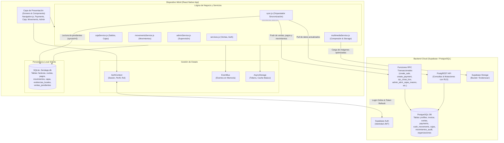
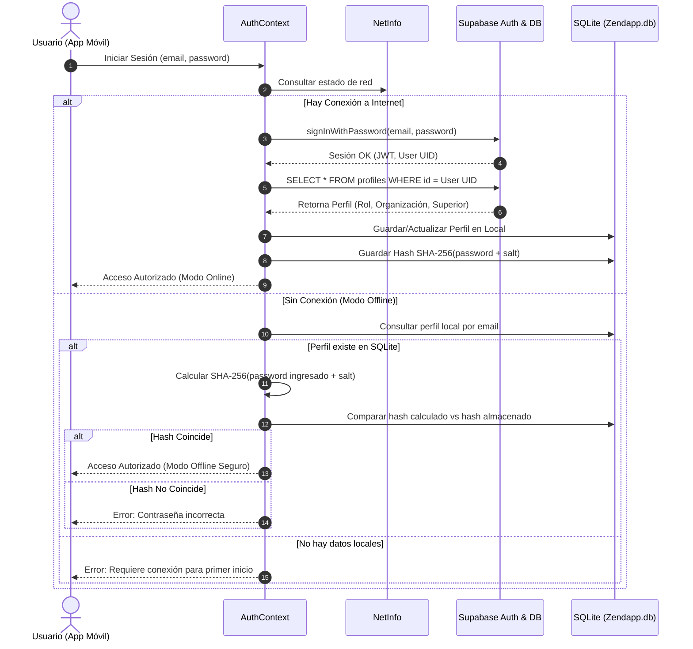
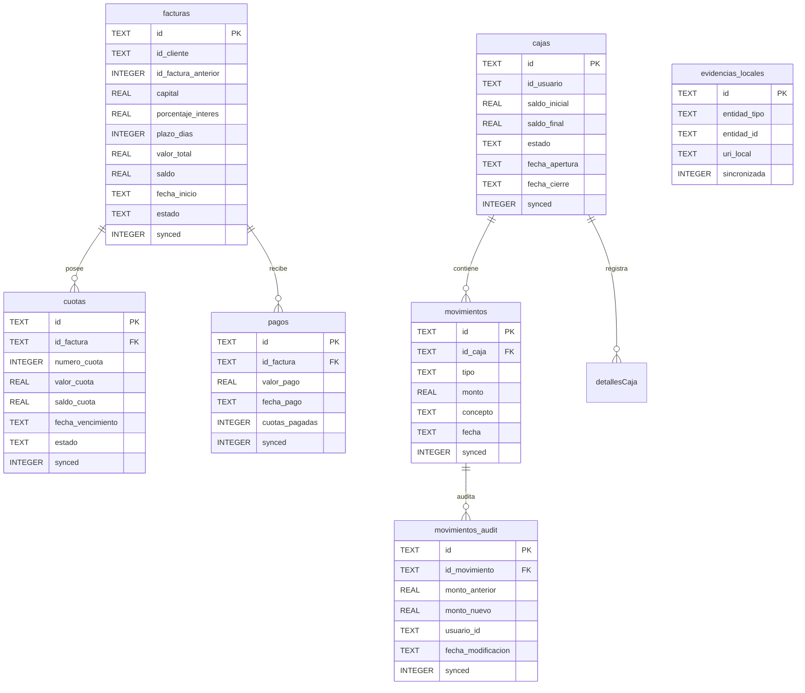

# ZENDA MOBILE — DOCUMENTO BASE Y AUDITORÍA TÉCNICA DE REFERENCIA (BASELINE)

> **Versión del Documento:** 1.0.0  
> **Fecha de Elaboración:** Noviembre 2026  
> **Estado:** Aprobado como Fuente de Verdad para Mantenimiento y Desarrollo  
> **Modo de Operación:** Estricto Contrato de No Regresión y Modo Lectura / Auditoría  
> **Entorno de Ejecución:** React Native CLI (Android / iOS) con Supabase Backend y SQLite Local  

---

## ÍNDICE GENERAL

1. [Arquitectura General del Sistema](#1-arquitectura-general-del-sistema)
2. [Inventario Completo de Funcionalidades por Módulo](#2-inventario-completo-de-funcionalidades-por-módulo)
3. [Reglas de Negocio y Lógica Financiera](#3-reglas-de-negocio-y-lógica-financiera)
4. [Autenticación, Roles, Jerarquías y Permisos](#4-autenticación-roles-jerarquías-y-permisos)
5. [Modelo de Datos y Esquema de Base de Datos](#5-modelo-de-datos-y-esquema-de-base-de-datos)
6. [Inventario de Servicios, RPC y Backend](#6-inventario-de-servicios-rpc-y-backend)
7. [Funcionamiento Offline y Ciclo de Sincronización](#7-funcionamiento-offline-y-ciclo-de-sincronización)
8. [Navegación y Flujos de Experiencia de Usuario](#8-navegación-y-flujos-de-experiencia-de-usuario)
9. [Estado Real de Pruebas y Cobertura](#9-estado-real-de-pruebas-y-cobertura)
10. [Historial Técnico de Errores y Regresiones](#10-historial-técnico-de-errores-y-regresiones)
11. [Matriz Integral de Dependencias y Riesgos](#11-matriz-integral-de-dependencias-y-riesgos)
12. [Contrato de No Regresión para Intervenciones Futuras](#12-contrato-de-no-regresión-para-intervenciones-futuras)

---

## 1. ARQUITECTURA GENERAL DEL SISTEMA

### 1.1. Tecnologías Base y Dependencias Principales

La aplicación móvil **Zenda** está construida sobre **React Native CLI** estructurado en JavaScript (ES6+ / CommonJS / JSX) optimizado para dispositivos móviles en terreno, con arquitectura Offline-First respaldada por una base de datos local SQLite y sincronizada bidireccionalmente con PostgreSQL gestionado vía **Supabase**.

- **Entorno Core:**
  - `react-native`: `^0.77.1`
  - `react`: `18.3.1`
  - `Node Runtime Target`: Node 18+ / 20+ LTS
  - `Android SDK`: Compile SDK 35, Target SDK 34, Min SDK 24 (Android 7.0+)
  - `Java/JDK`: OpenJDK 17
  - `Gradle`: 8.10.2 (Android Gradle Plugin 8.7.2)
  - `Arquitecturas Android Compiladas`: `arm64-v8a`, `x86_64` (configuradas en `android/gradle.properties`)

- **Backend y Red:**
  - `@supabase/supabase-js`: `^2.49.1` (Cliente API REST PostgREST, RPC y Auth)
  - `@react-native-community/netinfo`: `^11.4.4` (Monitoreo reactivo de conectividad online/offline)

- **Almacenamiento Local y Persistencia:**
  - `react-native-sqlite-storage`: `^6.0.1` (Motor relacional local SQLite `Zendapp.db`)
  - `@react-native-async-storage/async-storage`: `^2.1.2` (Tokens de sesión, perfil cacheado, banderas)

- **Navegación y UI:**
  - `@react-navigation/native`: `^7.0.14`
  - `@react-navigation/native-stack`: `^7.2.0`
  - `@react-navigation/bottom-tabs`: `^7.2.0`
  - `react-native-vector-icons`: `^10.2.0` (Iconografía FontAwesome 5/6, MaterialIcons)
  - `react-native-safe-area-context`: `^5.2.0`
  - `react-native-screens`: `^4.6.0`

- **Hardware, Multimedia y Background:**
  - `react-native-image-picker`: `^7.2.3` (Captura fotográfica de recibos y evidencias de clientes)
  - `react-native-compressor`: `^1.10.4` (Compresión de imágenes en cliente antes del upload a Storage)
  - `react-native-geolocation-service`: `^5.3.1` (Captura de coordenadas GPS en creación de clientes y cobros)
  - `react-native-background-timer`: `^2.4.1` (Procesamiento periódico en segundo plano)

---

### 1.2. Estructura de Directorios y Responsabilidades

```
zendapp/
├── android/                         # Configuración nativa Android (Gradle, Manifest, Autolinking)
├── ios/                             # Configuración nativa iOS (Podfile, Info.plist)
├── src/                             # Código fuente modular de la aplicación
│   ├── config/                      # Configuración global y variables de entorno
│   │   └── env.js                   # Carga de credenciales y URL de Supabase con fallback estricto
│   ├── context/                     # Contextos globales de React (React Context API)
│   │   └── AuthContext.js           # Proveedor de autenticación, rol, organización y perfil activo
│   ├── database/                    # Motor de base de datos local SQLite
│   │   ├── db.js                    # Creación, inicialización, migraciones e integridad de Zendapp.db
│   │   └── queryExecutor.js         # Ejecutor promisificado de transacciones y sentencias SQL locales
│   ├── lib/                         # Integraciones de SDKs externos
│   │   └── supabase.js              # Inicialización singleton del cliente Supabase con AsyncStorage
│   ├── screens/                     # Pantallas de la aplicación divididas por dominio
│   │   ├── Navigation.js            # Definición central de rutas, Stacks y Bottom Tabs por Rol
│   │   ├── LoginScreen.js           # Pantalla de autenticación online / offline
│   │   ├── ProfileScreen.js         # Vista de perfil de usuario y cierre de sesión
│   │   ├── caja/                    # Módulo de caja del vendedor en ruta
│   │   │   └── Caja.js              # Apertura, cierre, arqueo en vivo y resumen diario
│   │   ├── movements/               # Módulo de movimientos de efectivo
│   │   │   └── Movements.js         # Registro y edición de gastos, ingresos, retiros y transferencias
│   │   ├── payments/                # Módulo central de cobranza y ruta de cobros
│   │   │   ├── Payments.js          # Lista de cobranza diaria, filtros, ordenación y sincronización
│   │   │   ├── itemPayments.js      # Tarjeta interactiva de cobro a cliente y registro de cuotas
│   │   │   ├── FormattedNumberInput.js # Input controlado para formateo monetario en pesos
│   │   │   └── ReceiptModal.js      # Modal generador de comprobante de pago digital
│   │   ├── createClient/            # Módulo de alta y edición de clientes
│   │   │   ├── CrearCliente.js      # Formulario de datos personales, garantes y coordenadas
│   │   │   ├── CustomPicker.js      # Selector modal reutilizable para listas desplegables
│   │   │   └── LocationPickerModal.js # Selector y visualizador de mapa/geolocalización
│   │   ├── creditDetail/            # Módulo de originación de préstamos / ventas a crédito
│   │   │   └── CreditDetail.js      # Simulación, cálculo de amortización y emisión de créditos
│   │   ├── history/                 # Historial de transacciones de clientes
│   │   │   └── History.js           # Consulta de estados de cuenta históricos
│   │   └── admin/                   # Módulo de gestión y supervisión para rol 'admin'
│   │       ├── AdminUsuarios.js     # Creación, activación y reseteo de contraseñas de vendedores
│   │       ├── AdminCartera.js      # Visión global de saldos, capital prestado y recaudo
│   │       ├── AdminCarteraDetalle.js # Auditoría de créditos por vendedor y castigo de cartera
│   │       ├── AdminCajas.js        # Supervisión de cajas de subordinados y aperturas masivas
│   │       ├── AdminCajaDetalle.js  # Auditoría pormenorizada de movimientos y reapertura de cajas
│   │       ├── AdminMorosos.js      # Radar de mora y clientes en retraso crítico
│   │       └── AdminReportes.js     # Métricas consolidadas de cobro, ventas y flujo de caja
│   ├── services/                    # Capa de lógica de negocio, acceso a datos y comunicación
│   │   ├── services.js              # AuthService, gestión de facturas, ventas atómicas locales
│   │   ├── cajaService.js           # Fórmulas de saldo, aperturas, cierres y validaciones de caja
│   │   ├── movementsService.js      # Registro y actualización auditada de transacciones monetarias
│   │   ├── adminService.js          # Agrupador de consultas RPC y reportes de administración
│   │   └── multimediaService.js     # Compresión, almacenamiento offline y subida de fotos
│   └── utils/                       # Utilidades transversales
│       ├── sync.js                  # Orquestador del ciclo de sincronización SQLite <-> Supabase
│       ├── eventBus.js              # Bus de eventos desacoplado en memoria (pub/sub EventEmitter)
│       ├── utilities.js             # Formateadores monetarios, de fechas y helpers matemáticos
│       └── clearLocal.js            # Depurador seguro de caché y tablas locales
├── supabase/                        # Migraciones SQL, esquemas de tablas, RLS y funciones RPC
│   └── migrations/                  # Historial cronológico de 30+ migraciones SQL de producción
├── App.js                           # Punto de entrada de la aplicación y montaje del Context Provider
└── index.js                         # Registro del componente raíz en AppRegistry de React Native
```

---

### 1.3. Gestión del Estado

La aplicación utiliza un esquema híbrido y pragmático de gestión de estado estructurado en cuatro niveles:

1. **Estado Global de Autenticación y Perfil (`AuthContext`):**
   - Mantiene en memoria React el usuario autenticado (`user`), perfil extendido (`userProfile`: rol, `superior_id`, nombres), estado de la sesión, organización actual (`currentOrg`) y parámetros operativos (`parametros`).
2. **Bus de Eventos en Memoria (`eventBus`):**
   - Implementa un patrón Publicador/Suscriptor desacoplado (`EventEmitter`). Utilizado principalmente para notificar cambios transversales inmediatos sin forzar re-renderizados completos (ej. `eventBus.emit('cajaUpdated')`, `eventBus.emit('syncFinished')`).
3. **Estado Persistente Relacional (`SQLite Zendapp.db`):**
   - Es la verdadera **fuente de verdad operativa** en el dispositivo móvil. Almacena las facturas activas, el calendario de cuotas, el registro local de cobros y el balance acumulado de caja.
4. **Estado Local de Componentes (`useState` / `useReducer`):**
   - Manejo del ciclo de vida visual de pantallas, entradas de texto, modales de confirmación, loaders de sincronización y paginación.

---

### 1.4. Variables de Entorno y Configuración

Ubicadas y procesadas a través de `src/config/env.js`. La aplicación no depende de inyecciones dinámicas inseguras; valida la existencia de las siguientes constantes requeridas:

| Nombre de Variable | Propósito Operativo | Sensibilidad |
| :--- | :--- | :--- |
| `SUPABASE_URL` | URL HTTPS del proyecto Supabase (endpoint de PostgREST, Auth y Storage). | Pública / Proyecto |
| `SUPABASE_ANON_KEY` | Clave pública anónima JWT para el consumo de servicios autorizados con RLS. | Restringida / Cliente |

> [!IMPORTANT]
> El archivo `src/config/env.js` cuenta con una verificación que arroja un error controlado si alguna de estas variables no está inicializada, previniendo inicializaciones nulas del cliente Supabase.

---

### 1.5. Diagrama Mermaid de Arquitectura General



---

## 2. INVENTARIO COMPLETO DE FUNCIONALIDADES POR MÓDULO

### 2.1. Módulo: Autenticación y Perfil

#### F-01: Inicio de Sesión Dual (Online y Offline)
- **Propósito:** Permitir al usuario autenticarse contra Supabase Auth cuando hay internet, o validar credenciales criptográficas locales cuando está en zonas sin cobertura.
- **Pantallas y Componentes:** `LoginScreen.js` ([`src/screens/LoginScreen.js`](file:///f:/JS/JESD/Manager/zendapp/src/screens/LoginScreen.js)).
- **Servicios:** `AuthService.login` ([`src/services/services.js`](file:///f:/JS/JESD/Manager/zendapp/src/services/services.js)).
- **Tablas Involucradas:** Supabase: `auth.users`, `public.profiles`. SQLite: `profiles` / `parametrizacion`.
- **Funciones RPC:** `rpc_check_or_open_vendedor_caja` (si aplica apertura automática).
- **Datos Procesados:** Entrada: `email`, `password`. Salida: Token JWT, objeto `profile` (rol, `superior_id`, nombres), hash criptográfico guardado localmente (`hashOfflinePassword`).
- **Validaciones:** Formato de email, longitud de clave, coincidencia de hash local con salt.
- **Roles:** `admin`, `vendedor`.
- **Estado Actual:** **Implementada y Verificada.**

#### F-02: Cierre de Sesión y Limpieza Controlada
- **Propósito:** Finalizar la sesión activa, revocar tokens y asegurar la integridad de la base local sin destruir datos pendientes de sincronización.
- **Pantallas:** `ProfileScreen.js` ([`src/screens/ProfileScreen.js`](file:///f:/JS/JESD/Manager/zendapp/src/screens/ProfileScreen.js)).
- **Servicios:** `AuthService.logout`, `clearLocalData`.
- **Validaciones:** Alerta al usuario si existen transacciones locales con `synced = 0`.
- **Estado Actual:** **Implementada.**

---

### 2.2. Módulo: Ventas / Créditos / Préstamos

#### F-03: Simulación y Creación de Crédito (Venta Nueva)
- **Propósito:** Calcular plan de pagos (amortización), aplicar interés simple o configurado, generar cuotas y emitir el crédito en SQLite y Supabase.
- **Pantallas y Componentes:** `CreditDetail.js` ([`src/screens/creditDetail/CreditDetail.js`](file:///f:/JS/JESD/Manager/zendapp/src/screens/creditDetail/CreditDetail.js)).
- **Servicios:** `saveInvoice` ([`src/services/services.js`](file:///f:/JS/JESD/Manager/zendapp/src/services/services.js)).
- **Tablas Involucradas:** Supabase: `invoice`, `cuotas`, `cash_movements`, `ventas_pendientes`. SQLite: `facturas`, `cuotas`, `movimientos`, `ventas_pendientes`.
- **Funciones RPC:** `create_sale` (online) o cola en `ventas_pendientes` (offline).
- **Datos Procesados:** Entrada: `id_cliente`, `monto_prestamo` (capital), `porcentaje_interes`, `numero_cuotas`, `modalidad` (diario, semanal, quincenal, mensual), `pago_adelantado` (booleano).
- **Validaciones:**
  - Caja del vendedor debe estar abierta.
  - Saldo en caja suficiente para desembolsar el capital (si no se permite saldo negativo).
  - Capital > 0, Cuotas > 0, Interés >= 0.
- **Regla Financiera Especial:** Si `pago_adelantado === true`, la cuota #1 se registra pagada al instante, el saldo se descuenta por el valor de 1 cuota y se genera un movimiento de ingreso por cobro para el día siguiente.
- **Roles:** `vendedor`, `admin`.
- **Estado Actual:** **Implementada y Verificada.**

#### F-04: Renovación de Créditos
- **Propósito:** Cancelar el saldo pendiente de un crédito preexistente mediante la originación de un nuevo crédito por un monto superior o refinanciado.
- **Pantallas:** `CreditDetail.js`.
- **Servicios:** `saveInvoice`, `createCashMovement` con `tipo = 'renovacion'`.
- **Tablas:** `invoice`, `cuotas`, `cash_movements`.
- **Regla:** El monto desembolsado neto en caja equivale a `nuevo_capital - saldo_anterior_cancelado`.
- **Estado Actual:** **Implementada en código.**

#### F-05: Anulación y Cancelación de Crédito
- **Propósito:** Anular un crédito emitido erróneamente en el día, siempre y cuando no tenga pagos parciales de clientes posteriores al desembolso.
- **Pantallas:** `CreditDetail.js` / `AdminCarteraDetalle.js`.
- **Servicios:** `cancelInvoiceSale` ([`src/services/movementsService.js`](file:///f:/JS/JESD/Manager/zendapp/src/services/movementsService.js)).
- **Funciones RPC:** `rpc_delete_sale` / `rpc_cancel_sale`.
- **Validaciones:** No permite eliminar ventas si `pagos_realizados > 1` (excluyendo pago adelantado original).
- **Estado Actual:** **Implementada.**

---

### 2.3. Módulo: Ruta y Cobranza / Pagos

#### F-06: Gestión de Cobranza en Ruta (Lista Diaria de Cobro)
- **Propósito:** Listar los clientes asignados en el orden de cobro de la ruta, visualizando saldo pendiente, valor de la cuota diaria y estado del día (pendiente, pagado, no pagó).
- **Pantallas y Componentes:** `Payments.js` ([`src/screens/payments/Payments.js`](file:///f:/JS/JESD/Manager/zendapp/src/screens/payments/Payments.js)), `itemPayments.js` ([`src/screens/payments/itemPayments.js`](file:///f:/JS/JESD/Manager/zendapp/src/screens/payments/itemPayments.js)).
- **Servicios:** `getCobrosHoy`, `getFacturasLocales`.
- **Tablas:** SQLite: `facturas`, `cuotas`, `pagos`, `detallesCaja`.
- **Estado Actual:** **Implementada y Verificada.**

#### F-07: Registro de Pago / Abono
- **Propósito:** Registrar un pago total o parcial sobre una factura activa, amortizando cuotas y actualizando el saldo de la factura y de la caja en tiempo real.
- **Pantallas:** `itemPayments.js`.
- **Servicios:** `savePagoLocal` ([`src/services/services.js`](file:///f:/JS/JESD/Manager/zendapp/src/services/services.js)), `create_payment` (RPC Supabase).
- **Tablas:** Supabase: `payments`, `cuotas`, `invoice`, `cash_movements`. SQLite: `pagos`, `cuotas`, `facturas`, `movimientos`.
- **Validaciones:**
  - Monto debe ser mayor a cero.
  - Monto no debe exceder el saldo pendiente total de la factura.
  - Caja del usuario debe estar en estado `abierta`.
- **Efectos Secundarios:**
  - Genera automáticamente un registro en `movimientos` con `tipo = 'pago'`.
  - Recalcula el saldo en vivo en la cabecera de la pantalla de pagos y en la caja.
- **Estado Actual:** **Implementada y Verificada.**

#### F-08: Registro de "No Pago" Individual y Masivo
- **Propósito:** Marcar a los clientes que no realizaron el pago en la jornada para justificar la visita en la ruta y permitir el cierre ordenado de la caja.
- **Pantallas:** `itemPayments.js`, `Caja.js`.
- **Servicios:** `registrarNoPagosMasivos` ([`src/services/cajaService.js`](file:///f:/JS/JESD/Manager/zendapp/src/services/cajaService.js)).
- **Tablas:** `cash_movements`, `detallesCaja` (`tipo = 'nopago'`, `monto = 0`).
- **Estado Actual:** **Implementada y Verificada.**

---

### 2.4. Módulo: Gestión de Clientes

#### F-09: Creación y Edición de Clientes
- **Propósito:** Registrar la ficha integral del cliente (cédula/identificación, nombres, dirección, teléfono, coordenadas GPS del negocio o domicilio, garante/referencia).
- **Pantallas:** `CrearCliente.js` ([`src/screens/createClient/CrearCliente.js`](file:///f:/JS/JESD/Manager/zendapp/src/screens/createClient/CrearCliente.js)), `LocationPickerModal.js`.
- **Servicios:** `saveClientLocal`, `syncClients`.
- **Tablas:** Supabase: `clients`. SQLite: `clients` / `clientes`.
- **Validaciones:** Unicidad del documento de identidad por organización; captura opcional pero recomendada de GPS mediante `react-native-geolocation-service`.
- **Estado Actual:** **Implementada.**

---

### 2.5. Módulo: Caja y Movimientos de Efectivo

#### F-10: Apertura de Caja
- **Propósito:** Habilitar las transacciones financieras del día asignando un saldo base inicial (`saldo_inicial`).
- **Pantallas:** `Caja.js` ([`src/screens/caja/Caja.js`](file:///f:/JS/JESD/Manager/zendapp/src/screens/caja/Caja.js)).
- **Servicios:** `abrirCaja` ([`src/services/cajaService.js`](file:///f:/JS/JESD/Manager/zendapp/src/services/cajaService.js)).
- **Tablas:** Supabase: `cajas`. SQLite: `cajas`.
- **Validaciones:**
  - No permite abrir una nueva caja si ya existe una abierta en la fecha actual para el mismo usuario.
  - Vendedor sujeto al modo de parametrización (`modo_apertura_caja`: manual o `vendedor_dia` automático).
- **Estado Actual:** **Implementada y Verificada.**

#### F-11: Cierre de Caja y Arqueo
- **Propósito:** Consolidar las transacciones del día, congelar el saldo final calculado frente al saldo real reportado y cerrar la sesión contable de la ruta.
- **Pantallas:** `Caja.js`.
- **Servicios:** `cerrarCaja` ([`src/services/cajaService.js`](file:///f:/JS/JESD/Manager/zendapp/src/services/cajaService.js)).
- **Tablas:** Supabase: `cajas`. SQLite: `cajas`.
- **Funciones RPC:** `rpc_close_box`.
- **Validaciones Críticas Obligatorias:**
  - Requiere conexión activa a Internet (`NetInfo.isConnected === true`).
  - No permite cerrar si existen registros locales pendientes de sincronizar (`getPendingSyncCount() === 0`).
  - Valida si existen clientes sin visitar en la ruta (ofrece ejecutar `registrarNoPagosMasivos`).
- **Estado Actual:** **Implementada y Verificada.**

#### F-12: Registro y Auditoría de Movimientos Varios (Gastos, Ingresos, Retiros)
- **Propósito:** Asentar entradas o salidas de dinero no operativas (combustible, almuerzos, viáticos, inyecciones de capital o retiros del administrador).
- **Pantallas:** `Movements.js` ([`src/screens/movements/Movements.js`](file:///f:/JS/JESD/Manager/zendapp/src/screens/movements/Movements.js)).
- **Servicios:** `createCashMovement`, `updateCashMovement` ([`src/services/movementsService.js`](file:///f:/JS/JESD/Manager/zendapp/src/services/movementsService.js)).
- **Tablas:** `cash_movements`, `movimientos_audit`.
- **Reglas Estrictas de Modificación:**
  - Movimientos de tipo `ingreso`, `retiro` y `venta` son **estrictamente inmutables** desde la interfaz.
  - Los `gastos` solo pueden editarse si no superan el tope configurado `dinero_max_gasto`.
  - Si un `pago` se edita a valor `0`, el sistema lo convierte a `nopago`, restituye el saldo en la factura (`facturas.saldo += monto_anterior`) y decrementa `cuotasPagas`.
  - Toda edición genera un registro mandatorio en `movimientos_audit` con el usuario, fecha, valor anterior y nuevo valor.
- **Estado Actual:** **Implementada y Verificada.**

#### F-13: Transferencias Espejo entre Cajas
- **Propósito:** Enviar dinero en efectivo entre cajas abiertas (ej. de Administrador a Vendedor o viceversa).
- **Servicios:** `transferBetweenBoxes` ([`src/services/movementsService.js`](file:///f:/JS/JESD/Manager/zendapp/src/services/movementsService.js)).
- **Tablas:** `cash_movements`.
- **Regla:** Crea simultáneamente dos movimientos vinculados: un egreso (`retiro`) en la caja origen y un ingreso (`ingreso`) en la caja destino.
- **Estado Actual:** **Implementada.**

---

### 2.6. Módulo Administrativo (Rol: `admin`)

#### F-14: Gestión de Usuarios Subordinados
- **Propósito:** Crear cuentas de vendedores vinculados jerárquicamente a la cuenta del administrador (`superior_id`), activar/desactivar accesos y resetear contraseñas.
- **Pantallas:** `AdminUsuarios.js` ([`src/screens/admin/AdminUsuarios.js`](file:///f:/JS/JESD/Manager/zendapp/src/screens/admin/AdminUsuarios.js)).
- **Servicios:** `getSubordinates`, `createAdminUser`, `updateAdminUser`, `toggleAdminUser` ([`src/services/adminService.js`](file:///f:/JS/JESD/Manager/zendapp/src/services/adminService.js)).
- **Tablas:** `profiles`.
- **Estado Actual:** **Implementada.**

#### F-15: Supervisión de Cartera, Castigo y Traslados
- **Propósito:** Supervisar el saldo total colocado en calle, rentabilidad proyectada, cobros diarios y ejecutar traslados de cartera entre cobradores o castigo de créditos incobrables.
- **Pantallas:** `AdminCartera.js`, `AdminCarteraDetalle.js`.
- **Servicios:** `getCarteraSummary`, `getCarteraDetail`, `castigarCartera`, `trasladarCartera` ([`src/services/adminService.js`](file:///f:/JS/JESD/Manager/zendapp/src/services/adminService.js)).
- **Funciones RPC:** `admin_trasladar_cartera`, `rpc_castigar_cartera`.
- **Estado Actual:** **Implementada.**

#### F-16: Auditoría de Cajas de Cobradores y Aperturas Masivas
- **Propósito:** Apertura simultánea de cajas para todo el equipo de ruta al iniciar el día y reapertura forzada de cajas cerradas por error.
- **Pantallas:** `AdminCajas.js`, `AdminCajaDetalle.js`.
- **Servicios:** `getAdminCajas`, `abrirCajasMasivo`, `reabrirCajaAdmin`.
- **Funciones RPC:** `admin_abrir_cajas_masivo`, `rpc_reabrir_caja`.
- **Restricción:** El Administrador no puede reabrir la caja de un vendedor si la caja maestra del Administrador está cerrada.
- **Estado Actual:** **Implementada.**

#### F-17: Radar de Clientes Morosos y Reportes Consolidados
- **Propósito:** Detección de clientes con cuotas vencidas superiores a N días y generación de métricas de recaudo y eficiencia.
- **Pantallas:** `AdminMorosos.js`, `AdminReportes.js`.
- **Servicios:** `getAdminMorosos`, `getReporteConsolidado`.
- **Estado Actual:** **Implementada.**

---

### 2.7. Módulo Multimedia y Evidencias

#### F-18: Captura, Compresión y Subida de Evidencias
- **Propósito:** Adjuntar fotografías de pagarés firmados, comprobantes físicos o fachadas de clientes, garantizando funcionamiento sin internet.
- **Servicios:** `multimediaService.js` ([`src/services/multimediaService.js`](file:///f:/JS/JESD/Manager/zendapp/src/services/multimediaService.js)).
- **Librerías:** `react-native-image-picker`, `react-native-compressor`.
- **Tablas:** SQLite: `evidencias_locales`. Supabase Storage: Bucket `'Evidencias'`.
- **Flujo:** La imagen se comprime en el cliente (perfil balanceado: compresión JPEG al 70%, resolución máx 1280px), se registra en `evidencias_locales` con `sincronizada = 0` y se despacha a Supabase Storage en segundo plano.
- **Estado Actual:** **Implementada.**

---

## 3. REGLAS DE NEGOCIO Y LÓGICA FINANCIERA

Este apartado constituye el núcleo financiero de Zenda Mobile. Toda alteración de este comportamiento causará descalces contables entre la cartera en calle y la base de datos central.

### 3.1. Clientes
1. **Identificación Única:** No pueden existir dos clientes con el mismo número de documento (`cedula` o `nit`) dentro de la misma organización (`id_organizacion`).
2. **Propiedad y Jerarquía:** Cada cliente está vinculado obligatoriamente a un vendedor (`vendedor_id`) y a su respectivo supervisor (`admin_id` o `superior_id`).
3. **Persistencia Local:** Cuando se crea un cliente en modo offline, se le asigna un ID temporal negativo generado secuencialmente (`IdInsertion()`), el cual es reasignado mediante RPC durante la sincronización garantizando la integridad de las llaves foráneas en facturas.

---

### 3.2. Préstamos y Facturas (Lógica de Amortización)

#### 3.2.1. Cálculo de Intereses y Total
El modelo aplica interés sobre capital constante según la fórmula:

$$\text{Monto Interés} = \text{round}\left(\text{Capital} \times \frac{\text{Tasa de Interés}}{100}\right)$$

$$\text{Total Factura} = \text{Capital} + \text{Monto Interés}$$

$$\text{Valor Cuota} = \text{round}\left(\frac{\text{Total Factura}}{\text{Número de Cuotas}}\right)$$

#### 3.2.2. Modalidades y Plazos
Las fechas de vencimiento de las cuotas se generan secuencialmente según la periodicidad seleccionada:
- **Diario:** Cuotas consecutivas omitiendo o incluyendo domingos según la configuración institucional.
- **Semanal:** Cuotas cada 7 días calendario.
- **Quincenal:** Cuotas cada 15 días o días 15 y último de mes.
- **Mensual:** Cuota cada 30 días calendario.

#### 3.2.3. Regla de Pago Adelantado (`pago_adelantado === true`)
Cuando un cliente toma un crédito bajo modalidad de pago adelantado (descuento inmediato de la primera cuota):
1. La cuota #1 se marca automáticamente como pagada en el instante de la originación (`estado = 'pagada'`, `fecha_pago = NOW()`).
2. El saldo inicial de la factura se inicializa como:
   $$\text{Saldo Inicial Factura} = \text{Total Factura} - \text{Valor Cuota}$$
3. El conteo de `cuotasPagas` se inicializa en `1`.
4. El desembolso neto de caja se registra por el capital completo, pero se genera una transacción de ingreso vinculada al cobro de la primera cuota con fecha contable del día siguiente de recaudo para no desfasar el arqueo del día.

#### 3.2.4. Estados de una Factura
- `pendiente`: Factura con saldo pendiente y ninguna cuota cobrada (o solo pago adelantado inicial).
- `abonada`: Factura con al menos un abono registrado pero con saldo pendiente $> 0$.
- `pagada`: Saldo pendiente $\le 0$. Se marca automáticamente como cancelada y no se lista en la ruta activa de cobro.
- `castigada`: Cartera declarada incobrable por el Administrador mediante `rpc_castigar_cartera`. Permanece en el histórico pero se excluye del balance de activos circulantes.

---

### 3.3. Cuotas y Abonos

1. **Imputación de Pagos:** Todo pago registrado sobre una factura se aplica estrictamente en orden cronológico ascendente sobre las cuotas pendientes (`numero_cuota ASC`).
2. **Pagos Parciales:** Si el monto abonado es inferior al valor de una cuota:
   - La cuota permanece en estado `pendiente`.
   - Se reduce el saldo total de la factura.
   - El saldo pendiente individual de la cuota se actualiza internamente en las tablas de soporte.
3. **Pagos Superiores a una Cuota:** Se saldan completamente las cuotas que cubra el monto, y el excedente se imputa como abono a la cuota inmediatamente posterior.
4. **Liquidación Total:** Si el monto pagado iguala o supera el saldo restante de la factura, todas las cuotas restantes se marcan como `pagadas` y la factura transiciona a estado `pagada`.

---

### 3.4. Cajas y Control de Efectivo

#### 3.4.1. Fórmula Inviolable del Saldo en Caja
El saldo disponible en una caja en cualquier instante ($t$) se calcula estrictamente según:

$$\text{Saldo Actual} = \text{Saldo Inicial} + \sum (\text{Ingresos} + \text{Pagos}) - \sum (\text{Retiros} + \text{Ventas} + \text{Renovaciones} + \text{Gastos})$$

Cualquier cálculo que omita alguno de estos tipos generará descuadres entre la vista móvil y el arqueo en Supabase.

#### 3.4.2. Apertura y Concurrencia
- **Vendedor:** Únicamente puede poseer **una (1) caja abierta por día natural**. Si intenta abrir una segunda caja, el sistema arroja bloqueo de concurrencia.
- **Administrador:** Por regla de negocio configurada (`admin_max_3_cajas`), un usuario con rol de Administrador puede gestionar de forma simultánea un máximo de **tres (3) cajas abiertas**.

#### 3.4.3. Requisitos de Cierre de Caja
El cierre de caja (`cerrarCaja` / `rpc_close_box`) congela los balances y prohíbe transacciones futuras. Está condicionado a:
1. **Conexión a Internet Obligatoria:** No existe el cierre de caja offline para impedir que queden cobros en el dispositivo sin conciliar en la nube.
2. **Cola de Sincronización Vacía:** `getPendingSyncCount() === 0`. Si hay pagos, ventas o gastos pendientes de subir, el botón de cierre se deshabilita y alerta al usuario.
3. **Ruta Completa:** Todo cliente en la ruta debe tener un estado en el día (`pago` o `nopago`). Si existen clientes no visitados, se invoca `registrarNoPagosMasivos`.

---

## 4. AUTENTICACIÓN, ROLES, JERARQUÍAS Y PERMISOS

### 4.1. Flujo de Autenticación Online y Offline



---

### 4.2. Matriz de Roles y Capacidades

| Capacidad Operativa | Rol: `vendedor` | Rol: `admin` | Rol: `superadmin` |
| :--- | :---: | :---: | :---: |
| Cobranza y Registro de Pagos en Ruta | SÍ | SÍ | SÍ |
| Originación de Préstamos / Ventas | SÍ | SÍ | SÍ |
| Alta y Edición de Clientes | SÍ | SÍ | SÍ |
| Apertura y Cierre de Caja Propia | SÍ | SÍ | SÍ |
| Registro de Gastos propios (hasta tope) | SÍ | SÍ | SÍ |
| Modificación auditada de sus pagos/gastos del día | SÍ | SÍ | SÍ |
| Creación de Vendedores subordinados | NO | SÍ | SÍ |
| Apertura Masiva de Cajas de Subordinados | NO | SÍ | SÍ |
| Reapertura forzada de Cajas de Ruta | NO | SÍ | SÍ |
| Castigo de Cartera Incobrable | NO | SÍ | SÍ |
| Traslado de Cartera entre Vendedores | NO | SÍ | SÍ |
| Consulta de Reportes Consolidados y Rendimiento | NO | SÍ | SÍ |
| Edición de Parámetros Globales de Organización | NO | SÍ | SÍ |

---

### 4.3. Jerarquía y Row Level Security (RLS)

El backend de Supabase hace cumplir de forma estricta las siguientes políticas RLS:
1. **Aislamiento por Organización:** Ningún usuario puede leer ni escribir datos pertenecientes a un `id_organizacion` diferente al suyo.
2. **Subordinación Vendedor -> Admin:**
   - Un `vendedor` solo tiene permiso de lectura y mutación sobre sus propios clientes, sus facturas asignadas y sus propias cajas y movimientos.
   - Un `admin` tiene visibilidad completa sobre sus transacciones directas y sobre todos los registros donde `superior_id` o `admin_id` apunte a su UID.
   - Se utiliza la función de seguridad en PostgreSQL:
     ```sql
     auth.uid() = id OR superior_id = auth.uid()
     ```

---

## 5. MODELO DE DATOS Y ESQUEMA DE BASE DE DATOS

### 5.1. Esquema Local SQLite (`Zendapp.db`)

Definido y mantenido en `src/database/db.js` ([`src/database/db.js`](file:///f:/JS/JESD/Manager/zendapp/src/database/db.js)). Es el motor offline de la app.



---

### 5.2. Mapeo y Equivalencias: SQLite Local vs Supabase Cloud

| Entidad de Negocio | Tabla Local SQLite | Tabla Supabase Cloud | Estrategia de Sincronización |
| :--- | :--- | :--- | :--- |
| Créditos / Facturas | `facturas` | `invoice` | Push inicial vía `create_sale` o cola en `ventas_pendientes`. Pull incremental. |
| Amortización / Cuotas | `cuotas` | `cuotas` | Creadas en local atómicamente; en cloud generadas por el trigger/RPC de `create_sale`. |
| Recaudos / Abonos | `pagos` | `payments` | Push determinístico mediante UUIDv4 sintetizado (`00000000-0000-4000-8000-...`). |
| Cajas de Ruta | `cajas` | `cajas` | Mapeo 1:1; cierre mandatorio en cloud vía `rpc_close_box`. |
| Flujo de Efectivo | `movimientos` | `cash_movements` | UUID determinístico (`00000000-0000-4000-9000-...`). |
| Auditoría de Cambios | `movimientos_audit` | `movimientos_audit` | Despacho hacia `rpc_sync_movement_audit`. |
| Archivos Fotográficos | `evidencias_locales` | Bucket `'Evidencias'` | Subida binaria multipart y registro de URL pública. |

---

### 5.3. Estrategia de IDs Negativos y UUIDs Determinísticos

Para permitir la operatividad 100% offline sin generar colisiones ni duplicados al momento de reconectar, Zenda implementa dos mecanismos complementarios:

1. **IDs Temporales Negativos en SQLite:**
   - Toda entidad creada en el teléfono sin conexión recibe un identificador entero negativo (`-Date.now()` o `IdInsertion()`).
   - Esto indica de inmediato a la interfaz y a los servicios que la entidad está pendiente de asentamiento en Supabase.
2. **Generación de UUID Determinístico para Idempotencia:**
   - Durante la sincronización en `src/utils/sync.js`, para evitar que un reintento por corte de red duplique un pago o un movimiento en Supabase, el ID temporal se convierte en un UUID reproducible:
     - **Pagos:** `00000000-0000-4000-8000-${Math.abs(tempId).toString(16).padStart(12, '0')}`
     - **Movimientos:** `00000000-0000-4000-9000-${Math.abs(tempId).toString(16).padStart(12, '0')}`
     - **Ventas:** `00000000-0000-4000-7000-${Math.abs(tempId).toString(16).padStart(12, '0')}`
   - Al ejecutar un `UPSERT` en PostgreSQL con este UUID, si el registro ya había alcanzado el servidor antes del corte de red, PostgREST simplemente lo actualiza sin duplicar el dinero ni el cobro.

---

## 6. INVENTARIO DE SERVICIOS, RPC Y BACKEND

### 6.1. Capa de Servicios Locales (Rutas de Archivos)

- **`src/services/services.js`:**
  - `AuthService.login(email, password)`: Autenticación online/offline con derivación SHA-256.
  - `saveInvoice(invoiceData)`: Inserción transaccional atómica en SQLite de factura + cuotas + movimiento inicial.
  - `savePagoLocal(pagoData)`: Registro del recaudo, amortización de cuota y actualización del saldo de factura en SQLite.
- **`src/services/cajaService.js`:**
  - `computeCajaSaldo(movimientos, saldoInicial)`: Cálculo puro en memoria del balance contable.
  - `abrirCaja(usuarioId, saldoInicial)`: Apertura local/remota de caja.
  - `cerrarCaja(cajaId, saldoFinal)`: Orquestación del cierre con validación previa de sync y red.
  - `registrarNoPagosMasivos(clientes)`: Asienta movimientos de tipo `nopago` con monto 0 para clientes no visitados.
- **`src/services/movementsService.js`:**
  - `createCashMovement(movData)`: Registro de ingresos, retiros y gastos.
  - `updateCashMovement(movId, nuevoMonto, motivo)`: Edición con validación de tipo y generación obligatoria de auditoría.
  - `transferBetweenBoxes(origenId, destinoId, monto)`: Transferencia espejo atómica.
  - `cancelInvoiceSale(invoiceId)`: Anulación de créditos sin cobros posteriores.
- **`src/services/adminService.js`:**
  - `getCarteraSummary`, `getCarteraDetail`, `castigarCartera`, `abrirCajasMasivo`, `reabrirCajaAdmin`.

---

### 6.2. Inventario de Funciones RPC en Supabase (PostgreSQL)

| Nombre de Función RPC | Parámetros Principales | Acción Realizada en Base de Datos |
| :--- | :--- | :--- |
| `create_sale` | `p_client_id`, `p_amount`, `p_interest`, `p_installments`, `p_box_id`, `p_pago_adelantado` | Inserta atómicamente en `invoice`, calcula cuotas en `cuotas` y genera egreso por venta en `cash_movements`. |
| `create_payment` | `p_invoice_id`, `p_amount`, `p_box_id`, `p_payment_uuid` | Inserta en `payments`, descuenta saldo en `invoice`, transiciona cuotas y genera ingreso en `cash_movements`. |
| `rpc_close_box` | `p_caja_id`, `p_saldo_final_reportado`, `p_usuario_id` | Bloquea la caja, valida balance contra transacciones y sella el registro con `fecha_cierre = NOW()`. |
| `rpc_create_cash_movement` | `p_caja_id`, `p_tipo`, `p_monto`, `p_concepto`, `p_uuid` | Inserta un movimiento contable en `cash_movements` con idempotencia. |
| `rpc_update_cash_movement` | `p_movimiento_id`, `p_nuevo_monto`, `p_motivo`, `p_usuario_id` | Modifica monto del movimiento y escribe automáticamente en `movimientos_audit`. |
| `admin_abrir_cajas_masivo`| `p_admin_id`, `p_fecha`, `p_saldo_base` | Recorre los vendedores subordinados activos del admin y abre sus respectivas cajas para la jornada. |
| `admin_trasladar_cartera` | `p_vendedor_origen`, `p_vendedor_destino`, `p_invoices_ids` | Reasigna masivamente clientes y facturas entre cobradores actualizando `vendedor_id`. |
| `rpc_castigar_cartera` | `p_invoice_id`, `p_motivo`, `p_admin_id` | Cambia el estado de la factura a `castigada` y asienta nota de pérdida contable. |
| `rpc_reabrir_caja` | `p_caja_id`, `p_admin_id` | Restituye estado `abierta` a una caja cerrada; exige que la caja maestra del admin esté abierta. |
| `rpc_cancel_sale` | `p_invoice_id`, `p_caja_id` | Cancela el crédito y anula el movimiento de desembolso revertiendo el saldo de caja. |

---

## 7. FUNCIONAMIENTO OFFLINE Y CICLO DE SINCRONIZACIÓN

### 7.1. Orquestación del Flujo de Sincronización (`src/utils/sync.js`)

La sincronización se ejecuta de manera secuencial y ordenada para garantizar la consistencia referencial:
1. **Paso 1: Sincronización de Ventas Pendientes:**
   - Lee registros de `ventas_pendientes`.
   - Llama a `create_sale` en Supabase con los parámetros originales.
   - Recibe el ID definitivo de Supabase y actualiza las llaves foráneas locales en `facturas` y `cuotas`.
2. **Paso 2: Sincronización de Recaudos / Pagos:**
   - Lee de SQLite `pagos` donde `synced = 0`.
   - Convierte el ID local a UUID determinístico.
   - Envía el lote a la RPC `create_payment` o tabla `payments`.
   - Marca localmente `synced = 1`.
3. **Paso 3: Sincronización de Movimientos y Gastos:**
   - Lee de SQLite `movimientos` donde `synced = 0`.
   - Despacha hacia `cash_movements` con UUID determinístico.
   - Marca localmente `synced = 1`.
4. **Paso 4: Auditorías:**
   - Despacha los cambios registrados en `movimientos_audit`.
5. **Paso 5: Evidencias Fotográficas:**
   - Despacha en background los archivos en cola hacia Supabase Storage.
6. **Paso 6: Pull Incremental:**
   - Descarga desde Supabase las facturas, clientes o parámetros modificados por el administrador para actualizar la copia local de SQLite.

---

### 7.2. Diagrama Mermaid del Ciclo de Sincronización

```mermaid
flowchart TD
    Inicio([Evento de Sincronización Disparado]) --> CheckNet{¿Hay Conexión\n a Internet?}
    
    CheckNet -- NO --> FinAbort[Abortar Sincronización\nContinuar Operando en SQLite]
    
    CheckNet -- SÍ --> BloqueoMutex[Adquirir Lock de Sync\nPrevenir ejecuciones simultáneas]
    
    BloqueoMutex --> SyncVentas[1. Procesar 'ventas_pendientes'\nInvocar create_sale en Supabase]
    SyncVentas --> ReemplazarIDs[Mapear IDs temporales a permanentes\nActualizar SQLite local]
    
    ReemplazarIDs --> SyncPagos[2. Procesar 'pagos' con synced = 0\nSintetizar UUIDs determinísticos]
    SyncPagos --> EnviarPagos[Invocar create_payment / UPSERT]
    EnviarPagos --> MarcarPagosOK[Marcar pagos local synced = 1]
    
    MarcarPagosOK --> SyncMovs[3. Procesar 'movimientos' con synced = 0\nGastos, ingresos, retiros]
    SyncMovs --> EnviarMovs[Invocar rpc_create_cash_movement]
    EnviarMovs --> MarcarMovsOK[Marcar movimientos local synced = 1]
    
    MarcarMovsOK --> SyncAudit[4. Procesar auditorías pendientes]
    SyncAudit --> SyncFotos[5. Subir fotos de 'evidencias_locales'\nhacia Supabase Storage]
    
    SyncFotos --> PullData[6. Descargar cambios remotos (Pull)\nActualizar SQLite local]
    
    PullData --> LiberarMutex[Liberar Lock de Sync]
    LiberarMutex --> NotificarUI[Emitir evento: syncFinished\nRefrescar saldos en UI]
    NotificarUI --> Fin([Fin de Sincronización Exitoso])
```

---

## 8. NAVEGACIÓN Y FLUJOS DE EXPERIENCIA DE USUARIO

La navegación está construida con `@react-navigation/native-stack` y `@react-navigation/bottom-tabs` en `src/screens/Navigation.js` ([`src/screens/Navigation.js`](file:///f:/JS/JESD/Manager/zendapp/src/screens/Navigation.js)):

1. **Ruta Raíz Condicional (`RootNavigator`):**
   - Si no hay usuario autenticado $\rightarrow$ `LoginScreen`.
   - Si hay usuario autenticado:
     - Rol `admin` $\rightarrow$ Monta Stack Administrativo + Bottom Tabs de Gestión.
     - Rol `vendedor` $\rightarrow$ Monta Bottom Tabs de Ruta:
       - **Cobros (Tab 1):** `Payments.js` (pantalla inicial por defecto).
       - **Caja (Tab 2):** `Caja.js`.
       - **Movimientos (Tab 3):** `Movements.js`.
       - **Clientes (Tab 4):** `CrearCliente.js`.
       - **Perfil (Tab 5):** `ProfileScreen.js`.
2. **Modales y Pantallas Push:**
   - `CreditDetail.js`: Apertura o renovación de préstamos.
   - `LocationPickerModal.js`: Geolocalización en mapa interactivo.
   - `ReceiptModal.js`: Vista previa de comprobante digital post-pago.
   - `AdminCarteraDetalle.js` y `AdminCajaDetalle.js`: Auditorías profundas de supervisión.

---

## 9. ESTADO REAL DE PRUEBAS Y COBERTURA

### 9.1. Auditoría del Directorio de Pruebas (`__tests__/`)
- Se inspeccionó el archivo de pruebas existente: `__tests__/App.test.tsx`.
- **Hallazgo:** Corresponde a la plantilla base por defecto provista por el generador de React Native CLI (`it('renders correctly', () => { renderer.create(<App />); })`).
- **Estado Actual:**
  - Cobertura de pruebas unitarias automatizadas para la capa de servicios: **0%**.
  - Cobertura de pruebas para fórmulas contables (`computeCajaSaldo`): **0%**.
  - Cobertura de pruebas de integración para el ciclo de sincronización offline: **0%**.

### 9.2. Verificación de Compilación y Salud Nativa
- Se resolvió el error de autolinking nativo derivado de la reubicación del proyecto a `Manager/zendapp`.
- Se ejecutó compilación nativa en entorno Windows:
  ```powershell
  .\gradlew :app:compileDebugJavaWithJavac
  ```
- **Resultado:** **BUILD SUCCESSFUL** (237 tareas ejecutadas y cacheadas, 0 errores en código fuente Java/Kotlin/C++).
- Se validó la configuración de vinculación en CLI con `npx react-native config`, operando con **0 advertencias**.

---

## 10. HISTORIAL TÉCNICO DE ERRORES Y REGRESIONES

Esta sección documenta los incidentes críticos ocurridos previamente durante modificaciones asistidas por IA para evitar su repetición:

1. **Ruptura de la Ruta de Autolinking de Gradle:**
   - *Causa:* Al mover el repositorio a la subcarpeta `Manager/zendapp`, el archivo `android/build/generated/autolinking/autolinking.json` conservó rutas absolutas obsoletas (`F:\JS\JESD\zendapp`). Gradle no detectaba variantes para bibliotecas nativas (`No matching variant of project :react-native-... was found`).
   - *Lección de No Regresión:* No alterar manualmente scripts en `android/` y forzar limpieza de caché cuando se altere la estructura de carpetas.
2. **Desincronización del Saldo en Caja por Omisión de Tipos Contables:**
   - *Causa:* Un agente previo alteró la función `computeCajaSaldo` omitiendo el tipo `renovacion` y asumiendo que los abonos se sumaban dos veces (en pagos y en ingresos). Esto causó que las cajas de los cobradores reportaran faltantes ficticios en el arqueo diario.
   - *Lección de No Regresión:* La fórmula de saldo documentada en la sección 3.4.1 es **sagrada e inmutable**.
3. **Duplicación de Cobros por Pérdida de Idempotencia:**
   - *Causa:* Una modificación envió IDs aleatorios en cada reintento de sincronización tras cortes de red intermitentes, provocando que PostgREST insertara registros de pago duplicados en Supabase.
   - *Lección de No Regresión:* El cálculo de UUIDs determinísticos a partir del ID temporal local no debe ser modificado bajo ninguna circunstancia.

---

## 11. MATRIZ INTEGRAL DE DEPENDENCIAS Y RIESGOS

| Identificador | Dominio | Nivel de Riesgo | Descripción del Riesgo | Impacto Potencial | Mitigación Obligatoria |
| :--- | :--- | :---: | :--- | :--- | :--- |
| **R-01** | Financiero / Datos | **CRÍTICO** | Modificación manual del saldo en SQLite sin pasar por la fórmula de `computeCajaSaldo`. | Discrepancias irrecuperables entre el arqueo móvil y la contabilidad en la nube. | Prohibir actualizaciones directas a la columna `saldo` sin recalcular los movimientos asociados. |
| **R-02** | Sincronización | **CRÍTICO** | Pérdida de la síntesis de UUIDs determinísticos en `src/utils/sync.js`. | Cobros duplicados imputados a los clientes en caso de reintentos por falla de red. | Mantener intacta la máscara UUID basada en `Math.abs(tempId)`. |
| **R-03** | Base de Datos | **ALTO** | Alteración del orden de inserción atómica en `saveInvoice` (factura $\rightarrow$ cuotas $\rightarrow$ movimiento). | Violación de llaves foráneas y registros huérfanos en SQLite local. | Respetar la transacción SQLite encapsulada en `db.transaction()`. |
| **R-04** | Red / Offline | **ALTO** | Permitir el cierre de caja (`cerrarCaja`) en modo offline o con `getPendingSyncCount() > 0`. | Cierres de caja ficticios sin respaldo en Supabase; ventas no registradas. | Mantener las validaciones bloqueantes de `NetInfo` y cola vacía en la pantalla `Caja.js`. |
| **R-05** | Seguridad / RLS | **ALTO** | Modificación de consultas directas omitiendo el filtro de `id_organizacion` o `superior_id`. | Fuga de datos de clientes y carteras entre organizaciones o cobradores ajenos. | Depender de las políticas RLS activas en Supabase y no desactivar el contexto de perfil. |
| **R-06** | Hardware / SO | **MEDIO** | Bloqueo de permisos de geolocalización o cámara en Android 13+ / 14+. | Imposibilidad de capturar coordenadas de clientes o evidencias fotográficas. | Manejo controlado de fallos con fallback que no bloquee el flujo principal de cobro. |

---

## 12. CONTRATO DE NO REGRESIÓN PARA INTERVENCIONES FUTURAS

Cualquier desarrollador o asistente de Inteligencia Artificial que intervenga el código de **Zenda Mobile** debe cumplir taxativamente las siguientes reglas contractuales:

> ### CLÁUSULA 1: PRESERVACIÓN DEL MODO OFFLINE-FIRST
> Queda terminantemente prohibido transformar cualquier operación local de lectura o escritura en una llamada directa obligatoria a Supabase que bloquee la interfaz si no hay internet. Toda operación de ruta (cobrar, listar clientes, registrar gastos, emitir préstamos) **debe ejecutarse primero en SQLite** y encolarse para sincronización.

> ### CLÁUSULA 2: INMUTABILIDAD DE LAS FÓRMULAS FINANCIERAS
> La fórmula de cálculo de intereses ($\text{Capital} \times \text{Tasa}$), la distribución de cuotas y la fórmula de balance de caja no pueden ser modificadas sin una especificación formal y expresa del usuario.

> ### CLÁUSULA 3: PROTECCIÓN DE LA AUDITORÍA DE MOVIMIENTOS
> Bajo ningún concepto se debe permitir la modificación silenciosa de un movimiento de efectivo. Toda actualización debe registrarse en `movimientos_audit` y los movimientos de tipo `ingreso`, `retiro` y `venta` deben permanecer inmutables.

> ### CLÁUSULA 4: VERIFICACIÓN NATIVA OBLIGATORIA
> Toda adición o actualización de paquetes en `package.json` debe ser validada ejecutando la verificación de configuración y compilación nativa en Android (`.\gradlew :app:compileDebugJavaWithJavac`) antes de dar la tarea por concluida.

> ### CLÁUSULA 5: PRESERVACIÓN DE COMENTARIOS Y CONTRATOS DE TIPOS
> Se prohíbe eliminar comentarios explicativos o cambiar contratos de parámetros en `services.js`, `cajaService.js`, `movementsService.js` y `adminService.js`.

