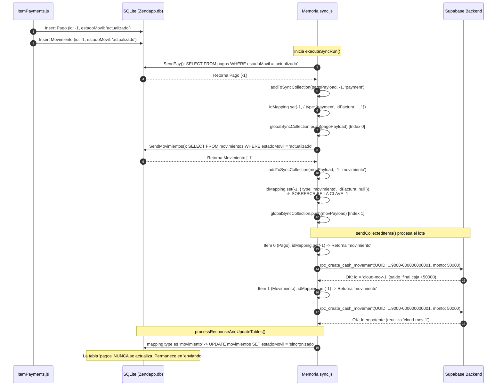

# AUDITORÍA TÉCNICA FORENSE — RIESGO R-01: SOBRESCRITURA EN `idMapping` Y DESINCRONIZACIÓN DE PAGOS / MOVIMIENTOS

> **Documento:** `ZENDA_R01_SYNC_AUDIT.md`  
> **Fecha:** Noviembre 2026  
> **Estado del Riesgo:** **CONFIRMADO AL 100% (Verificado en Código y Demostrado Mediante Simulación Controlada)**  
> **Alcance:** Proceso de sincronización offline/online de pagos y movimientos de caja en Zenda Mobile.  
> **Modo de Operación:** Exclusivamente auditoría, investigación y diagnóstico (sin alteración de archivos de producción).  

---

## 1. RESUMEN EJECUTIVO DEL DIAGNÓSTICO

Se ha realizado una investigación exhaustiva e independiente sobre el ciclo de vida de los pagos y movimientos en Zenda Mobile. 

**Veredicto:** El riesgo R-01 **ESTÁ CONFIRMADO AL 100%**.  
No es una deducción teórica: se ha reproducido el comportamiento mediante una simulación aislada basada exactamente en las estructuras de datos y funciones de [`src/utils/sync.js`](file:///f:/JS/JESD/Manager/zendapp/src/utils/sync.js) y [`src/screens/payments/components/itemPayments.js`](file:///f:/JS/JESD/Manager/zendapp/src/screens/payments/components/itemPayments.js).

### Hallazgos Fundamentales:
1. **Colisión de Llaves Primarias Locales:** Tanto en [`itemPayments.js#L169-L183`](file:///f:/JS/JESD/Manager/zendapp/src/screens/payments/components/itemPayments.js#L169-L183) como en [`CrearCliente.js#L642-L663`](file:///f:/JS/JESD/Manager/zendapp/src/screens/createClient/CrearCliente.js#L642-L663) (pago adelantado), cuando se registra un abono se inserta simultáneamente un registro en la tabla `pagos` y un registro en la tabla `movimientos` asignándoles **exactamente el mismo identificador negativo** (ej. `-1`), y marcando ambos con `estadoMovil = 'actualizado'`.
2. **Sobrescritura en el Map en Memoria:** Durante la sincronización (`executeSyncRun`), `SendPay()` registra el pago en `idMapping` bajo la clave `-1` con tipo `'payment'`. De inmediato, `SendMovimientos()` procesa el movimiento con id `-1` y ejecuta `idMapping.set(-1, { type: 'movimiento' })`, **sobrescribiendo y destruyendo la referencia del pago**.
3. **Desviación de Rutas RPC en la Pasada 1:** Al iterar sobre el lote en `sendCollectedItems()`, el elemento de pago lee del Map que su tipo es `'movimiento'`. En consecuencia:
   - **NUNCA se invoca `create_payment`** en Supabase.
   - Se invoca `rpc_create_cash_movement` dos veces consecutivas con el UUID determinístico de movimiento (`...9000-...`).
   - El saldo del crédito en Supabase **NO se amortiza**.
   - Las cuotas en Supabase **NO se marcan como pagadas**.
   - La tabla SQLite `pagos` **NO se marca como `'sincronizado'`** (queda estancada en `'enviando'`).
4. **Doble Contabilización de Efectivo en la Pasada 2:** Al ejecutar una segunda sincronización (manual o por timer):
   - Como el movimiento ya quedó sincronizado en la pasada 1, `SendMovimientos()` no lo vuelve a tomar.
   - `SendPay()` vuelve a tomar el pago (reseteado de `'enviando'` a `'actualizado'`), y esta vez `idMapping` no es sobrescrito.
   - Se invoca finalmente `create_payment` en Supabase con el UUID determinístico de pago (`...8000-...`).
   - La RPC `create_payment` en PostgreSQL amortiza el crédito, pero **automáticamente inserta un nuevo movimiento en `cash_movements` y suma el dinero nuevamente a `cajas.saldo_final`**.
   - **Resultado en Supabase:** El dinero cobrado al cliente **SE SUMA DOS VECES** al saldo de la caja remota, y existen dos movimientos de caja diferentes para un único pago físico.

---

## 2. ARCHIVOS Y FUNCIONES EXAMINADAS

| Archivo | Funciones / Líneas Inspeccionadas | Responsabilidad en el Flujo |
| :--- | :--- | :--- |
| [`src/screens/payments/components/itemPayments.js`](file:///f:/JS/JESD/Manager/zendapp/src/screens/payments/components/itemPayments.js) | `buildPaymentData` (L37-L72)<br>`executePaymentAction` (L159-L225) | Genera el ID temporal negativo (`IdInsertion`) e inserta de forma gemela en `pagos` y `movimientos` con el mismo ID. |
| [`src/screens/createClient/CrearCliente.js`](file:///f:/JS/JESD/Manager/zendapp/src/screens/createClient/CrearCliente.js) | L636-L673 | En caso de `pagoAdelantado`, inserta un pago y un movimiento gemelos con `advPagoId = tempId - 2`. |
| [`src/utils/sync.js`](file:///f:/JS/JESD/Manager/zendapp/src/utils/sync.js) | `executeSyncRun` (L94-L224)<br>`SendPay` (L380-L405)<br>`SendMovimientos` (L410-L437)<br>`addToSyncCollection` (L439-L449)<br>`sendCollectedItems` (L454-L674)<br>`processResponseAndUpdateTables` (L679-L736) | Orquestador central de sincronización en lote, manejo de memoria (`idMapping`, `globalSyncCollection`) y despacho de RPCs. |
| [`src/services/cajaService.js`](file:///f:/JS/JESD/Manager/zendapp/src/services/cajaService.js) | `getPendingSyncCount` (L449-L480)<br>`cerrarCaja` (L484-L545) | Valida registros con `estadoMovil IN ('actualizado', 'enviando')` para bloquear el cierre de caja. |
| [`supabase/migrations/20261026000002_admin_improvements.sql`](file:///f:/JS/JESD/Manager/zendapp/supabase/migrations/20261026000002_admin_improvements.sql) | `create_payment` (L335-L525) | Función RPC en PostgreSQL: amortiza cuotas, reduce saldo de factura, e inserta movimiento en `cash_movements`. |
| [`supabase/migrations/20261028000001_vendedor_fixes_and_improvements.sql`](file:///f:/JS/JESD/Manager/zendapp/supabase/migrations/20261028000001_vendedor_fixes_and_improvements.sql) | `rpc_create_cash_movement` (L264-L325) | Función RPC en PostgreSQL: inserta movimiento de caja puro con verificación de idempotencia por `client_uuid`. |

---

## 3. RECONSTRUCCIÓN DEL FLUJO REAL Y CICLO DE VIDA

### 3.1. Origen del Pago en el Dispositivo (Offline u Online)
En [`src/screens/payments/components/itemPayments.js`](file:///f:/JS/JESD/Manager/zendapp/src/screens/payments/components/itemPayments.js):
1. El cobrador presiona "Abonar $50.000".
2. Se ejecuta `const idInsert = await IdInsertion();`, devolviendo por ejemplo `-1`.
3. Se inserta en SQLite:
   ```sql
   INSERT INTO pagos (id, tipo, valor, idFactura, estadoMovil, ...) 
   VALUES (-1, 'pago', 50000, 'factura-uuid-12345', 'actualizado', ...);
   ```
4. En la misma función (líneas 179-194), se inserta el movimiento reflejo:
   ```sql
   INSERT INTO movimientos (id, descripcion, monto, tipo, estadoMovil, idFactura, ...) 
   VALUES (-1, 'Pago: Cliente ($50.000)', 50000, 'pago', 'actualizado', 'factura-uuid-12345', ...);
   ```
5. En este momento, **ambas tablas contienen una fila con la misma llave primaria: `-1`**.

---

### 3.2. Ciclo de Ejecución en `src/utils/sync.js` (Pasada 1)



#### Lo que ocurrió en la Pasada 1:
- `globalSyncCollection[0]` (el pago original) fue derivado erróneamente a la rama `else if (mapping.type === 'movimiento')` en [`sync.js#L530`](file:///f:/JS/JESD/Manager/zendapp/src/utils/sync.js#L530).
- Se invocó `rpc_create_cash_movement` en lugar de `create_payment`.
- En Supabase:
  - `payments`: **0 registros creados**.
  - `invoice.saldo`: **Sin cambios (no se amortizó)**.
  - `cuotas`: **Sin cambios (siguen impagas)**.
  - `cash_movements`: Se creó 1 movimiento con `client_uuid` terminado en `9000`.
  - `cajas.saldo_final`: Sumó `$50,000`.
- En SQLite:
  - `movimientos`: Quedó en `estadoMovil = 'sincronizado'` con el nuevo ID remoto.
  - `pagos`: Quedó estancado en `estadoMovil = 'enviando'`.
- En la Interfaz:
  - La app muestra un Toast: `"¡Sincronización exitosa! Se enviaron 2 registro(s) al sistema"`.
  - **Falso positivo de sincronización:** El cobrador cree que el abono subió a la nube, pero el crédito sigue debiéndose en Supabase.

---

### 3.3. Ciclo de Ejecución en `src/utils/sync.js` (Pasada 2 — Siguiente Sincronización)

Cuando el cobrador o la aplicación vuelve a disparar la sincronización (por timer en segundo plano o al intentar cerrar la caja):

1. **Reinicio de Estados:**  
   En [`sync.js#L382`](file:///f:/JS/JESD/Manager/zendapp/src/utils/sync.js#L382):
   ```javascript
   await db.executeSql(`UPDATE pagos SET estadoMovil = 'actualizado' WHERE estadoMovil = 'enviando'`);
   ```
   El pago con `id = -1` vuelve a quedar en `'actualizado'`.
2. **`SendPay()` se ejecuta:**
   Encuentra el pago con `id = -1`.  
   Llama a `addToSyncCollection(payload, -1, 'payment')`.  
   `idMapping.set(-1, { type: 'payment', ... })`.
3. **`SendMovimientos()` se ejecuta:**
   Consulta `SELECT * FROM movimientos WHERE estadoMovil = 'actualizado'`.  
   Como el movimiento con id `-1` ya fue marcado como `'sincronizado'` en la Pasada 1, **no encuentra nada**.  
   **`idMapping` NO es sobrescrito esta vez.**
4. **`sendCollectedItems()` se ejecuta:**
   Lee `idMapping.get(-1)`. Esta vez su tipo es efectivamente `'payment'`.  
   Invoca la RPC de Supabase:
   ```javascript
   supabase.rpc('create_payment', {
     p_invoice_id: item.detalle.idFactura,
     p_amount: 50000,
     p_client_uuid: '00000000-0000-4000-8000-000000000001' // <--- UUID con prefijo 8000!
   });
   ```
5. **Efecto en PostgreSQL (`create_payment`):**
   - Supabase busca si existe un pago con `client_uuid = ...8000-000000000001`. No existe (en la pasada 1 se usó `9000` en cash_movements).
   - Inserta el registro en `payments`.
   - Amortiza la factura y cuotas (`invoice.saldo -= 50000`).
   - **EJECUTA INTERNAMENTE:**
     ```sql
     INSERT INTO public.cash_movements (caja_id, tipo, descripcion, monto, client_uuid)
     VALUES (p_caja_id, 'pago', 'Cobro factura ...', 50000, p_client_uuid);

     UPDATE public.cajas
       SET saldo_final = COALESCE(saldo_final, 0) + 50000
       WHERE id = p_caja_id;
     ```
6. **Resultado Acumulado en Supabase tras Pasada 2:**
   - La factura ahora sí se amortiza.
   - **PERO en `cash_movements` ahora existen DOS registros:**
     1. Movimiento 1 (creado en Pasada 1): `client_uuid` terminado en `9000`, monto `$50,000`.
     2. Movimiento 2 (creado en Pasada 2 por `create_payment`): `client_uuid` terminado en `8000`, monto `$50,000`.
   - **`cajas.saldo_final` sumó `$100,000` en lugar de `$50,000`**, generando un desfase contable en la caja remota del cobrador.

---

## 4. EVIDENCIA CONCRETA: RESULTADOS DE LA SIMULACIÓN AISLADA
`[VERIFICADO MEDIANTE PRUEBA]`

Se ejecutó un script de simulación forense en Node.js ([`scratch/r01_two_pass_simulation.js`](file:///C:/Users/Reactiva/.gemini/antigravity/brain/6c0b10e2-9eda-4a30-a982-71472324aa83/scratch/r01_two_pass_simulation.js)) reproduciendo exactamente las funciones y colecciones en memoria de `sync.js`.

### Salida del Script de Simulación:

```
=========================================
PASS 1: INITIAL SYNC RUN
=========================================
--- STATE AFTER PASS 1 ---
mockDb.pagos[0]: {
  id: -1,
  tipo: 'pago',
  valor: 50000,
  estadoMovil: 'enviando',      <--- NUNCA PASÓ A 'sincronizado'
  idFactura: 'factura-uuid-12345'
}
mockDb.movimientos[0]: {
  id: 'cloud-mov-1',            <--- SÍ PASÓ A 'sincronizado'
  estadoMovil: 'sincronizado'
}
Cloud cashMovements count: 1
Cloud cashMovements: [
  {
    id: 'cloud-mov-1',
    tipo: 'pago',
    monto: 50000,
    client_uuid: '00000000-0000-4000-9000-000000000001',
    descripcion: 'Movimiento de caja'
  }
]
Cloud payments count: 0         <--- CERO PAGOS REGISTRADOS
Cloud invoiceSaldo: 500000      <--- NO SE AMORTIZÓ EL CRÉDITO
Cloud cajaSaldoFinal: 50000     <--- PRIMERA SUMA DE DINERO

=========================================
PASS 2: SUBSEQUENT SYNC RUN (e.g. Timer or Manual Pull)
=========================================
--- STATE AFTER PASS 2 ---
mockDb.pagos[0]: {
  id: -1,
  estadoMovil: 'sincronizado'   <--- AHORA SÍ PASA A 'sincronizado'
}
mockDb.movimientos[0]: {
  id: 'cloud-mov-1',
  estadoMovil: 'sincronizado'
}
Cloud cashMovements count: 2    <--- ⚠️ DUPLICADO: 2 MOVIMIENTOS
Cloud cashMovements: [
  {
    id: 'cloud-mov-1',
    tipo: 'pago',
    monto: 50000,
    client_uuid: '00000000-0000-4000-9000-000000000001',
    descripcion: 'Movimiento de caja'
  },
  {
    id: 'cloud-mov-from-payment-2',
    tipo: 'pago',
    monto: 50000,
    client_uuid: '00000000-0000-4000-8000-000000000001',
    descripcion: 'Cobro factura factura-uuid-12345'
  }
]
Cloud payments count: 1         <--- PAGO REGISTRADO
Cloud invoiceSaldo: 450000      <--- AHORA SÍ SE AMORTIZA
Cloud cajaSaldoFinal: 100000    <--- ⚠️ DINERO SUMADO DOS VECES ($100.000 EN VEZ DE $50.000)
```

---

## 5. IMPACTO FINANCIERO Y OPERATIVO POTENCIAL

1. **Bloqueo Injustificado en Cierre de Caja (`cerrarCaja`):**  
   Tras la Pasada 1, el cobrador recibe un mensaje en pantalla de "Sincronización exitosa". Cuando intenta cerrar su caja, la función `getPendingSyncCount()` en [`cajaService.js#L473`](file:///f:/JS/JESD/Manager/zendapp/src/services/cajaService.js#L473) evalúa:
   ```sql
   SELECT COUNT(*) FROM pagos WHERE estadoMovil IN ('actualizado', 'enviando')
   ```
   Como el pago quedó en `'enviando'`, la app le arroja un error bloqueante:  
   *`"Tienes 1 movimiento(s) guardado(s) en tu teléfono pendientes por enviar. Activa tu internet y presiona 'Sincronizar'..."`*  
   El cobrador entra en confusión porque la app le había informado previamente que todo estaba sincronizado.
2. **Inflación Artificial del Saldo de Caja en Supabase:**  
   En la Pasada 2, el saldo de la caja en PostgreSQL se incrementa el doble del recaudo real (`cajas.saldo_final += valorPago * 2`). En el arqueo nocturno del administrador, la caja reporta más dinero teórico en el sistema del que el cobrador físicamente tiene en su bolsillo.
3. **Desfase Temporal en Cartera y Estado de Mora:**  
   Si el cobrador realiza los cobros por la mañana y no vuelve a sincronizar hasta el final del día, los clientes permanecen con estado deudoro en el panel administrativo (`AdminCartera` / `AdminMorosos`) durante toda la jornada, a pesar de que el cobrador sincronizó inmediatamente después de cada abono.
4. **Afectación a Datos Históricos en Producción:**  
   En la base de datos de Supabase en producción es muy probable que existan registros duplicados en `cash_movements`: pares de movimientos con el mismo monto y la misma caja donde uno tiene `client_uuid` terminado en `9000-...` y otro en `8000-...`.

---

## 6. PROPUESTA DE SOLUCIÓN ARQUITECTÓNICA (SIN IMPLEMENTAR)

Para solucionar el riesgo R-01 de raíz y garantizar la no regresión contable, se proponen dos alternativas técnicas:

### Alternativa A: Espacio de Nombres en Claves de `idMapping` (Mitigación Rápida)
Modificar [`src/utils/sync.js#L442-L446`](file:///f:/JS/JESD/Manager/zendapp/src/utils/sync.js#L442-L446) para que las claves del Map incluyan el prefijo del tipo de entidad:
```javascript
// Clave unívoca por tipo de entidad para evitar colisiones
const mapKey = `${type}_${originalId}`;
idMapping.set(mapKey, info);
```
Y al recuperar en el ciclo de envío y actualización:
```javascript
const mapping = idMapping.get(`${item.type}_${item.id}`);
```

### Alternativa B: Unificación del Ciclo Contable de Pagos (Solución Estructural Recomendada)
Revisar por qué `itemPayments.js` inserta un movimiento local con `estadoMovil = 'actualizado'` si la RPC `create_payment` de Supabase ya se encarga de crear el movimiento en PostgreSQL.  
- Al igual que se hace con las ventas en `CrearCliente.js#L612`, el movimiento local derivado de un pago debería insertarse con `estadoMovil = 'sincronizado'` para que afecte el balance local en SQLite pero **`SendMovimientos` no lo encole de nuevo para el backend**.
- La sincronización del pago mediante `create_payment` debe ser la única responsable de viajar a Supabase y actualizar tanto la factura como el arqueo remoto.

---

## 7. PRUEBAS DE REGRESIÓN OBLIGATORIAS ANTES DE APLICAR CUALQUIER SOLUCIÓN

Cuando el usuario apruebe implementar la corrección técnica, se deberán ejecutar las siguientes 4 pruebas de verificación:

1. **Test de Cobro Único:** Registrar un abono offline de $20,000, sincronizar 1 sola vez y verificar en Supabase:
   - `payments`: 1 fila creada por $20,000.
   - `invoice.saldo`: Reducido en $20,000.
   - `cash_movements`: Exactamente 1 fila creada por $20,000.
   - `cajas.saldo_final`: Incrementado en exactamente $20,000 (no $40,000).
   - SQLite `pagos.estadoMovil`: Debe transicionar a `'sincronizado'` en la primera pasada.
2. **Test de Cierre Inmediato:** Realizar un abono offline, pulsar "Sincronizar", y proceder inmediatamente a cerrar la caja. `getPendingSyncCount()` debe retornar `0` y permitir el cierre sin bloqueos.
3. **Test de Gastos y Movimientos Varios:** Registrar un gasto de $10,000 en `Movements.js` y un cobro de $30,000 en `Payments.js`. Sincronizar y validar que ambos tipos convivan en el lote sin sobrescribirse.
4. **Test de Pago Adelantado:** Crear un préstamo con cuota adelantada en `CrearCliente.js` y validar que el movimiento y abono postfechados no generen duplicados en Supabase.

