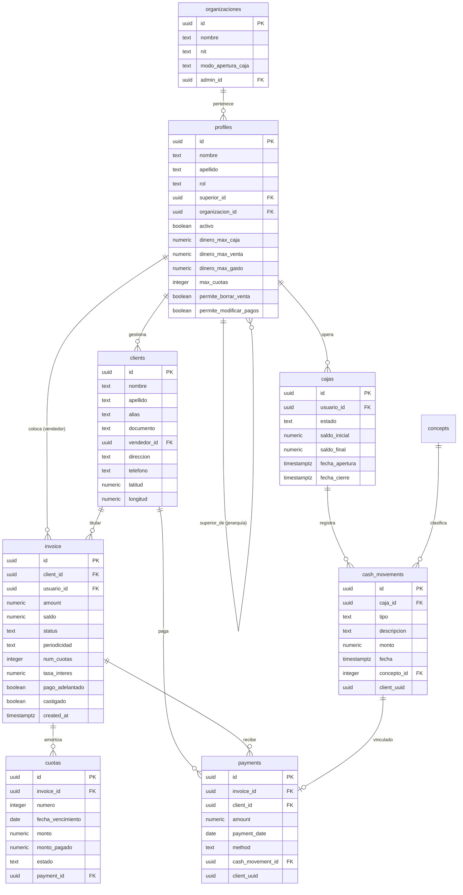
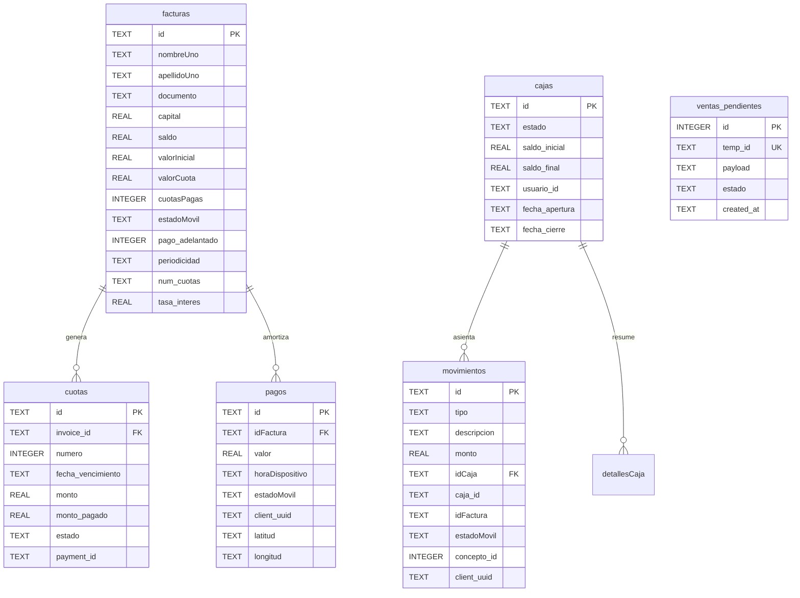

# ZENDA — AUDITORÍA TÉCNICA DE INTERNACIONALIZACIÓN GEOGRÁFICA Y MONETARIA
> **Documento:** Auditoría previa a la implementación de multi-país y multi-moneda  
> **Fecha:** Noviembre 2026  
> **Versión:** 1.0.0  
> **Estado:** Aprobado para ejecución  
> **Entorno:** React Native CLI (0.77.0) · Supabase (PostgreSQL 15) · SQLite (`react-native-sqlite-storage`)

---

## 1. ARQUITECTURA ACTUAL IDENTIFICADA

### 1.1. Resumen Ejecutivo
Zenda es una plataforma financiera y operativa diseñada bajo el paradigma **Offline-First**, orientada a la gestión de microcréditos, cobranza en ruta, apertura/cierre de cajas y supervisión administrativa de carteras.

La plataforma opera en tres capas principales:
1. **Frontend Móvil (React Native 0.77.0 en JavaScript / Hermes habilitado):**
   - Interfaz con componentes adaptados al estilo Apple / iOS (`appleTheme.js`).
   - Gestión de estado mediante `AuthContext` (sesión, usuario, perfil, permisos) y un bus de eventos en memoria desacoplado (`eventBus.js`).
   - Persistencia local transaccional mediante `react-native-sqlite-storage` que opera sobre la base de datos `Zendapp.db` clonada inicialmente desde `android/app/src/main/assets/www/Zendapp.db`.
2. **Capa de Sincronización Bidireccional (`src/utils/sync.js`):**
   - Escritura local obligatoria inmediata con marcas de estado (`estadoMovil = 'actualizado'`).
   - Orquestación en segundo plano disparada reactivamente por operaciones y monitoreo de conectividad mediante `@react-native-community/netinfo`.
   - Empuje atómico hacia Supabase mediante Funciones RPC transaccionales (`create_sale`, `create_payment`, `rpc_create_cash_movement`).
   - Reconciliación post-sync y refresco incremental de cartera activa (`get_invoices_vendedor`).
3. **Backend Cloud (Supabase / PostgreSQL 15):**
   - Autenticación mediante Supabase Auth (`auth.users`, `auth.identities`).
   - Esquema relacional con Row Level Security (RLS) activo en todas las tablas.
   - Lógica de negocio crítica concentrada en más de 25 funciones RPC transaccionales con privilegios `SECURITY DEFINER`.
   - Almacenamiento de comprobantes y fotos de pagarés en Supabase Storage (bucket privado `Evidencias`).

---

## 2. DIAGRAMA DE RELACIONES RELEVANTES

### 2.1. Modelo Relacional PostgreSQL (Supabase)



### 2.2. Modelo Relacional Local SQLite (`Zendapp.db`)



---

## 3. FUNCIONAMIENTO ACTUAL DE ROLES Y JERARQUÍAS

### 3.1. Identificación del Admin Raíz y Estructura Organizacional
- **Admin Raíz:** Se identifica técnicamente en `profiles` por tener `rol = 'admin'` y `superior_id IS NULL`. Representa al dueño de la organización y administrador principal.
- **Administradores Secundarios:** Tienen `rol = 'admin'` y `superior_id = <admin_padre_id>`. Pueden supervisar a los vendedores y sub-administradores asignados a su rama jerárquica.
- **Vendedores (Cobradores):** Tienen `rol = 'vendedor'` y `superior_id = <admin_id>`. Operan en ruta directamente con la aplicación móvil en cuatro pestañas (`Payments`, `CrearCliente`, `Movements`, `Caja`).
- **Clientes:** Tienen `rol = 'cliente'` o registros en `clients` vinculados al `vendedor_id`.

### 3.2. Reglas de Validación y Permisos en Base de Datos
- **Función `public.is_admin()`:** Valida si el usuario en sesión (`auth.uid()`) tiene rol `'admin'`.
- **Función recursiva `public.is_same_hierarchy(target_user uuid)`:** Determina si un usuario objetivo desciende del usuario en sesión o si es él mismo.
- **Función recursiva `public._is_descendant_of(child_id, ancestor_id)`:** Verifica en árbol recursivo si `child_id` pertenece al linaje de `ancestor_id`.
- **Creación de Usuarios (`admin_create_user`):**
  - Solo un usuario administrador puede invocarla (`is_admin()`).
  - Hereda automáticamente el `organizacion_id` del administrador creador.
  - El parámetro `p_superior_id` es opcional; si no se especifica, se asigna `auth.uid()`. Si se especifica otro superior, debe validarse que sea descendiente del administrador actual con `_is_descendant_of`.
  - Crea simultáneamente el registro en `auth.users`, `auth.identities` y `public.profiles`.
  - Si el usuario es vendedor, inicializa automáticamente su caja inicial con el saldo configurado.

---

## 4. FUNCIONAMIENTO ACTUAL DE MONEDAS Y CÁLCULOS

### 4.1. Asunciones Explícitas e Implícitas de Colombia (COP)
1. **Formateo Monetario Quemado en Frontend:**
   - La gran mayoría de pantallas (`AdminCajaDetalle.js`, `AdminCartera.js`, `AdminCarteraDetalle.js`, `AdminMorosos.js`, `AdminReportes.js`, `CajaCard.js`, `CarteraUserCard.js`, `UserCard.js`) tienen funciones locales:
     ```javascript
     const formatMoney = (val) => {
       const num = parseFloat(val) || 0;
       return '$' + num.toLocaleString('es-CO');
     };
     ```
   - En `src/utils/utilities.js`:
     - `FormatMoney(value)` concatena `'$ ' + NumberWithCommas(value)`.
     - `NumberWithCommas(value)` elimina caracteres no numéricos con `replace(/[^0-9]/g, "")` y convierte con `parseInt()`, **destruyendo completamente cualquier decimal**.
     - `formatMoneyInput(value)` usa expresión regular `replace(/\B(?=(\d{3})+(?!\d))/g, '.')` asumiendo punto para miles, estilo pesos colombianos.
     - `cleanMoneyValue(value)` elimina todo caracter no dígito con `\D`, impidiendo el ingreso de separadores decimales requeridos para monedas fraccionarias como PEN y MXN.
2. **Zona Horaria Quemada en Backend y Triggers:**
   - En la migración `20261104000003_strict_single_caja_per_day.sql`:
     ```sql
     CREATE OR REPLACE FUNCTION public._check_single_caja_per_day() ...
     DECLARE
       v_tz text := 'America/Bogota';
     ```
     El límite de una caja diaria por usuario se calcula forzando la zona horaria colombiana `America/Bogota`.
   - En la migración `20261105000001_admin_hierarchical_navigation.sql` (`admin_get_cajas`):
     ```sql
     AND (c.fecha_apertura AT TIME ZONE 'America/Bogota')::date >= p_fecha_ini
     ```
     El filtro de fechas de arqueos y cajas se calcula con `America/Bogota`.
3. **Ausencia de Código de Moneda en Transacciones:**
   - Ni `invoice`, ni `cuotas`, ni `payments`, ni `cajas`, ni `cash_movements` poseen actualmente columna `currency_code`.
   - Todos los montos se asumen implícitamente en Pesos Colombianos (COP) enteros.

### 4.2. Precisión y Redondeo Financiero
- En PostgreSQL: los montos se almacenan como `numeric(14,2)` o `numeric`.
- En SQLite: se almacenan como `REAL`.
- Intereses en `create_sale` y `CrearCliente.js`:
  $$\text{Interés} = \text{round}(\text{Capital} \times \text{Tasa}) \quad\text{(redondeo a 2 decimales en SQL)}$$
- Cuotas:
  $$\text{Cuota Base} = \text{floor}\left(\frac{\text{Total}}{\text{NumCuotas}}\right)$$
  $$\text{Última Cuota} = \text{Total} - (\text{Cuota Base} \times (\text{NumCuotas} - 1))$$
  El residuo siempre se suma a la última cuota para evitar pérdida de centavos/fracciones.

---

## 5. DEPENDENCIAS ENTRE SUPABASE, SQLITE Y REACT NATIVE

```
┌────────────────────────────────────────────────────────┐
│                      SUPABASE                          │
│  - profiles (superior_id, organizacion_id)             │
│  - invoice, cuotas, payments, cajas, cash_movements    │
│  - RPC: create_sale, create_payment, admin_create_user │
│  - Edge Functions: get-user-profile                    │
└────────────────────────▲───────────────────────────────┘
                         │ HTTPS / RPC / PostgREST
                         │ (Sincronización Idempotente)
┌────────────────────────▼───────────────────────────────┐
│                   SYNC ENGINE                          │
│  - sync.js: SendVentas(), SendPay(), SendMovimientos() │
│  - UUIDs Determinísticos por client_uuid               │
│  - Descarga de cartera: get_invoices_vendedor          │
└────────────────────────▲───────────────────────────────┘
                         │ Transacciones SQLite
┌────────────────────────▼───────────────────────────────┐
│                    SQLITE                              │
│  - Zendapp.db: facturas, cuotas, pagos, cajas, movs    │
│  - parametrizacion: credenciales offline, perfil local │
│  - ventas_pendientes, evidencias_locales               │
└────────────────────────▲───────────────────────────────┘
                         │ State / Props / Events
┌────────────────────────▼───────────────────────────────┐
│                  REACT NATIVE                          │
│  - AuthContext (perfil en memoria y AsyncStorage)      │
│  - UI: Admin (Usuarios, Cartera, Cajas), Vendedor      │
│  - Hermes JS Engine (Intl NumberFormat soportado)      │
└────────────────────────────────────────────────────────┘
```

---

## 6. ARCHIVOS QUE NECESITAN MODIFICACIONES

### 6.1. Backend Supabase (`supabase/migrations/`)
- Nueva migración: `supabase/migrations/20261114000001_internationalization_geo_currency.sql`
  - Creación de tablas `currencies`, `countries`, `administrative_divisions`, `cities`.
  - Ampliación de `profiles` con `country_id`, `administrative_division_id`, `city_id`, `currency_code`, `locale`, `timezone`.
  - Ampliación de `invoice`, `cuotas`, `payments`, `cajas`, `cash_movements` con `currency_code`.
  - Actualización de trigger `_check_single_caja_per_day` para usar dinámicamente `timezone` del usuario.
  - Actualización de RPCs: `admin_create_user`, `admin_update_user`, `create_sale`, `create_payment`, `admin_get_cajas`, `admin_get_subordinates`.
  - Asignación retroactiva controlada de datos preexistentes a Colombia (`COP`, `es-CO`, `America/Bogota`).

### 6.2. Persistencia SQLite y Servicios Locales
- `src/database/db.js`:
  - Agregar tablas `currencies`, `countries`, `administrative_divisions`, `cities`.
  - Añadir columnas `currency_code` a `facturas`, `cuotas`, `pagos`, `cajas`, `movimientos`.
  - Añadir columnas de configuración territorial a `parametrizacion` o tabla local de usuario.
- `src/utils/sync.js`:
  - Mantener `currency_code` en payloads de ventas, pagos y movimientos sincronizados.
  - Sincronización del catálogo geográfico hacia SQLite sin sobrecargar la red.
- `src/services/services.js`:
  - Actualizar `AuthService.login` para persistir configuración regional en SQLite y AsyncStorage.
  - Sincronizar catálogo geográfico inicial.
- `src/services/adminService.js`:
  - Adaptar llamadas RPC (`createAdminUser`, `updateAdminUser`, `getSubordinates`, `getCajas`) para incluir datos territoriales y moneda.
- `src/services/cajaService.js`:
  - Consultar `timezone` y `currency_code` del perfil activo en lugar de quemar `'America/Bogota'`.

### 6.3. Servicio Centralizado de Moneda y Formato
- Crear `src/utils/currency.js`:
  - Servicio centralizado para formateo de importes, símbolos, decimales y separadores según ISO de moneda y locale.
  - Reemplazo y deprecación controlada de formatters rígidos de `utilities.js`.
- Modificar `src/utils/utilities.js`:
  - Ajustar `FormatMoney`, `FormatMoneyDecimales`, `cleanMoneyValue` y `formatMoneyInput` para delegar en `src/utils/currency.js` con retrocompatibilidad.

### 6.4. Formularios e Interfaz de Usuario
- `src/screens/admin/components/UserModal.js`:
  - Flujo progresivo: Rol → País → Departamento/Estado → Ciudad → Detección automática de Moneda, Locale y Zona Horaria.
- `src/screens/admin/AdminUsuarios.js`:
  - Mostrar país/ciudad/moneda en las tarjetas de usuario.
- `src/screens/admin/components/UserCard.js`:
  - Badge territorial y uso del servicio centralizado de moneda por usuario/caja.
- `src/screens/admin/AdminCajas.js` y `AdminCajaDetalle.js`:
  - Formato dinámico según la moneda de la caja.
- `src/screens/admin/AdminCartera.js` y `AdminCarteraDetalle.js`:
  - Formato según moneda de los créditos.
- `src/screens/admin/AdminMorosos.js` y `AdminReportes.js`:
  - Formato monetario internacionalizado.
- `src/screens/payments/Payments.js` y `itemPayments.js`:
  - Desplegar importe y saldos con la moneda correspondiente.
- `src/screens/caja/Caja.js`:
  - Indicador de moneda en caja del vendedor.
- `src/screens/createClient/CrearCliente.js`:
  - Asignar moneda del vendedor a la nueva venta sin restringir el cliente a la ciudad del vendedor.
- `src/components/PaymentReceiptModal.js`:
  - Comprobante digital con símbolo y código de moneda correspondiente.

---

## 7. TABLAS QUE NECESITAN MODIFICACIONES

| Tabla | Capa | Modificación requerida |
| :--- | :--- | :--- |
| **`currencies`** (NUEVA) | Supabase & SQLite | Catálogo ISO 4217: `code` (PK), `nombre`, `symbol`, `decimal_digits`, `enabled`. |
| **`countries`** (NUEVA) | Supabase & SQLite | `id` (PK), `iso2`, `iso3`, `nombre`, `currency_code` (FK), `locale`, `timezone_default`, `enabled`. |
| **`administrative_divisions`** (NUEVA) | Supabase & SQLite | `id` (PK), `country_id` (FK), `parent_id` (FK), `nombre`, `division_type`, `source`, `source_id`. |
| **`cities`** (NUEVA) | Supabase & SQLite | `id` (PK), `country_id` (FK), `administrative_division_id` (FK), `nombre`, `geoname_id`, `latitude`, `longitude`, `timezone`, `source`, `enabled`. |
| **`profiles`** | Supabase & SQLite | Columnas: `country_id` (FK), `administrative_division_id` (FK), `city_id` (FK), `currency_code` (FK), `locale`, `timezone`. |
| **`invoice`** | Supabase & SQLite | Columna: `currency_code` (FK a currencies, default `'COP'`). |
| **`payments`** | Supabase & SQLite | Columna: `currency_code` (FK a currencies, default `'COP'`). |
| **`cuotas`** | Supabase & SQLite | Columna: `currency_code` (FK a currencies, default `'COP'`). |
| **`cajas`** | Supabase & SQLite | Columna: `currency_code` (FK a currencies, default `'COP'`). |
| **`cash_movements`** | Supabase & SQLite | Columna: `currency_code` (FK a currencies, default `'COP'`). |

---

## 8. RIESGOS DE COMPATIBILIDAD

1. **Riesgo 1: Pérdida o corrupción de datos preexistentes**  
   - *Mitigación:* Ninguna columna nueva será `NOT NULL` sin un valor por defecto seguro (`DEFAULT 'COP'`). Se asignará retroactivamente Colombia (`country_id` de Colombia, `COP`, `es-CO`, `America/Bogota`) a los registros históricos preexistentes sin alterar montos ni saldos.
2. **Riesgo 2: Clientes multi-organización y restricciones de documento**  
   - *Mitigación:* Se mantendrá intacta la regla que permite que un mismo documento exista en diferentes organizaciones o con distintos vendedores. No se creará restricción `UNIQUE` global en `clients.documento`.
3. **Riesgo 3: Formateo monetario en entornos Hermes (React Native)**  
   - *Mitigación:* React Native 0.77 cuenta con Hermes nativo que soporta `Intl.NumberFormat`. Sin embargo, `src/utils/currency.js` incluirá un fallback robusto en caso de ausencia o fallo de locale en versiones específicas.
4. **Riesgo 4: Operaciones offline con moneda inconsistente**  
   - *Mitigación:* Al crear una venta, cuotas o pagos offline en SQLite, el `currency_code` se grabará directamente en el registro local. Durante la sincronización posterior, la RPC de Supabase validará que la moneda recibida coincida con la moneda de la factura y de la caja.
5. **Riesgo 5: Cálculo de medianoche y apertura de cajas en países con distinta zona horaria**  
   - *Mitigación:* La función `_check_single_caja_per_day` y los filtros de `admin_get_cajas` consultarán la zona horaria del usuario asociado a la caja, en lugar de asumir `'America/Bogota'`.

---

## 9. ESTRATEGIA DE MIGRACIÓN DE DATOS EXISTENTES

1. **Paso 1: Población previa de catálogos base**  
   - Insertar monedas (`COP`, `MXN`, `PEN`, `CLP`, `USD`).
   - Insertar países (`CO`, `MX`, `PE`, `CL`).
   - Insertar divisiones administrativas y ciudades principales desde GeoNames.
2. **Paso 2: Migración DDL no destructiva**  
   - Agregar columnas territoriales y monetarias con `ALTER TABLE ... ADD COLUMN IF NOT EXISTS`.
3. **Paso 3: Backfill de datos históricos**  
   - Actualizar `profiles` preexistentes que carezcan de país asignándoles Colombia, `COP`, `es-CO`, `America/Bogota`.
   - Si existen organizaciones sin país, asignar Colombia.
   - Actualizar `invoice`, `payments`, `cuotas`, `cajas`, `cash_movements` preexistentes que tengan `currency_code IS NULL` con `currency_code = 'COP'`.
4. **Paso 4: Verificación de consistencia**  
   - Comprobar que ningún saldo, estado o clave primaria/foránea se haya visto alterado.

---

## 10. PROPUESTA DE IMPLEMENTACIÓN

La implementación se estructura en las siguientes fases secuenciales sin interrupción de la operación existente:

- **Fase 1: Catálogo Geográfico y GeoNames (Etapa 3):**
  - Scripts SQL y dataset inicial optimizado para Colombia, México, Perú y Chile.
- **Fase 2: Esquema Supabase y Migraciones (Etapas 4, 7, 9, 10):**
  - Migración SQL idempotente y retrocompatible.
  - Actualización de RPCs (`admin_create_user`, `admin_update_user`, `create_sale`, `create_payment`, etc.).
- **Fase 3: Servicio Centralizado de Moneda (Etapa 6):**
  - Implementación de `src/utils/currency.js` con soporte para decimales, separadores de miles y locales.
- **Fase 4: Adaptación de SQLite y Sincronización Offline (Etapas 7, 8):**
  - Actualización de `src/database/db.js` y `src/utils/sync.js`.
- **Fase 5: Formularios de Usuario e Interfaz (Etapa 5):**
  - Componente modal progresivo en `UserModal.js`.
  - Adaptación de pantallas administrativas y operativas al servicio de moneda.
- **Fase 6: Batería de Pruebas y Validación de Escenarios (Etapa 11):**
  - Validación de los 8 escenarios obligatorios.
- **Fase 7: Documentación Final de Entrega (Etapa 12).**

