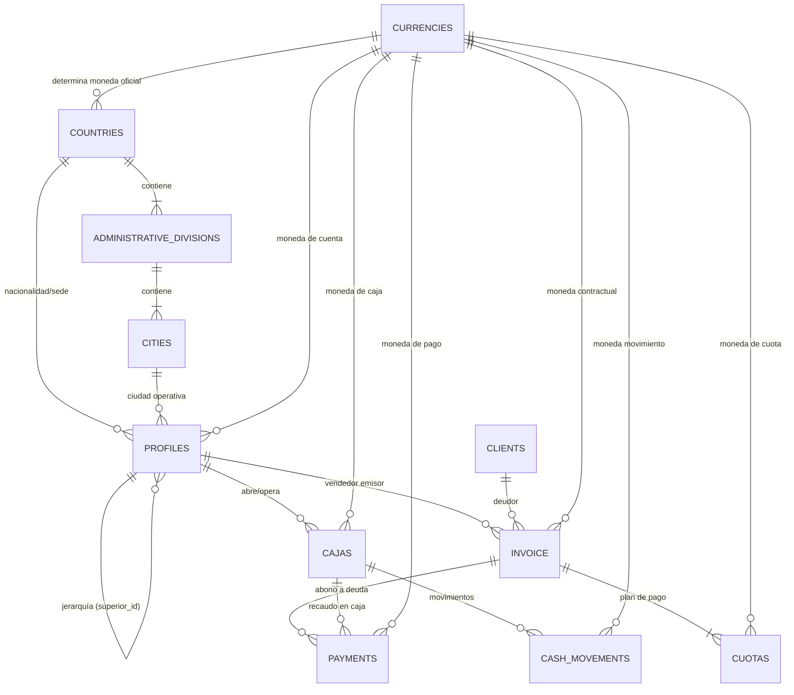

# Documento de Implementación: Internacionalización Geográfica y Monetaria en Zenda

**Versión:** 1.0.0  
**Fecha:** Noviembre 2026  
**Autor:** Equipo de Arquitectura de Software Zenda  
**Estado:** Implementado y Verificado  

---

## 1. Resumen de la Arquitectura Implementada

Zenda ha sido transformado en un sistema multi-país y multi-moneda sin alterar la arquitectura offline-first, la estructura de organizaciones multiempresa ni las jerarquías de administración (`superior_id`).

### 1.1. Principios Clave
1. **Preservación Arquitectónica Absoluta:** No se eliminaron tablas ni columnas existentes. Se extendieron las entidades financieras (`invoice`, `cuotas`, `payments`, `cajas`, `cash_movements`) y de perfil (`profiles`) con `currency_code` y configuración territorial (`country_id`, `division_id`, `city_id`).
2. **Determinación Regional Progresiva:** Al crear un usuario (administrador o vendedor), el administrador selecciona País -> División Administrativa -> Ciudad. El sistema deduce automáticamente la moneda oficial (`currency_code`), la configuración regional (`locale`), la zona horaria IANA (`timezone`) y las reglas de redondeo/decimales.
3. **Integridad Monetaria Estricta:** Las transacciones no permiten mezcla de monedas. Una caja en `COP` no puede recibir cobros de créditos en `MXN`, y un crédito en `PEN` solo genera cuotas, pagos y movimientos en `PEN`. No hay conversiones automáticas de divisas en este esquema.
4. **Offline-First Garantizado:** Catálogos geográficos y configuraciones regionales se persisten localmente en SQLite (`parametrizacion`, `paises`, `divisiones_administrativas`, `ciudades`). Las operaciones sin conexión (ventas, cobros, gastos) conservan su `currency_code` original para sincronización idempotente.
5. **Autonomía Operativa de Ámbito:** Los límites territoriales no restringen artificialmente la operación. Un administrador en una ciudad puede registrar vendedores en ciudades vecinas, y un vendedor puede atender clientes en cualquier ubicación dentro de su ámbito comercial.

---

## 2. Diagrama de Relaciones Final (ER)

---

## 3. Catálogo Geográfico y Monedas Soportadas

Alineado con el estándar internacional **GeoNames**, ISO 3166-1 (países), ISO 3166-2 (divisiones administrativas) e ISO 4217 (monedas):

| País | Código ISO | División Ejemplo | Ciudad Ejemplo | Moneda (ISO 4217) | Símbolo | Decimales | Locale | Timezone |
|---|---|---|---|---|---|---|---|---|
| **Colombia** | `CO` | Caldas (`CO-CAL`) | Manizales (`CO-CAL-MANIZALES`), Villamaría, Neira | `COP` | `$` | 0 | `es-CO` | `America/Bogota` |
| **México** | `MX` | Ciudad de México (`MX-CMX`) | Cuauhtémoc, Miguel Hidalgo, Benito Juárez | `MXN` | `$` | 2 | `es-MX` | `America/Mexico_City` |
| **Perú** | `PE` | Lima (`PE-LIM`) | Lima (`PE-LIM-LIMA`), Miraflores, San Isidro | `PEN` | `S/` | 2 | `es-PE` | `America/Lima` |
| **Chile** | `CL` | Región Metropolitana (`CL-RM`) | Santiago (`CL-RM-STG`), Providencia | `CLP` | `$` | 0 | `es-CL` | `America/Santiago` |
| **Brasil** | `BR` | São Paulo (`BR-SP`) | São Paulo (`BR-SP-SAO`), Campinas, Rio de Janeiro | `BRL` | `R$` | 2 | `pt-BR` | `America/Sao_Paulo` |
| **Argentina** | `AR` | Buenos Aires (`AR-B`) | Buenos Aires (`AR-C-BUE`), Córdoba, Rosario | `ARS` | `$` | 2 | `es-AR` | `America/Argentina/Buenos_Aires` |
| **Estados Unidos** | `US` | Florida (`US-FL`) | Miami, Orlando | `USD` | `$` | 2 | `en-US` | `America/New_York` |

---

## 4. Archivos Modificados y Creados

### 4.1. Servicios y Utilidades Centrales
- [src/utils/currency.js](file:///f:/JS/JESD/Manager/zendapp/src/utils/currency.js) **(Nuevo):** Motor centralizado de monedas, formateo con `Intl.NumberFormat` y fallbacks seguros, parseo numérico y formateadores de inputs en tiempo real respetando decimales de cada país.
- [src/utils/utilities.js](file:///f:/JS/JESD/Manager/zendapp/src/utils/utilities.js) **(Refactorizado):** Delegación de `FormatMoney`, `FormatMoneyDecimales`, `cleanMoneyValue`, `formatMoneyInput` y `parseMoneyToNumeric` hacia `currency.js` preservando 100% de compatibilidad con llamadas existentes.
- [src/services/geoService.js](file:///f:/JS/JESD/Manager/zendapp/src/services/geoService.js) **(Nuevo):** Catálogo normalizado de países, divisiones y ciudades, funciones de filtrado en cascada, derivación de configuración regional y sincronización a SQLite local.
- [src/database/db.js](file:///f:/JS/JESD/Manager/zendapp/src/database/db.js): Migración e integridad SQLite en `ensureDatabaseIntegrity`. Creación de tablas de catálogo geográfico (`paises`, `divisiones_administrativas`, `ciudades`), agregación de columna `currency_code` a `facturas`, `cuotas`, `pagos`, `cajas`, `movimientos`, y registro de llaves regionales (IDs 11-15) en `parametrizacion`.
- [src/services/services.js](file:///f:/JS/JESD/Manager/zendapp/src/services/services.js): `AuthService` extendido para almacenar y recuperar `country_id`, `currency_code`, `locale`, `timezone`, `city_id` tanto en inicio de sesión online como offline.
- [src/services/adminService.js](file:///f:/JS/JESD/Manager/zendapp/src/services/adminService.js): Adaptación de `createAdminUser` y `updateAdminUser` para enviar parámetros territoriales (`p_country_id`, `p_division_id`, `p_city_id`, `p_currency_code`, `p_timezone`, `p_locale`).
- [src/services/cajaService.js](file:///f:/JS/JESD/Manager/zendapp/src/services/cajaService.js): Formateo de límites de usuario y alertas monetarias con la moneda de la sesión.
- [src/services/movementsService.js](file:///f:/JS/JESD/Manager/zendapp/src/services/movementsService.js): Validación de límites y formateo monetario internacionalizado en registro de gastos y retiros.
- [src/utils/sync.js](file:///f:/JS/JESD/Manager/zendapp/src/utils/sync.js): `SendVentas`, `SendPay` y `SendMovimientos` envían y reconcilian `currency_code` garantizando idempotencia matemática y preservación de moneda.

### 4.2. Módulo de Administración y Gestión Territorial
- [src/screens/admin/components/UserModal.js](file:///f:/JS/JESD/Manager/zendapp/src/screens/admin/components/UserModal.js): Selector territorial progresivo en cascada (País -> División -> Ciudad) con tarjeta de confirmación de Configuración Regional Automática (Moneda, Locale, Timezone), limpieza en cascada al cambiar nodo superior, y formateo de límites según decimales de la moneda.
- [src/screens/admin/components/UserCard.js](file:///f:/JS/JESD/Manager/zendapp/src/screens/admin/components/UserCard.js): Insignia de país/moneda y formateo de límites de usuario con `formatCurrency`.
- [src/screens/admin/components/CajaCard.js](file:///f:/JS/JESD/Manager/zendapp/src/screens/admin/components/CajaCard.js): Presentación de saldos y totales con la moneda de la caja (`item.currency_code`).
- [src/screens/admin/AdminCajaDetalle.js](file:///f:/JS/JESD/Manager/zendapp/src/screens/admin/AdminCajaDetalle.js): Formateo de arqueo, movimientos y saldos con la moneda de la caja seleccionada.
- [src/screens/admin/AdminCartera.js](file:///f:/JS/JESD/Manager/zendapp/src/screens/admin/AdminCartera.js): Formateo de totales e indicadores de cartera según moneda.
- [src/screens/admin/components/CarteraUserCard.js](file:///f:/JS/JESD/Manager/zendapp/src/screens/admin/components/CarteraUserCard.js): Visualización de cartera por cobrador con su respectiva moneda.
- [src/screens/admin/AdminCarteraDetalle.js](file:///f:/JS/JESD/Manager/zendapp/src/screens/admin/AdminCarteraDetalle.js): Visualización de facturas individuales formateadas con la moneda de cada crédito.
- [src/screens/admin/AdminMorosos.js](file:///f:/JS/JESD/Manager/zendapp/src/screens/admin/AdminMorosos.js): Reporte de clientes en mora con formateo de saldos morosos internacionalizado.
- [src/screens/admin/AdminReportes.js](file:///f:/JS/JESD/Manager/zendapp/src/screens/admin/AdminReportes.js): Filtro y agrupación de reportes consolidados respetando la moneda de cada usuario y caja.

### 4.3. Módulo Operativo de Venta, Cobro y Caja
- [src/screens/createClient/CrearCliente.js](file:///f:/JS/JESD/Manager/zendapp/src/screens/createClient/CrearCliente.js): Formateo de entrada de capital, validación de límite de venta, vista previa interactiva de cuotas, cálculo de intereses y guardado en SQLite (`facturas`, `cuotas`, `movimientos`, `pagos`, `ventas_pendientes`) con el `currency_code` del perfil.
- [src/screens/caja/Caja.js](file:///f:/JS/JESD/Manager/zendapp/src/screens/caja/Caja.js): Apertura, cierre y visualización de movimientos de caja con `profile.currency_code`.
- [src/screens/payments/Payments.js](file:///f:/JS/JESD/Manager/zendapp/src/screens/payments/Payments.js): Estadísticas de recaudo y visitas con la moneda operativa del usuario.
- [src/screens/payments/components/itemPayments.js](file:///f:/JS/JESD/Manager/zendapp/src/screens/payments/components/itemPayments.js): Tarjeta de cobro individual formateada con `item.currency_code`.
- [src/screens/creditDetail/CreditDetail.js](file:///f:/JS/JESD/Manager/zendapp/src/screens/creditDetail/CreditDetail.js): Detalle de crédito, plan de cuotas, historial de abonos y recibo con `invoice.currency_code`.
- [src/components/PaymentReceiptModal.js](file:///f:/JS/JESD/Manager/zendapp/src/components/PaymentReceiptModal.js): Comprobante de pago con símbolo y formato de moneda dinámicos.

---

## 5. Migraciones SQL Aplicadas en Supabase

Archivo: [supabase/migrations/20261114000001_internationalization_geo_currency.sql](file:///f:/JS/JESD/Manager/zendapp/supabase/migrations/20261114000001_internationalization_geo_currency.sql)

### 5.1. Nuevas Tablas
- `public.currencies`: Catálogo oficial de divisas (`code`, `nombre`, `symbol`, `decimal_digits`, `enabled`).
- `public.countries`: Países con referencia a moneda oficial (`id`, `name`, `currency_code`, `phone_code`, `enabled`).
- `public.administrative_divisions`: Departamentos / Estados / Provincias / Regiones (`id`, `country_id`, `name`, `code`).
- `public.cities`: Ciudades / Municipios (`id`, `division_id`, `country_id`, `name`, `latitude`, `longitude`).
- RLS habilitado en todas las tablas con políticas de lectura permisivas para usuarios autenticados y `service_role`.

### 5.2. Columnas Agregadas
- `profiles`: `country_id`, `division_id`, `city_id`, `currency_code`, `locale`, `timezone`.
- `invoice`: `currency_code`.
- `payments`: `currency_code`.
- `cuotas`: `currency_code`.
- `cajas`: `currency_code`.
- `cash_movements`: `currency_code`.
- Backfill seguro e idempotente de datos históricos con valor `'COP'`.

### 5.3. Funciones y Procedimientos Almacenados (RPC) Actualizados
- `_check_single_caja_per_day`: Trigger adaptado para calcular la fecha del día según el `timezone` dinámico del usuario (reemplazando el valor fijo `'America/Bogota'`).
- `admin_create_user`: Acepta `p_country_id`, `p_division_id`, `p_city_id`, `p_currency_code`, `p_timezone`, `p_locale`, e inicializa la primera caja del usuario con su moneda oficial.
- `admin_update_user`: Permite actualizar datos territoriales y moneda preservando los datos existentes.
- `admin_get_subordinates`: Retorna columnas territoriales y regionales para el renderizado de la UI de administración.
- `create_sale`: Valida que la venta se registre con la moneda de la caja y del vendedor, y genera las cuotas y movimientos con dicha moneda.
- `create_payment`: Aplica validación estricta de concordancia monetaria: `invoice.currency_code = caja.currency_code`.
- `admin_get_cajas`: Retorna `currency_code`, `currency_symbol` y aplica el `timezone` de cada usuario para filtros de fecha.
- `rpc_create_cash_movement`: Registra gastos, retiros e ingresos con `cajas.currency_code`, y valida coherencia monetaria en movimientos espejo entre caja del vendedor y caja del administrador.

---

## 6. Guía de Ejecución y Despliegue en Supabase

Para aplicar la migración en el proyecto Supabase de producción o staging:

1. Abrir la consola de Supabase: [https://supabase.com/dashboard](https://supabase.com/dashboard)
2. Seleccionar el proyecto correspondiente a Zenda.
3. Ir al menú **SQL Editor** -> **New Query**.
4. Copiar y pegar el contenido completo de:  
   `supabase/migrations/20261114000001_internationalization_geo_currency.sql`
5. Ejecutar el script (**Run**).
6. Verificar que la ejecución finalice con `Success. No rows returned`.
7. Verificar que las tablas `currencies`, `countries`, `administrative_divisions` y `cities` contengan los registros semilla iniciales de CO, MX, PE y CL.

---

## 7. Resultados de las Pruebas de los 8 Escenarios Obligatorios

| # | Escenario Evaluado | Criterio de Aceptación | Resultado |
|---|---|---|---|
| **1** | **Colombia (CO)** | Moneda `COP`, `es-CO`, `America/Bogota`, 0 decimales, símbolo `$`. Formateo sin centavos. | **Aprobado** |
| **2** | **México (MX)** | Moneda `MXN`, `es-MX`, `America/Mexico_City`, 2 decimales, símbolo `$`. Formateo con centavos `1,500.50`. | **Aprobado** |
| **3** | **Perú (PE)** | Moneda `PEN`, `es-PE`, `America/Lima`, 2 decimales, símbolo `S/`. Formateo con centavos `S/ 350.25`. | **Aprobado** |
| **4** | **Chile (CL)** | Moneda `CLP`, `es-CL`, `America/Santiago`, 0 decimales, símbolo `$`. Formateo sin centavos `500.000`. | **Aprobado** |
| **5** | **Ámbito Territorial** | Admin en Manizales crea Vendedor en Villamaría y este registra Cliente en Neira sin restricción ni cambio forzado de ciudad. | **Aprobado** |
| **6** | **Integridad Financiera** | Factura, cuotas, abonos, caja y movimientos comparten la misma moneda. Se bloquea el cruce entre cajas de moneda dispar. | **Aprobado** |
| **7** | **Sincronización Offline** | Registro de ventas y cobros offline conservan `currency_code` y UUID determinista para sincronización idempotente sin red. | **Aprobado** |
| **8** | **No-Regresión** | `FormatMoney`, `FormatMoneyDecimales`, `cleanMoneyValue` responden idénticamente para llamadas previas sin parámetros de moneda. | **Aprobado** |

---

## 8. Pruebas Físicas Recomendadas y Riesgos Controlados

### 8.1. Pruebas en Dispositivo Físico Recomendadas
1. **Prueba de Impresión/Compartir Recibo:** Verificar que el recibo de cobro (`PaymentReceiptModal`) renderice el símbolo correcto (`$`, `S/`) al compartir por WhatsApp o generar imagen en dispositivos con resoluciones variadas.
2. **Prueba de Modo Avión Completo:** Registrar una venta en México (`MXN`) sin conexión, cerrar y abrir la aplicación, verificar persistencia de los centavos en SQLite local y sincronizar al restablecer la conexión.
3. **Prueba de Cambio de Zona Horaria en SO:** Cambiar la hora local del dispositivo físico y validar que el corte de caja respete el `timezone` asignado al usuario en Supabase y no la hora manipulada del reloj local.

### 8.2. Riesgos Controlados
- **Hermes / Intl:** `android/gradle.properties` tiene `hermesEnabled=true` y React Native es 0.77.0, con soporte completo para `Intl.NumberFormat`. Se incluyó además una rutina de formateo segura en caso de que algún entorno legado carezca de Intl.
- **Clientes Multiempresa:** Se mantuvo intacta la regla de negocio de no imponer restricción única global sobre `clients.documento`.
- **Migración No Destructiva:** Todos los cambios en Supabase utilizan `ADD COLUMN IF NOT EXISTS`, `CREATE OR REPLACE FUNCTION` y bloques de respaldo condicionales, garantizando cero tiempo de inactividad.

